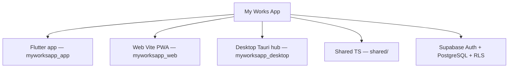

# My Works App — Ecosistema multiplataforma (MVP)

[]()
[]()
[]()

Marketplace de servicios del hogar (cliente + profesional) para Chile, con web de clientes y consola de escritorio para el equipo interno.  
**Estado (main `08154dfc`, 20-nov-2026):** web en producción en el dominio propio; pagos con Transbank en **ambiente de integración** (solo tarjetas de prueba). El paso a producción sigue el runbook de Transbank.

Web publicada: https://myworksapp.cl (también `www.myworksapp.cl` y https://myworksapp-cl.vercel.app) · Encuesta de prueba con usuarios (SUS): https://myworksapp.cl/encuesta · Guion de demo: [`DEMO.md`](DEMO.md).  
Casos de uso: [`docs/casos_de_uso.md`](docs/casos_de_uso.md) · Despliegue de la web: [`docs/deploy_web.md`](docs/deploy_web.md).  
Documento técnico de referencia: [`ESTADO_DEL_PROYECTO.md`](ESTADO_DEL_PROYECTO.md).  
Diccionario de datos: [`docs/DICCIONARIO_BASE_DATOS.md`](docs/DICCIONARIO_BASE_DATOS.md).  
Pruebas de capacidad (k6): [`docs/RUNBOOK_CAPACIDAD_CARGA.md`](docs/RUNBOOK_CAPACIDAD_CARGA.md).  
Escala ≥20.000 usuarios: [`docs/RUNBOOK_ESCALA_20K_USUARIOS.md`](docs/RUNBOOK_ESCALA_20K_USUARIOS.md).  
Registro de pruebas vigente: [`docs/anexos/2026-11-15-pruebas/REGISTRO.md`](docs/anexos/2026-11-15-pruebas/REGISTRO.md).

---

## Arquitectura de software

### En una frase

> **Monorepo multiplataforma** con arquitectura **cliente–servidor** sobre **Supabase (BaaS)**: tres clientes (móvil, web, escritorio) comparten un backend (Auth + PostgreSQL + RLS + Realtime + Edge Functions). La web vive en Vercel con el dominio `myworksapp.cl` (DNS en Cloudflare) y el correo de Auth sale por Resend. En la app Flutter se usa un enfoque **modular por features** con capas prácticas (UI → servicios → repositorios), inspirado en Clean Architecture sin aplicarla de forma rígida.

### Qué tipo de arquitectura es

| Nombre que usamos | Qué significa en la práctica |
|-------------------|------------------------------|
| **Cliente–servidor** | Los datos viven en la nube (Supabase). Las apps no son “solo offline”. |
| **BaaS (Backend as a Service)** | No inventamos un API desde cero: Auth, Postgres, RLS y Edge Functions. |
| **Monorepo** | Un solo repositorio con app, web, desktop y `shared/`. |
| **Modular / Feature-First (Flutter)** | Pantallas agrupadas por funcionalidad (`features/`), con un `core/` compartido. |
| **Capas pragmáticas** | Presentación → servicios de aplicación → dominio → repositorios → Supabase. |
| **Serverless en el borde** | Webpay, Oneclick, compra como invitado, reembolsos, liberación e invitaciones corren en **18 Edge Functions** (Deno), no en el celular. |

### Diagrama del ecosistema

```text
┌─────────────────┐   ┌──────────────────────┐   ┌──────────────────────┐
│  App Flutter    │   │  Web (React/Vite)    │   │  Consola (Tauri 2)   │
│  Cliente /      │   │  Clientes, invitado  │   │  Admin / soporte /   │
│  profesional    │   │  myworksapp.cl       │   │  QA · TOTP · bitácora│
└────────┬────────┘   └──────────┬───────────┘   └──────────┬───────────┘
         │                       │  shared/ (TypeScript)    │
         └───────────────┬───────┴──────────────────────────┘
                         ▼
     Supabase: Auth (SMTP Resend) · PostgreSQL + RLS · Realtime · pg_cron
                         │
                         ▼
     Edge Functions (Webpay, Oneclick, invitado, funciones de administrador)
                         │
                         ▼
     Transbank (ambiente de integración)
```

### Capas dentro de la app móvil (Flutter)

```text
features/*/presentation/   →  pantallas y widgets
core/services/             →  orquestación (trabajos, precios, estados)
core/domain/               →  reglas y constantes de negocio
core/database/repositories →  acceso a datos
                    ↓
              Supabase (Postgres + Auth)
```

Web y desktop reutilizan contratos TypeScript en `shared/` y hablan al mismo backend.

### Dinero (patrón de pagos)

1. El cliente paga en **Transbank Webpay Plus** o con su tarjeta inscrita en **Oneclick**. My Works App **no** pide ni guarda el número de la tarjeta (en jerga bancaria: **PAN** = *Primary Account Number*, el número largo de la tarjeta).  
2. El commit deja el pago **`retenido`** (escrow de negocio: la plata queda “congelada”). **Recibo conforme** del cliente lo deja **`liberado`**.  
3. Un administrador registra la liquidación al profesional (`liquidaciones`, hoy transferencia manual).
4. Comisión en el código: 5 % del pago principal, mínimo $1.000 y nunca más que el pago (`comision_servicio_clp`, `shared/src/metrics/period.ts`), descontada al profesional. Una orden de cambio cobra al cliente el monto más 8 %.

Detalle: [`docs/DICCIONARIO_BASE_DATOS.md`](docs/DICCIONARIO_BASE_DATOS.md) y [`docs/RUNBOOK_TRANSBANK_PRODUCCION.md`](docs/RUNBOOK_TRANSBANK_PRODUCCION.md).

---

## Metodología de trabajo

### En una frase

> Trabajamos con **desarrollo ágil iterativo e incremental** orientado a un **MVP**, organizado por **fases Capstone (APT / Duoc UC)** y entregas pequeñas que se pueden demostrar, auditar y documentar.

### Qué metodología es (y qué no es)

| Sí aplicamos | Cómo se ve en el proyecto |
|--------------|---------------------------|
| **Ágil / iterativo-incremental** | Se entrega por ciclos: auth → trabajos → RLS → Webpay → liquidación → hardening. |
| **MVP primero** | Priorizamos lo demostrable y comercializable; lo demorado (payout automático, Transbank en producción) queda explícito como pendiente. |
| **Fases Capstone (PTY4614)** | Fase 1 definición; Fase 2 y siguientes con evidencias académicas; el código vive en el monorepo. |
| **Trabajo por dominio** | Cada incremento toca un flujo (reserva, pago, admin) de punta a punta, no “páginas sueltas”. |
| **Calidad continua** | CI (analyze/test Flutter; pruebas de `shared/`, lint, build y Playwright en la web; lint, pruebas y build de la consola; build Tauri en Windows), runbooks, diccionario de BD, auditorías de seguridad. |

| No pretendemos ser | Por qué |
|--------------------|---------|
| Waterfall / cascada pura | El alcance del MVP se ajusta con feedback, no con un único diseño cerrado al inicio. |
| Clean Architecture dogmática | Las capas existen donde aportan velocidad y claridad; no hay use-cases formales en cada feature. |

### Ciclo típico de una iteración

```text
Priorizar un flujo (ej. Webpay guest)
    → Diseñar / acordar estados en BD
    → Implementar clientes + Edge + migración
    → Probar (local / integración Transbank)
    → Documentar (README, diccionario, runbook)
    → Commit + CI
```

---

## Estructura del monorepo



| Carpeta | Rol |
|---------|-----|
| `myworksapp_app/` | App Flutter para clientes y profesionales (versión 1.0.11+12) |
| `myworksapp_web/` | Web de clientes (React 19 + Vite 8) |
| `myworksapp_desktop/` | Consola operativa (Tauri 2 + React 19) |
| `shared/` | Auth, repositorios, pagos, métricas y tipos TypeScript compartidos (web y consola) |
| `myworksapp_app/supabase/migrations/` | 125 migraciones SQL (esquema, RLS, Webpay, consola, rate limit) |
| `myworksapp_app/supabase/functions/` | 18 Edge Functions y el código común `_shared/` |
| `docs/` | Casos de uso, diccionario BD, runbooks, despliegue web y anexos de pruebas |

---

## Qué es real vs demo

| Capacidad | Realidad |
|-----------|----------|
| Auth Supabase + perfiles / roles | Real. Correos por SMTP de Resend (`no-responder@myworksapp.cl`) |
| Trabajos, reservas y estados | Real (RPC `transicionar_trabajo` en la base) |
| Escrow / pagos | **Webpay Plus y Oneclick en integración** (solo tarjetas de prueba; el paso a producción va por secrets, ver runbook) |
| Ubicación en vivo | Real: el profesional comparte su posición (`ubicacion_en_vivo`) y la web la lee (`useLiveJobLocation.ts`) |
| Cuentas demo | Visibles en el catálogo mientras `app_config.demo_modo = 1`; con otro valor se ocultan y no se pueden reservar ni cobrar |
| Liquidación al profesional | Manual: el administrador registra la transferencia |
| Pruebas automatizadas | Flutter (unit/widget), `shared/` (Node test runner), consola (Node test runner) y Playwright en la web |
| Pruebas de carga | Scripts k6 y Node en `scripts/load/` (ejecución manual) |

---

## Arranque rápido para el equipo (app móvil)

Si al clonar o hacer `git pull` ves una versión vieja de la app (consulta la tabla `profiles`, sesión expirada, no aparecen trabajadores), casi siempre es porque **la compilación nueva falló** y el emulador sigue abriendo la app vieja instalada.

**Requisitos:** Flutter **3.47.x stable** (`flutter --version`) y Android Studio actual. El proyecto Android usa **Gradle 9.3.1 + AGP 9.1.0 + Kotlin 2.3.20**, que funcionan con el JDK 21 o el JDK 25 que trae Android Studio.

```bash
cd myworksapp_app
flutter doctor -v              # revisa que "Java version" sea 21 o 25
flutter clean
flutter pub get
adb uninstall cl.myworksapp.app   # borra la app vieja del emulador/teléfono (si no está, da error y no pasa nada)
flutter run                    # debug: usa el Supabase de la demo, no requiere .env
```

- **No hace falta `.env` para la app en debug:** `lib/core/config/supabase_config.dart` trae la URL y la clave **publicable** del proyecto `wxqrfcqifkfgawrnqmnj`.
- **Release (APK para instalar o `--release`) sí exige los `--dart-define`** (si faltan, la app se cierra al abrir):

```bash
flutter build apk --release \
  --dart-define=SUPABASE_URL=https://wxqrfcqifkfgawrnqmnj.supabase.co \
  --dart-define=SUPABASE_ANON_KEY=sb_publishable_WN_cTANRJ4nCuPw_6HWd7w_iDJjRA8O
# APK: build/app/outputs/flutter-apk/app-release.apk
```

- **Ver la app móvil en el navegador rápido:** `flutter run -d chrome --release` con los mismos dos `--dart-define`. En debug (`flutter run -d chrome` o `-d web-server --web-port 8080`) la primera carga tarda mucho; eso no es la web del proyecto. La web de clientes es `myworksapp_web` (Vite) en `http://localhost:5173` (el retorno de Webpay solo funciona en 5173).
- **Si la compilación falla con un error que solo dice `25.0.x`:** tu copia todavía tiene Gradle 8.14. Haz `git pull`. Como alternativa temporal, `flutter config --jdk-dir=<ruta a un JDK 21>`.
- **Login demo:** el atajo de cuentas demo solo aparece en debug. Cuentas y contraseña en `DEMO.md`.

## Ejecución local

### Variables de entorno

Copia los ejemplos y completa con tu proyecto Supabase:

```bash
cp myworksapp_web/.env.example myworksapp_web/.env
cp myworksapp_desktop/.env.example myworksapp_desktop/.env
```

Flutter (opcional, recomendado en CI):

```bash
flutter run --dart-define=SUPABASE_URL=https://xxx.supabase.co --dart-define=SUPABASE_ANON_KEY=sb_publishable_...
```

### Web

```bash
cd myworksapp_web
npm install
npm run dev
```

### Consola de escritorio

```bash
cd myworksapp_desktop
npm install
npm run tauri:dev
```

### Flutter

```bash
cd myworksapp_app
flutter pub get
flutter test
flutter run
```

Cuentas demo **solo staging/debug** (nunca en release UI): ver `DEMO.md`. Runbook Webpay: [`docs/RUNBOOK_TRANSBANK_PRODUCCION.md`](docs/RUNBOOK_TRANSBANK_PRODUCCION.md).

---

## Calidad y CI

- Flutter: `flutter analyze` + `flutter test` (`.github/workflows/flutter_ci.yml`)
- Web: dominio TS↔Dart, pruebas de `shared/`, lint, build y Playwright; consola: lint, pruebas y build; Tauri build en Windows (`.github/workflows/web_desktop_ci.yml`)
- Gitleaks, Scorecard, commitlint y keepalive de Supabase (requiere secrets `SUPABASE_URL` / `SUPABASE_ANON_KEY`)
- **Capacidad / stress (manual):** [`docs/RUNBOOK_CAPACIDAD_CARGA.md`](docs/RUNBOOK_CAPACIDAD_CARGA.md) — scripts en `scripts/load/k6/`

Pre-commit local: ver `.pre-commit-config.yaml`.

---

## Licencia

Proyecto académico / demo. Todos los derechos reservados salvo acuerdo distinto.
