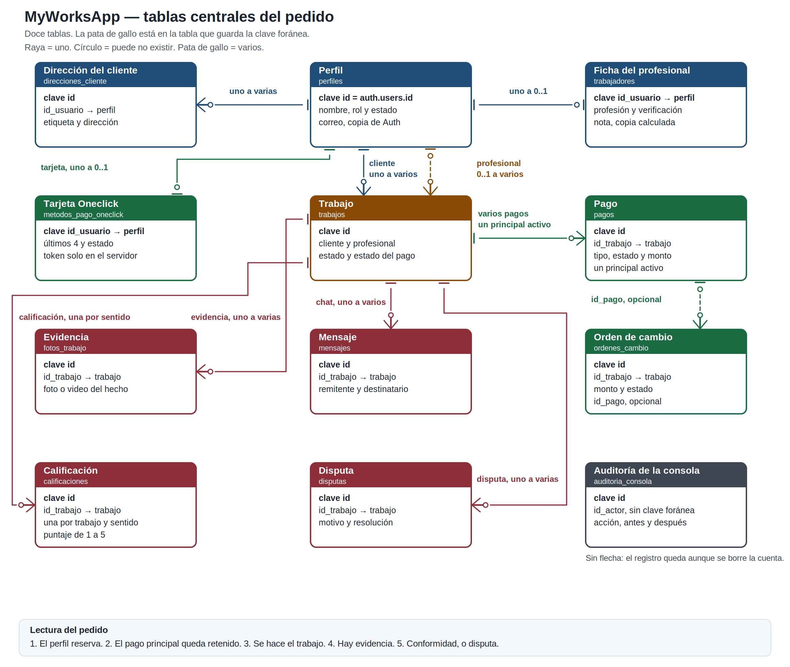

# Modelo entidad-relación

> Al 20-11-2026 (`main` `d9d2c7c`) el esquema documentado tenía **60 tablas** y 86 claves foráneas: las migraciones del 20-nov agregaron `auditoria_consola`, `rate_limit_ventana` y `direcciones_cliente` (detalle en la sección 0 de [`DICCIONARIO_BASE_DATOS.md`](DICCIONARIO_BASE_DATOS.md)). Las figuras del informe final se rehicieron con las 60 tablas en [`modelo_er60/`](modelo_er60/). Las fuentes DBML y SQL de abajo siguen en el snapshot del 17-11.
>
> **22-11-2026.** Una lectura del catálogo de la base viva contó **76 tablas** y **94 claves foráneas** en `public`, con RLS en las 76. Las figuras y el DBML no se redibujaron. Las 15 tablas que faltan en el diccionario están en la sección 0-bis de ese documento. La forma normal de esas 15 se anota en la sección 0-ter, del 23-11-2026.
>
> **23-11-2026, 01:11 hora de Chile.** El mismo catálogo se volvió a contar: 76 tablas, RLS en las 76 y 94 claves foráneas. La migración aplicada es `20261123040924`; el archivo en el repositorio es `20261124050000_esquema_bcnf.sql`. El modelo que se explica es el central de 12 tablas. El SQL para MySQL Workbench está en [`modelo_er_central_workbench.sql`](../../Fase%202/modelo_entidad_relacion/modelo_er_central_workbench.sql). El diagrama está en [`modelo_er_central/er_central.png`](modelo_er_central/er_central.png). El script de 57 tablas y el mapa de 60 siguen en su sitio: el de 60 es el anexo histórico.

El modelo ER del snapshot (57 tablas, 85 claves foráneas, migración `20261117223850`) está en
[`Fase 2/modelo_entidad_relacion/`](../../Fase%202/modelo_entidad_relacion/LEEME.txt):

- `figuras/er_00_dominios`: mapa de los 7 dominios.
- `figuras/er_00_general`: las 57 tablas con su PK y todas las FK.
- `figuras/er_01` a `er_07`: un diagrama por dominio con columnas, tipos, PK/FK y cardinalidad.
- `modelo_er.dbml` (dbdiagram.io), `modelo_er_postgres.sql`, `modelo_er_mysql_workbench.sql` y `fuentes/*.dot`.
- `modelo_er_central_workbench.sql`: las 12 tablas centrales, para MySQL Workbench. El catálogo vivo tiene 76 tablas; este archivo es el modelo que se explica.
- `LEEME.txt` explica la notación, los dominios, las relaciones lógicas sin FK y cómo regenerar todo.

La explicación de cada dominio, el flujo de pago y escrow y las decisiones de diseño están en la
sección 2b de [`DICCIONARIO_BASE_DATOS.md`](DICCIONARIO_BASE_DATOS.md) (3b en el `.docx`).

