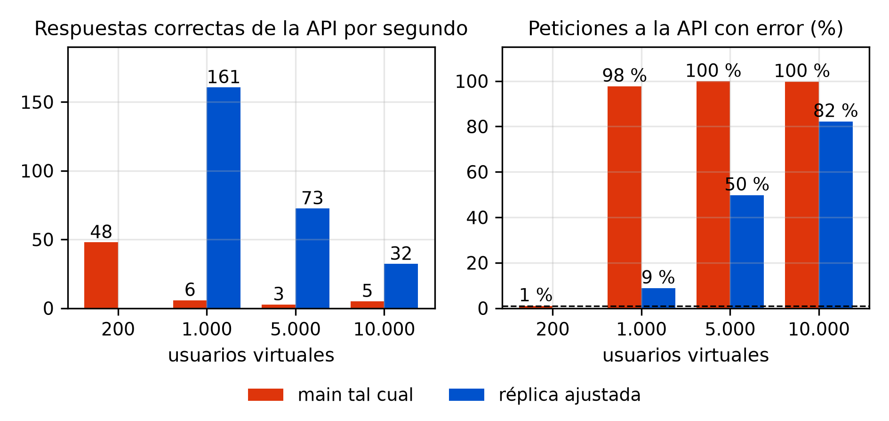
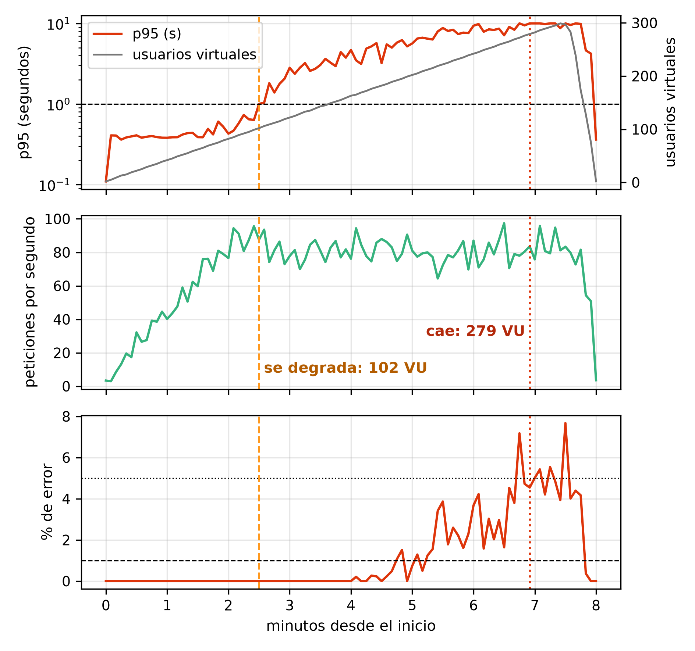
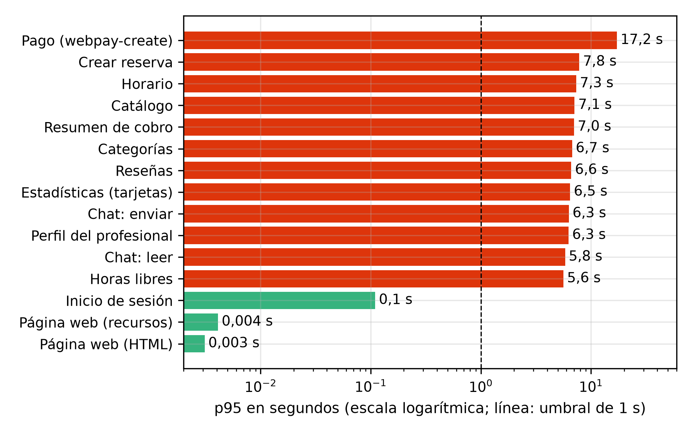
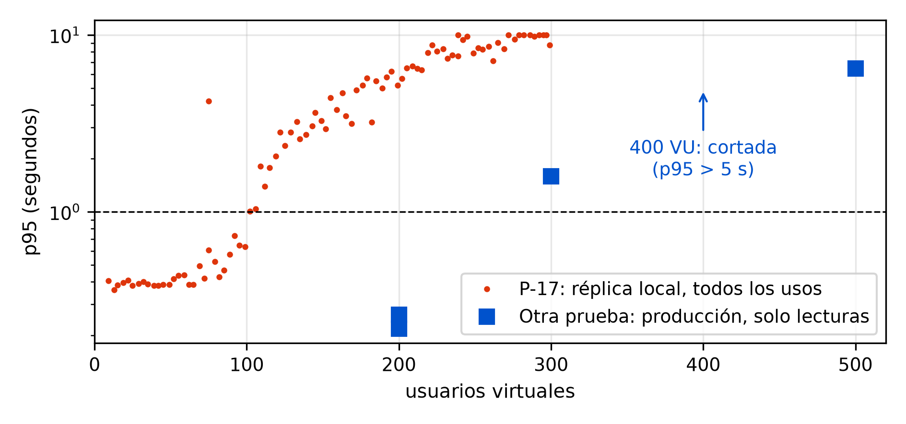

# Pruebas de MyWorksApp

Qué se probó, cómo, con qué resultado y qué falta. Estado al 20-11-2026. Es la prueba P-17 del informe final (`Fase 2/Myworksapp_Informe_Final_PTY4614.pdf`); las pruebas anteriores, P-01 a P-16, también están en el informe.

## Contenido

- [En resumen](#en-resumen)
- [Cómo se hizo (sin tocar producción)](#cómo-se-hizo-sin-tocar-producción)
- [Pruebas unitarias, de integración y de extremo a extremo](#pruebas-unitarias-de-integración-y-de-extremo-a-extremo)
- [Rendimiento por nivel](#rendimiento-por-nivel)
- [Punto de quiebre](#punto-de-quiebre)
- [Qué lo limita](#qué-lo-limita)
- [Hallazgos](#hallazgos)
- [Otra prueba: producción, solo lecturas](#otra-prueba-producción-solo-lecturas)
- [Recomendaciones](#recomendaciones)
- [Dónde están los archivos](#dónde-están-los-archivos)

## En resumen

- **Pruebas automatizadas: 641 de 641 aprobadas** (una prueba de extremo a extremo la omite el propio proyecto).
- **Capacidad con `main` tal cual (réplica local):** se degrada con unos **100** usuarios virtuales y cae con unos **280**.
- **Qué la limita:** el catálogo (`listar_profesionales_catalogo`) llama a `stats_profesional()` una vez por cada profesional. Eso agota la CPU de Postgres y llena el pool de 10 conexiones de PostgREST.
- **Hallazgo grave (H1):** desde la migración `20261118230000`, todo `INSERT` en `trabajadores` falla, así que no se pueden dar de alta profesionales. **Está aplicada en producción** (verificado el 20-11-2026 con consultas de solo lectura; ver [Hallazgos](#hallazgos)). La corrección está en el parche de pruebas y no se ha aplicado.
- 1.000, 5.000 y 10.000 usuarios simultáneos no los soporta hoy el sistema.

## Cómo se hizo (sin tocar producción)

| Regla | Qué significa |
|---|---|
| Réplica local | Supabase completo en Docker (Postgres 17, PostgREST con 10 conexiones, Auth, gateway Kong, Edge Runtime) y la web compilada para producción, en una máquina de 8 vCPU y 16 GB que también corre el generador de carga |
| Proveedores simulados | Transbank reemplazado por un simulador local (250 ms). Resend sin clave: no puede enviar correos |
| Datos sintéticos | 1.000 profesionales, 20.000 clientes `@carga.test`, 40.000 trabajos, 120.000 mensajes. No se usó `seed_historial_puerto_montt.sql` |
| Nunca producción | El script de carga se niega a correr si el destino no es `127.0.0.1` |

- **Código probado:** `main` `08154dfc`. El PR #82 (`d9d2c7c`) llegó después; no cambia migraciones ni las consultas medidas.
- **Herramientas:** k6 v2.4.0, `node --test` con c8, `flutter test`, Playwright, `deno test` y `deno check`, `psql`, `EXPLAIN ANALYZE`, `pg_stat_statements`.
- **Mezcla de uso:** navegación 35 %, búsqueda 20 %, perfil 15 %, inicio de sesión 10 %, chat 8 %, reserva 7 % y pago 5 %.
- **Criterios:** *se degrada* cuando el p95 pasa de 1 s o los errores del 1 %. *Cae* cuando los errores pasan del 5 % o el p95 llega a 10 s, durante al menos 15 s.
- **Cómo leer:** un usuario virtual (VU) repite un recorrido con pausas de 1 a 8 s, así que genera más carga que una persona real. El p95 es el tiempo dentro del cual responde el 95 % de las peticiones.

## Pruebas unitarias, de integración y de extremo a extremo

| Módulo | Herramienta | Aprobadas / total | Cobertura |
|---|---|---:|---|
| `shared` | `node --test` + c8 | 243 / 243 (antes 231) | 76,11 % sentencias · 79,63 % ramas · 76,92 % funciones |
| Consola | `node --test` + c8, ESLint, tsc | 12 / 12 | 92,7 % · 74,41 % · 80,95 % |
| Web (tipos, lint y build) | tsc, oxlint, vite build | sin errores (27 avisos de lint) | — |
| Web (extremo a extremo) | Playwright | 24 / 24 (+1 omitida por el proyecto) | — |
| App Flutter | `flutter test`, `flutter analyze` | 350 / 350 | 39,97 % de líneas (de los 177 archivos que cargan las pruebas) |
| Edge Functions | `deno test`, `deno check` | 7 / 7; `deno check` 18 / 18 con el parche | `reconcile_auth`: 100 % |
| Base de datos | `psql`, cada prueba con ROLLBACK | 3 / 3 + 2 / 2 nuevas | — |
| **Total** | | **641 / 641** | |

**Parche de pruebas** (para el Programador): 12 pruebas nuevas en `shared` (`payout.release.test.ts` y `webpay.session.test.ts`), 2 pruebas SQL (`permisos_consola_y_comision.sql` y `alta_profesional_agenda.sql`) y la corrección de H1 (`20261120180000_agenda_alta_sin_generate_series_time.sql`). Rebasado sobre `main` `d9d2c7c` queda en **3 commits**: el cuarto, el arreglo de tipos de `require_admin`, ya venía en el PR #82. Con el parche aplicado sobre `d9d2c7c`: `shared` 246 de 246 y `deno check` 18 de 18 (comprobado el 20-11-2026 a las 04:14, hora de Chile).

## Rendimiento por nivel

`main` tal cual, gateway de la réplica de fábrica:

| VU | Peticiones | req/s | API correctas/s | p50 | p95 | % error API | CPU Postgres |
|---:|---:|---:|---:|---:|---:|---:|---:|
| 10 | 313 | 6,7 | 4,5 | 5 ms | 372 ms | 0,9 % | — |
| 20 | 1.119 | 15,2 | 10,4 | 4 ms | 351 ms | 0 % | — |
| 200 | 19.753 | 71,6 | 47,9 | 556 ms | 6,0 s | 1,0 % | 5,2 núcleos |
| 1.000 | 120.288 | 429,6 | 5,8 | 0 ms* | 1 ms* | 97,7 % | 0,5 |
| 5.000 | 1.017.568 | 2.994,0 | 2,7 | 0 ms* | 1 ms* | 99,8 % | 0,3 |
| 10.000 | 1.241.539 | 3.651,4 | 5,1 | 1 ms* | 204 ms* | 99,8 % | 0,7 |

\* **El p95 bajo es engañoso.** El gateway Kong de la réplica admite 512 conexiones por proceso; al pasarlas corta la conexión en menos de 1 ms (65.885 cortes con 1.000 VU, 729.271 con 10.000). Lo que responde bien es sobre todo la página estática. Mira la columna **% error API**. Ese límite es de la réplica, no de producción.

**Réplica ajustada** (Kong con 4 procesos × 16.384 conexiones y un prototipo del catálogo optimizado; **no es `main`**):

| VU | API correctas/s | p95 | % error API |
|---:|---:|---:|---:|
| 1.000 | 160,7 | 10,0 s | 8,8 % |
| 5.000 | 72,6 | 30,0 s | 49,8 % |
| 10.000 | 32,2 | 142 s | 82,2 % |

El techo es de unas 160 respuestas correctas por segundo. Desde 5.000 VU la máquina de pruebas también es parte del límite (k6 usó 7,1 GB de RAM con 10.000).

## Punto de quiebre

Subida de 0 a 300 VU, 20 más cada 30 s, con `main` tal cual:

| Fase | VU | Qué se ve |
|---|---:|---|
| Sano | 0 a ~100 | p95 de 0,4 a 0,6 s, sin errores |
| **Se degrada** | **102** | El p95 pasa de 1 s y no baja; el throughput queda plano en 75 a 90 req/s |
| Errores > 1 % | ~190 a 205 | 504 de PostgREST (sin conexión libre en 10 s) |
| **Cae** | **279** | p95 pegado en 10 s y errores sobre 5 % (máx. 7,7 %) |

Con la réplica ajustada se degrada cerca de 490 VU y cae cerca de 570.

## Qué lo limita

1. **CPU de Postgres por el catálogo.** Con 200 VU hubo 3.875 llamadas al catálogo y 3,88 millones a `stats_profesional()` (unas 1.000 por catálogo), con unos 2.300 s de CPU. En reposo el catálogo tarda 412 ms; el prototipo optimizado, 76 ms. Las demás consultas tardan de 0,16 a 6,5 ms: no faltan índices.
2. **Pool de PostgREST (10 conexiones).** Cada catálogo ocupa una conexión 0,4 a 0,6 s; el resto espera y a los 10 s recibe 504. Por eso hasta los endpoints triviales se ponen lentos.
3. **Gateway Kong** (solo la réplica) y **la máquina de pruebas** (desde 5.000 VU).

No fueron el límite: el inicio de sesión, la web estática, el simulador de Transbank ni el número de conexiones de Postgres.

## Hallazgos

| # | Gravedad | Qué pasa | Estado |
|---|---|---|---|
| H1 | **Alta** | `trabajador_horarios_desde_alta` (migración `20261118230000`) usa `generate_series(time, time, interval)`, que no existe en Postgres 17. Todo `INSERT` en `trabajadores` falla | **Aplicada en producción.** Corrección y prueba en el parche; **sin aplicar** |
| H2 | Alta (rendimiento) | El catálogo calcula `stats_profesional()` por cada profesional | Prototipo medido (412 → 76 ms); sin integrar |
| H3 | Media | Las migraciones no aplican desde cero (se reordenó una y se volvieron condicionales 54 `DROP TRIGGER` y 20 `ALTER POLICY`) | Pendiente |
| H4 | Media | 5 Edge Functions no pasaban `deno check` | Resuelto en `main` con el PR #82 (18 / 18) |
| H5, H6 | Baja | Doble recálculo en los triggers de calificaciones; índice `idx_trabajos_id_trabajador` repetido | Pendiente |

**Cómo se verificó H1 en producción** (20-11-2026, cerca de las 04:14, hora de Chile; solo lectura, sin escribir nada):

1. La lista de migraciones del proyecto `wxqrfcqifkfgawrnqmnj` incluye `20261118230000 agenda_por_defecto_trabajador_nuevo`. Las 125 versiones coinciden con los 125 archivos del repositorio.
2. `pg_get_functiondef` de `public.trabajador_horarios_desde_alta` contiene `generate_series(time '09:00', time '17:00', interval '1 hour')`.
3. El trigger `trabajador_horarios_desde_alta` está activo en `trabajadores` y no existe una versión de `generate_series` para `time`.
4. `SELECT count(*) FROM generate_series(time '09:00', time '17:00', interval '1 hour')` responde `42883: function generate_series(time without time zone, time without time zone, interval) does not exist`.

No se revisó si hubo altas fallidas desde el 18-11.

## Otra prueba: producción, solo lecturas

> **No es parte de P-17.** La hizo el Programador el 20-11-2026, de 02:29 a 03:05 (hora de Chile), contra Supabase real (plan gratis, Micro, us-west-2) y `myworksapp.cl`. Solo lecturas públicas y `/auth/v1/user`; sin escrituras, pagos ni correos. Las cifras son de su informe y no se volvieron a medir.

| VU | req/s | p95 | % error | Veredicto |
|---:|---:|---:|---:|---|
| 200 | 167 a 169 | 0,22 a 0,26 s | 0 % | Bien (repetido) |
| 300 | 186 | 1,6 s | 0 % | Saturado |
| 400 | ~30 | > 5 s | 0 % | Cortada a los 23 s |
| 500 | ~150 | 6,4 s | 0 % | Cortada |

Coincide con P-17 en la causa (CPU de la base y cola de PostgREST). Producción aguanta más (200 a 250 VU) porque tiene pocos profesionales y solo hubo lecturas; **a medida que crezcan los profesionales, su techo bajará hacia el de la réplica** si no se optimiza el catálogo.

## Recomendaciones

| # | Acción | Costo | Efecto |
|---|---|---|---|
| 1 | Aplicar la corrección de H1 en producción | Gratis | Vuelve el alta de profesionales |
| 2 | Catálogo sin cálculo por fila (leer `trabajadores.calificacion` y `trabajos_completados`, o el prototipo) | Gratis | 412 → 76 ms o menos; quiebre de ~100 a ~490 VU en la réplica |
| 3 | Caché en el CDN de catálogo y categorías (`s-maxage=60`) | Gratis | Saca de la base la mayoría de las lecturas públicas |
| 4 | Menos llamadas por vista y caché más larga en el cliente | Gratis | Menos peticiones por usuario |
| 5 | Pooler (Supavisor) y revisar el pool de PostgREST | Gratis | Más margen de conexiones; no arregla la CPU |
| 6 | Migraciones que apliquen desde cero (H3); H5 y H6 | Gratis | Entorno reproducible; escrituras más livianas |
| 7 | Recién después, subir de plan en Supabase | Desde US$25/mes + cómputo | Más CPU; no corrige el catálogo |

## Dónde están los archivos

| Qué | Dónde |
|---|---|
| Informe completo de las pruebas | [`anexos/2026-11-20-pruebas-unitarias-rendimiento/INFORME_PRUEBAS.md`](anexos/2026-11-20-pruebas-unitarias-rendimiento/INFORME_PRUEBAS.md) |
| Figuras del informe final | [`anexos/2026-11-20-pruebas-unitarias-rendimiento/figuras/`](anexos/2026-11-20-pruebas-unitarias-rendimiento/figuras/) |
| Capturas citadas en el informe de pruebas (salidas de cada suite, cobertura, gráficos y paneles de k6) | [`anexos/2026-11-20-pruebas-unitarias-rendimiento/capturas/`](anexos/2026-11-20-pruebas-unitarias-rendimiento/capturas/) |
| Resultados crudos de k6, scripts y réplica | En la máquina de pruebas (`/workspace/mwa_tests/`); no están en el repositorio |
| Parche de pruebas y correcciones | Se entrega aparte al Programador (3 commits sobre `d9d2c7c`) |
