> **Copia del informe de pruebas del 19 y 20-nov-2026.** Las rutas `/workspace/mwa_tests/...` son de la máquina de pruebas y no están en este repositorio. El resumen y su lectura están en [`../../PRUEBAS.md`](../../PRUEBAS.md). Las capturas citadas están en [`capturas/`](capturas/); las figuras redibujadas para el informe final están en [`figuras/`](figuras/). **Actualización:** H1 ya se revisó en producción el 20-11-2026 con consultas de solo lectura y **la migración `20261118230000` está aplicada**, con el error (ver [`PRUEBAS.md`](../../PRUEBAS.md#hallazgos)).

# Pruebas unitarias, de rendimiento y estrés — MyWorksApp

> Fecha de ejecución: 19 y 20 de noviembre de 2026 (hora de Chile, America/Santiago).
> Código probado: repositorio `nicoussj/Proyecto-Titulo-MyWorksApp`, rama `main`, commit `08154df`.
> Todas las cifras de este informe salen de ejecuciones reales; los archivos crudos están en
> `/workspace/mwa_tests/` (ver el anexo al final). Nada se inventó ni se redondeó a favor.

## 0. Resumen en una página

**Dos pruebas distintas, no mezclar:**

| | **A. Réplica local** (este informe, secciones 4 a 9) | **B. Producción, solo lecturas** (sección 10) |
|---|---|---|
| Quién la corrió | Equipo de pruebas, en la máquina de pruebas | El Programador, por su cuenta |
| Contra qué | Copia local de Supabase en Docker + build local de la web | Supabase real `wxqrfcqifkfgawrnqmnj` (plan gratis, Micro) y `myworksapp.cl` |
| Qué se probó | Todo: pruebas unitarias y carga de 10 a 10.000 usuarios con lecturas, login, chat, reservas y pago simulado | Solo lecturas públicas y `/auth/v1/user`, de 200 a 500 usuarios |
| Datos | Sintéticos, generados para la prueba (`@carga.test`) | Los datos reales del proyecto |
| Transbank y Resend | Simulados (mock local); nunca se llamaron | No se tocaron |

**Resultados clave**

- **Pruebas unitarias, de integración y E2E: 641 de 641 aprobadas** (1 E2E omitida a propósito por el propio
  proyecto). Se agregaron 12 tests unitarios y 2 tests SQL en un parche (`pruebas-carga-unitarias.patch`).
- **Punto de quiebre (réplica local, `main` tal cual): se degrada a ~100 usuarios virtuales (VU) y cae a ~280 VU.**
  A 200 VU el p95 ya es de 6 s. Producción (prueba B, solo lecturas) aguanta un poco más: ~200–250 VU, y a los
  300 VU el p95 sube a 1,6 s.
- **Qué se rompe primero: la CPU de Postgres**, gastada casi entera en el RPC del catálogo
  (`listar_profesionales_catalogo`), que llama a `stats_profesional()` una vez por cada profesional: a 200 VU
  hubo 3.875 llamadas al catálogo y **3,9 millones** de llamadas a `stats_profesional`. Detrás viene la cola de
  PostgREST, que solo tiene 10 conexiones a la base de datos.
- **1.000, 5.000 y 10.000 VU sí se corrieron**, pero muestran un sistema ya caído: con `main` fallan entre el
  97,7 % y el 99,8 % de las peticiones a la API (57–64 % del total, contando la web estática). Con la réplica
  ajustada (gateway más grande + catálogo optimizado) fallan entre el 8,8 % y el 82 %. A 10.000 VU el generador
  de carga (k6) usó 7,1 GB de RAM: ahí parte del límite es la máquina de pruebas.
- **Hallazgo grave (H1):** la migración `20261118230000` hace que **todo `INSERT` en `trabajadores` falle**
  en Postgres 17 (alta de profesionales bloqueada). Se incluye la corrección y su test. Hay que revisar si ya está
  aplicada en producción.

## 1. Alcance y reglas de seguridad

- **Nada de la prueba A apuntó a producción.** Ni `myworksapp.cl`, ni el proyecto Supabase real, ni Transbank,
  ni Resend. El script de carga se niega a correr si el destino no es `127.0.0.1`.
- Los datos de carga son **sintéticos** y están marcados como tales (`seed/seed_sintetico_carga.sql`). No se usó
  `seed_historial_puerto_montt.sql`.
- Transbank se reemplazó por un mock local (`replica/tbk-mock/server.js`, responde en 250 ms) y Resend no tiene
  clave en la réplica, así que no puede enviar correos.
- No se hizo push ni se abrieron PR. Los cambios de código quedaron en una rama local y en un parche.
- Se decidió **no** hacer la prueba corta opcional contra la página de inicio en producción.
- La prueba B (producción) **no** la hizo el equipo de pruebas: la hizo el Programador. Él dice que tenía el visto
  bueno de Mathias; eso no se pudo verificar al escribir este informe. Aquí solo se resume y se compara.

## 2. Entorno de la prueba A (réplica local)

| Elemento | Detalle |
|---|---|
| Máquina | 8 vCPU Intel Xeon, 16 GB RAM, sin swap, Debian 13.7. **Generador y sistema comparten la misma máquina.** |
| Supabase local | CLI 3.2.0 en Docker: Postgres 17, PostgREST v16.5 (pool de 10 conexiones), GoTrue v2.198 (Auth), Kong 2.8.1 (gateway), Edge Runtime v1.79.1 |
| Web | Build de producción de `myworksapp_web` apuntando a la réplica, servido por nginx (simula un CDN) |
| Generador | k6 v2.4.0 con dashboard web exportado a HTML |
| Monitoreo | `k6/monitor.py` cada 5 s: CPU/RAM de la máquina, CPU por contenedor, conexiones a Postgres y RAM de k6 |

**Diferencias de la réplica frente a producción (importante para leer los números):**

1. **Migraciones:** las 126 migraciones **no aplican desde cero** tal como están en `main`, aunque
   `MIGRATIONS_INVENTORY` dice que basta `supabase db push`. Para la réplica se usó el volcado remoto como base,
   se movió una migración de fecha y se hicieron condicionales 54 `DROP TRIGGER` y 20 `ALTER POLICY`
   (detalle en `replica/supabase/migrations/REORDEN_MIGRACIONES.txt`). Resultado: 126/126 aplicadas.
2. **Gateway Kong:** el Kong local trae 1 proceso con 512 conexiones. Sobre ~500 conexiones simultáneas corta
   (errores `EOF`). Eso es propio de la réplica, no de producción. Por eso hay dos series de resultados:
   «main tal cual» (Kong de fábrica) y «réplica ajustada» (Kong con 4 procesos × 16.384 conexiones).
3. **Límites de Auth:** en la réplica se subieron los límites de inicio de sesión por IP, porque todo el tráfico
   sale de una sola IP. En producción el límite por defecto es de 30 registros o inicios cada 5 min por IP
   y 150 peticiones a `/auth/v1/token` cada 5 min por IP ([Supabase, Rate limits](https://supabase.com/docs/guides/auth/rate-limits)).
4. **Hardware:** la réplica tiene 8 vCPU compartidas con el generador; producción (plan gratis) tiene una
   instancia con CPU compartida y 0,5–1 GB de RAM. No son comparables uno a uno; la sección 10 lo contrasta.

## 3. Datos sintéticos de la prueba A

Archivo: `seed/seed_sintetico_carga.sql` (encabezado: «DATOS SINTÉTICOS DE PRUEBA DE CARGA»).

| Tabla | Filas |
|---|---:|
| Profesionales | 1.000 |
| Clientes (`@carga.test`, clave común de laboratorio) | 20.000 |
| Trabajos completados con calificación | 40.000 |
| Mensajes de chat | 120.000 |
| Horas publicadas (7 días × 08:00–20:00) | 91.000 |

`demo_modo` quedó en 0. Antes de cada nivel, `k6/reset_replica.sh` borra lo que creó la prueba anterior
(trabajos, pagos, mensajes) y reinicia las estadísticas, para que cada nivel parta igual.
Para tener sesiones reales, `k6/gen_tokens.mjs` inició sesión con 12.000 usuarios sintéticos
(103,7 s, ~116 logins/s).

## 4. Pruebas unitarias, de integración y E2E

Todo se corrió sobre el clon local de `main` (`08154df`). Las E2E y los tests SQL corrieron contra la réplica local.

### 4.1 Resultado por módulo

| Módulo | Herramienta | Aprobadas / total | Cobertura | Captura |
|---|---|---:|---|---|
| `shared` (lógica común web/escritorio/funciones) | `node --test` + c8 | **243 / 243** (antes 231 / 231) | 76,11 % sentencias · 79,63 % ramas · 76,92 % funciones (antes 73 % · 79,73 % · 75 %) | `capturas/t01_shared.png`, `capturas/c01_cobertura_shared.png` |
| `myworksapp_desktop` (consola) | `node --test` + c8, ESLint, tsc | **12 / 12**; lint 0 avisos; tsc sin errores | 92,7 % sentencias · 74,41 % ramas · 80,95 % funciones | `capturas/t02_desktop.png`, `capturas/c03_cobertura_desktop.png` |
| `myworksapp_web` | tsc, oxlint, `vite build` | tsc sin errores; lint **0 errores, 27 avisos**; build OK | — | `capturas/t03_web.png` |
| `myworksapp_web` E2E | Playwright (Chromium) contra build local y réplica | **24 / 24** (+1 omitida por el propio proyecto) en 35,1 s | — | `capturas/t04_e2e.png`, `capturas/c06_playwright.png` |
| `myworksapp_app` (Flutter) | `flutter test --coverage`, `flutter analyze` | **350 / 350** en 55 s; analyze sin problemas | 39,97 % de líneas (3.496 / 8.747) de los 177 archivos que cargan los tests; `lib/` tiene 415 archivos | `capturas/t05_flutter.png`, `capturas/c05_cobertura_flutter.png` |
| Edge Functions (Deno) | `deno test`, `deno check` | **7 / 7**; `deno check` 13 / 18 en `main` → **18 / 18** con el parche | `reconcile_auth`: 100 % | `capturas/t06_deno.png`, `capturas/c04_cobertura_deno.png` |
| Base de datos (SQL) | `psql` contra la réplica, cada test en transacción con ROLLBACK | **3 / 3** existentes + **2 / 2** nuevos | — | `capturas/t07_sql.png` |

**Total: 641 de 641 pruebas aprobadas.** La E2E omitida (`desktop-invite-password`) está marcada como `skip` en el
propio repositorio.

Los 27 avisos de lint de la web son de React (`react-hooks/exhaustive-deps` y `set-state-in-effect` en `App.tsx`) y
un `no-unused-vars` en `public/tbk-post.js`. No rompen el build, pero los de dependencias de efectos pueden causar
datos desactualizados. El build avisa que el chunk del mapa pesa 1,2 MB (333 kB comprimido).

### 4.2 Qué se agregó (parche de tests)

Rama local `test/pruebas-carga-unitarias` (4 commits sobre `main`, sin push). Parche único:
`/workspace/mwa_tests/pruebas-carga-unitarias.patch` (y por commit en `patch/0001…0004`). Se aplica con `git am`.

| Commit | Qué hace |
|---|---|
| `test(shared): cubrir liberación manual y sesión Webpay` | 12 tests nuevos: `payout.release.test.ts` (6) y `webpay.session.test.ts` (6). Cobertura de `payout.ts` 48 → 75 % y de `webpay.ts` 34 → 93 %. |
| `test(db): probar comisión y permisos de las funciones de consola` | `supabase/tests/permisos_consola_y_comision.sql`: verifica que **22 funciones de consola rechazan** a un usuario sin rol admin. |
| `fix(db): el alta de profesional no usa generate_series con time` | Corrige el hallazgo H1 (migración `20261120180000_…`) y agrega `supabase/tests/alta_profesional_agenda.sql`. |
| `fix(functions): aceptar PromiseLike en requireAdmin y la auditoría` | Arregla 5 Edge Functions que no pasaban `deno check` (error TS2345). |

### 4.3 Capturas

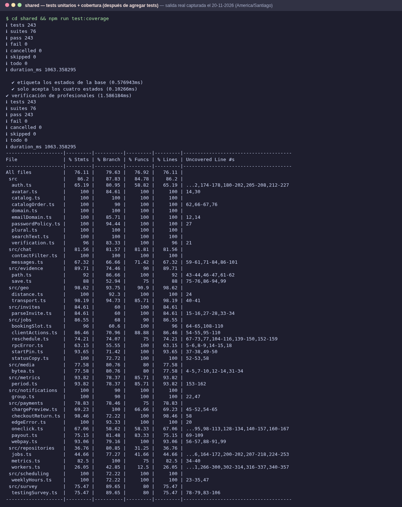
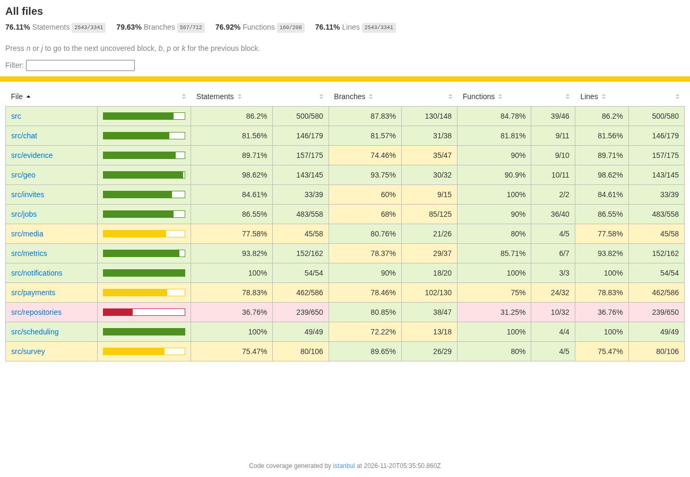
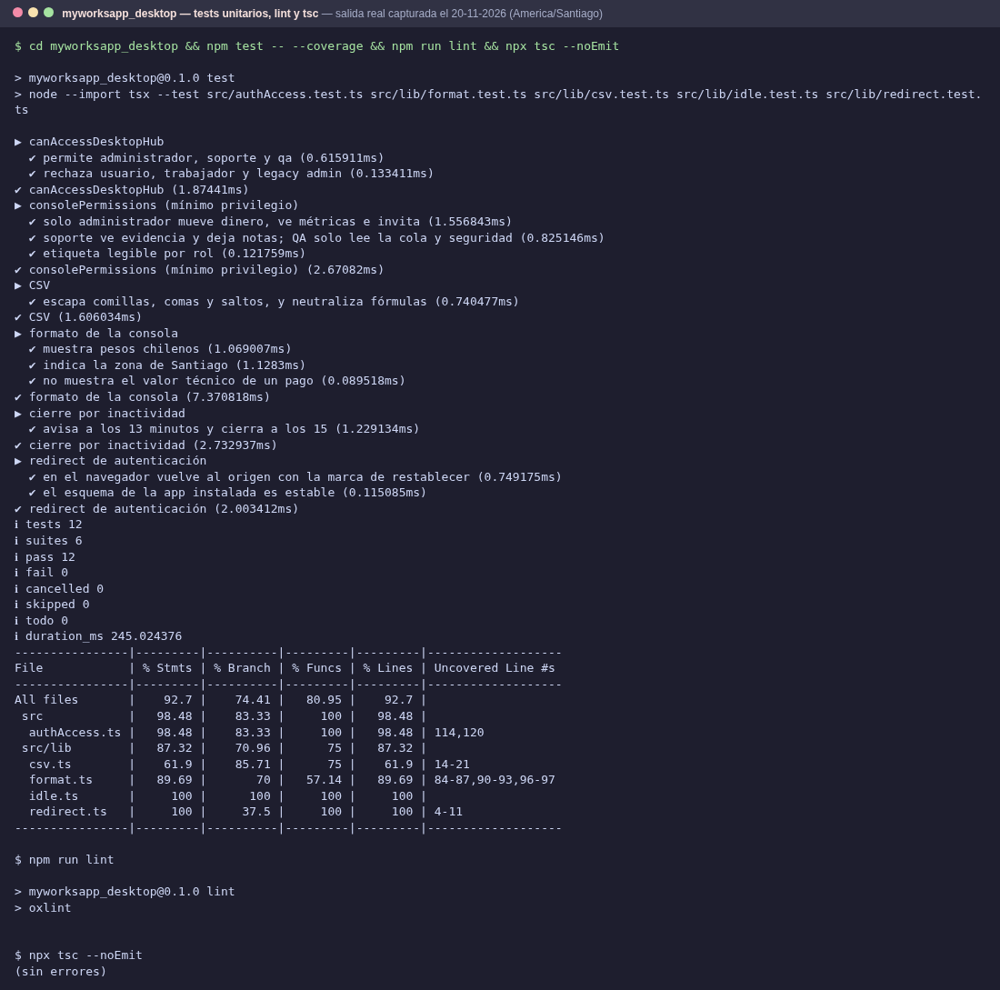
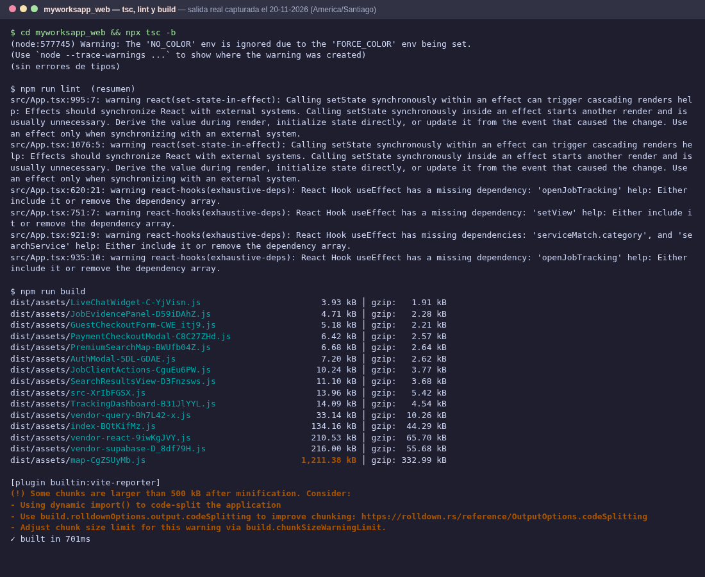
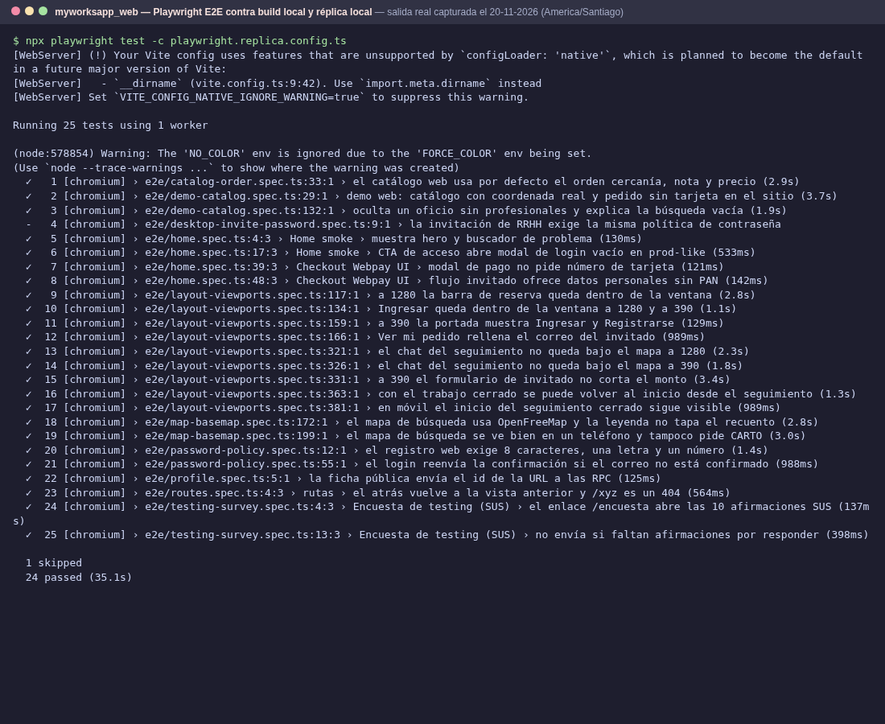
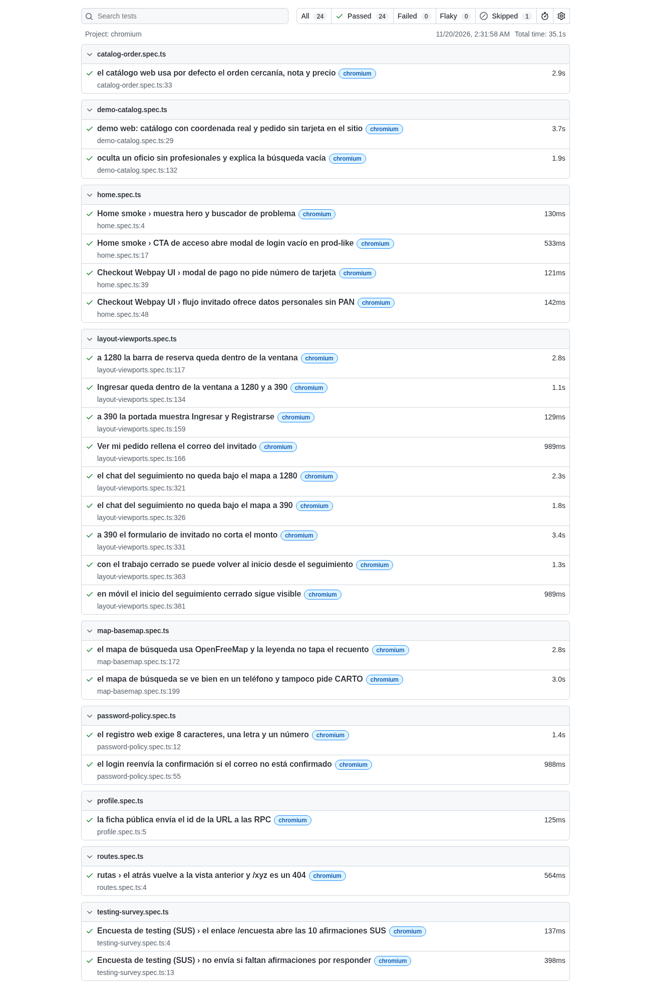
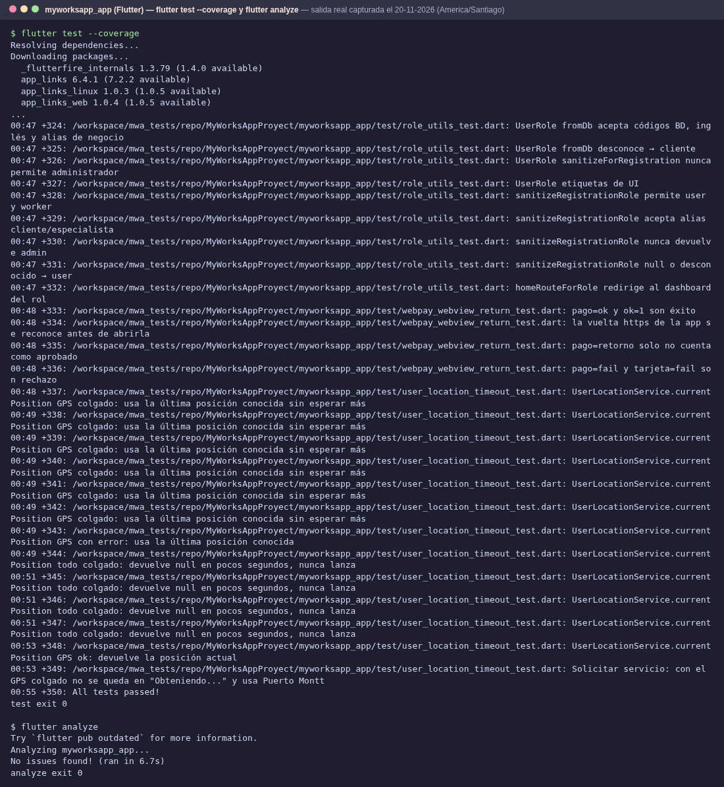
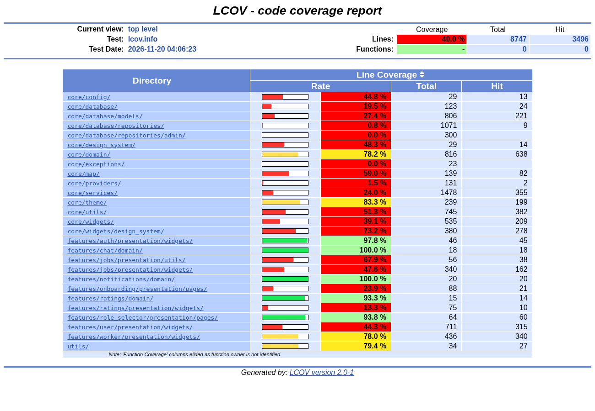
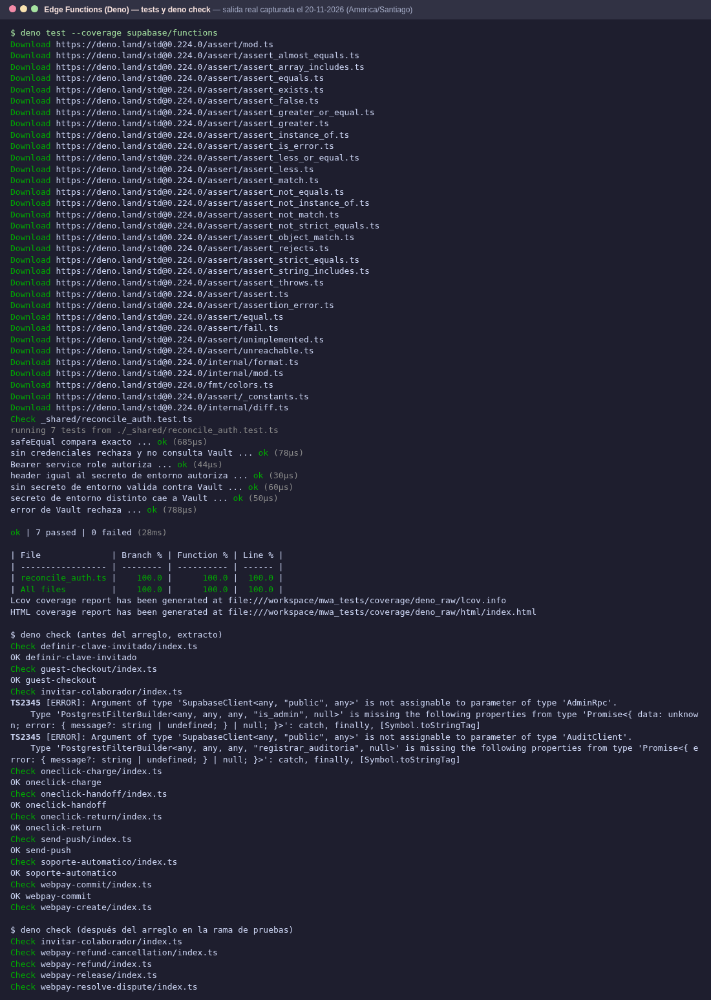
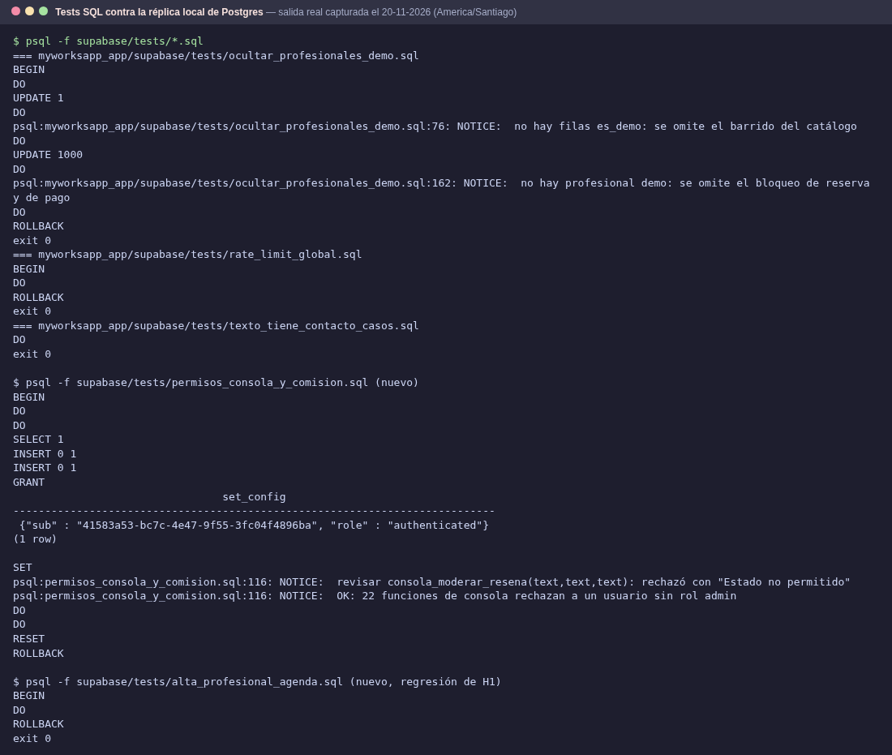

## 5. Pruebas de rendimiento y estrés (prueba A, réplica local)

### 5.1 Cómo se hizo

- **Herramienta:** k6 v2.4.0, script `k6/mwa_carga.js`. Cada usuario virtual (VU) repite un «viaje» con pausas de
  persona real (think time) y usa una sesión real de un usuario sintético.
- **Mezcla de viajes** (pensada para parecerse al uso real):

| Viaje | % | Qué hace |
|---|---:|---|
| Navegación anónima | 35 | Abre la web (HTML + recursos) y el catálogo |
| Búsqueda | 20 | Categorías y catálogo filtrado |
| Perfil de un profesional | 15 | Perfil, horario, reseñas y horas libres |
| Login | 10 | `/auth/v1/token` con clave |
| Chat | 8 | Lee y envía mensajes de un trabajo |
| Reserva | 7 | Crea un trabajo (escritura real en la réplica) |
| Pago | 5 | `webpay-create` (Edge Function) contra el **mock** de Transbank |

- **Niveles:** 10, 20, **200, 1.000, 5.000 y 10.000 VU**. Cada nivel: rampa de subida (1 min; 2 min en 5.000 y
  10.000 ajustados), meseta de 3 min y bajada.
- **Prueba de quiebre:** subida continua de usuarios para ver en qué momento se degrada y en qué momento cae.
- **Criterios** (umbrales de k6, por endpoint): **se degrada** cuando el p95 pasa de 1 s o los errores pasan del
  1 %; **cae** cuando los errores pasan del 5 % o el p95 llega a 10 s (el tope de espera del pool de PostgREST),
  sostenido por al menos 15 s.
- **Glosario:** *p50/p95/p99* = el 50/95/99 % de las peticiones tardó eso o menos. *req/s* = peticiones por
  segundo. *VU* = usuario virtual simultáneo (cada uno hace una petición cada pocos segundos, así que 1 VU no es
  1 persona: una persona real hace menos peticiones).

### 5.2 Resultados por nivel — «main tal cual»

Código de `main` sin cambios y gateway Kong de la réplica de fábrica (512 conexiones).

| VU | Peticiones | req/s total | req/s API correctas | p50 | p95 | p99 | % error total | % error API | CPU máquina (prom.) | CPU Postgres (núcleos) | Conexiones PG (máx.) | RAM k6 |
|---:|---:|---:|---:|---:|---:|---:|---:|---:|---:|---:|---:|---:|
| 10 | 313 | 6,7 | 4,5 | 5 ms | 372 ms | 407 ms | 0,64 % | 0,9 % | — | — | — | — |
| 20 | 1.119 | 15,2 | 10,4 | 4 ms | 351 ms | 391 ms | 0 % | 0 % | — | — | — | — |
| **200** | 19.753 | 71,6 | 47,9 | 556 ms | **6,0 s** | 10,0 s | 0,7 % | 1,0 % | 90 % | 5,2 | 22 | 0,4 GB |
| **1.000** | 120.288 | 429,6 | 5,8 | 0 ms* | 1 ms* | 30,0 s | **57,3 %** | **97,7 %** | 25 % | 0,5 | 22 | 1,0 GB |
| **5.000** | 1.017.568 | 2.994,0 | 2,7 | 0 ms* | 1 ms* | 5 ms* | **58,8 %** | **99,8 %** | 44 % | 0,3 | 22 | 3,7 GB |
| **10.000** | 1.241.539 | 3.651,4 | 5,1 | 1 ms* | 204 ms* | 602 ms* | **64,2 %** | **99,8 %** | 71 % | 0,7 | 29 | **7,1 GB** |

\* **Ojo:** desde 1.000 VU los tiempos bajos son engañosos. Casi todas las peticiones a la API fallan en menos de
1 ms porque el gateway corta la conexión (`EOF`), y las que salen bien son sobre todo la página estática. A 1.000 VU
hubo 65.885 cortes `EOF` y 2.834 timeouts; a 10.000 VU, 729.271 `EOF`. Lo que importa es la columna **% error API**:
el backend ya no atiende a casi nadie.

A 10 y 20 VU el sistema va bien (p95 ~0,35 s, que es lo que tarda el catálogo). A **200 VU ya está degradado**: el
p95 de casi todos los endpoints es de 5 a 7 s, el de `webpay-create` 17 s, y PostgREST empieza a responder 504
(`PGRST003`: no consiguió conexión del pool en 10 s).

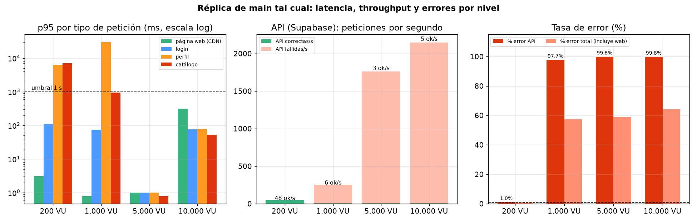
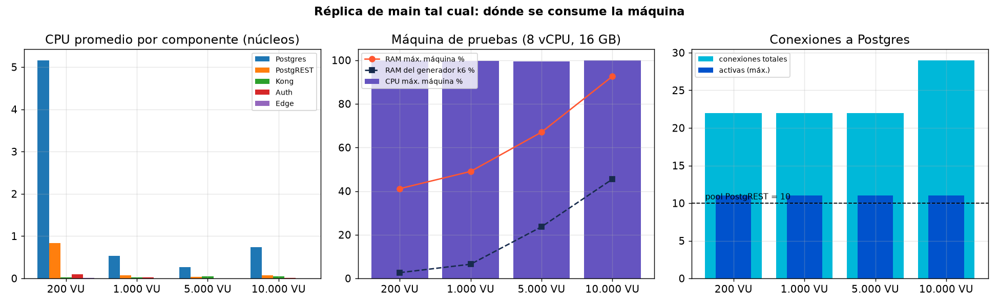
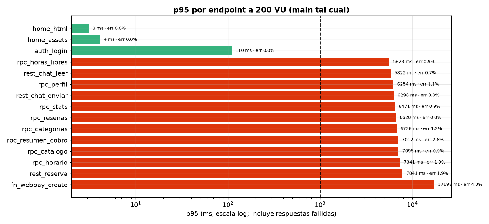

### 5.3 Resultados por nivel — «réplica ajustada»

Para saber qué pasa si el gateway local no fuera el límite, se repitieron 1.000, 5.000 y 10.000 VU con:
(1) Kong con 4 procesos y 16.384 conexiones, y (2) el prototipo del catálogo optimizado
(`listar_profesionales_catalogo_v2`, sección 8). **Esto no es `main`:** es lo que podría rendir con esas mejoras.

| VU | Peticiones | req/s total | req/s API correctas | p50 | p95 | p99 | % error total | % error API | CPU máquina | CPU Postgres (núcleos) | CPU PostgREST (núcleos) | RAM k6 |
|---:|---:|---:|---:|---:|---:|---:|---:|---:|---:|---:|---:|---:|
| 1.000 | 71.686 | 260,3 | **160,7** | 689 ms | 10,0 s | 10,0 s | 5,95 % | 8,8 % | 92 % | 4,1 | 1,8 | 0,7 GB |
| 5.000 | 103.749 | 239,0 | 72,6 | 5,6 s | 30,0 s | 124 s | 30,1 % | 49,8 % | 89 % | 4,7 | 1,6 | 2,7 GB |
| 10.000 | 145.327 | 316,7 | 32,2 | 4,8 s | 142 s | 143 s | 47,0 % | 82,2 % | 89 % | 3,2 | 1,2 | 5,4 GB |

Con el gateway ajustado ya no hay cortes `EOF`: las peticiones esperan en cola hasta que vencen (timeouts). Los
p95 sobre 30 s son peticiones que pasaron más tiempo esperando turno en la máquina que el límite de 30 s del
script; se dejan tal cual salieron. El techo real es **~160 respuestas correctas de API por segundo** con la
máquina al 90 % de CPU: subir de 1.000 a 10.000 VU no agrega capacidad, solo cola y errores.

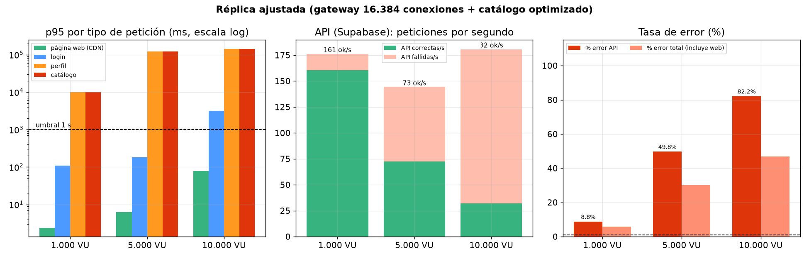
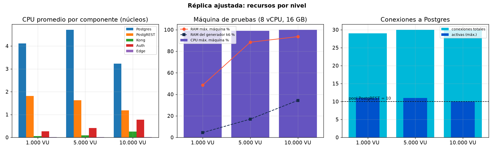
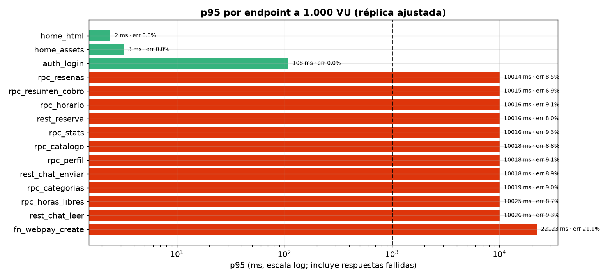

### 5.4 Evolución en el tiempo de cada nivel

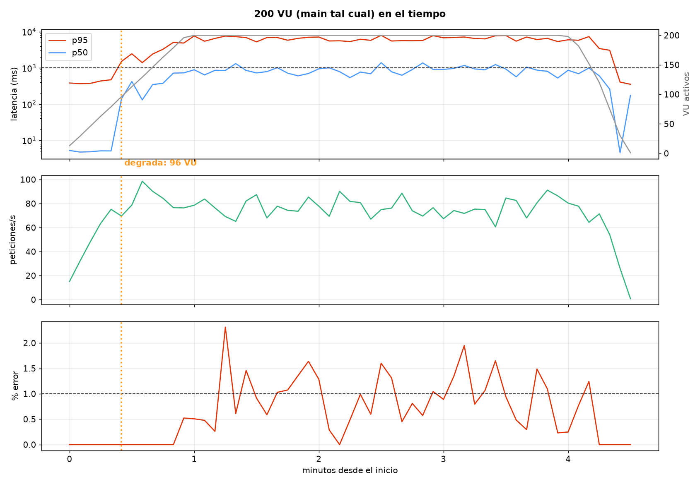
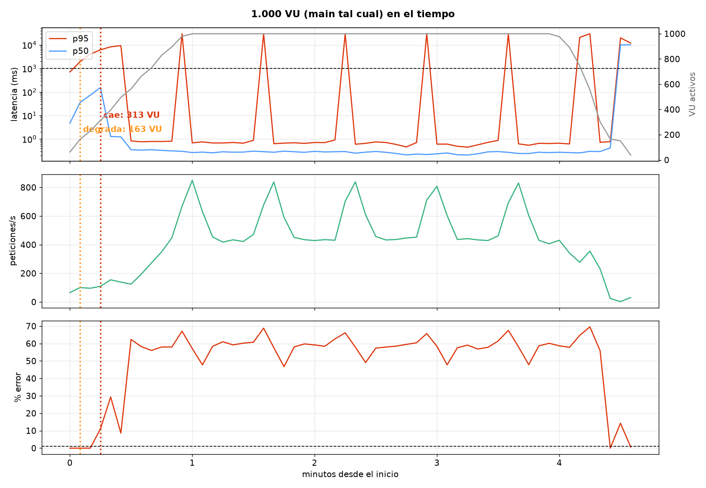
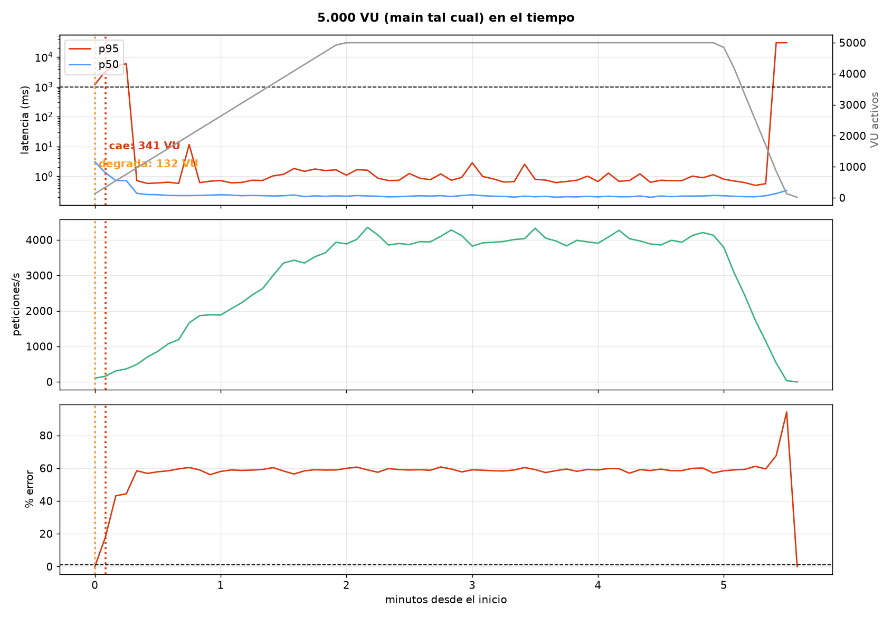
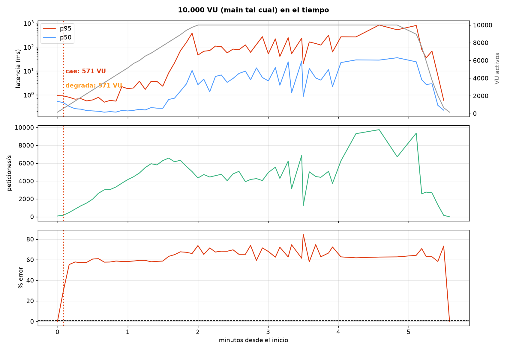

Capturas del dashboard de k6 y del resumen de consola (salida real) de cada corrida:
`capturas/d_<corrida>_dashboard.png` (versión completa en `d_<corrida>_dashboard_completo.png`) y
`capturas/k_resumen_<corrida>.png`. Ejemplos:

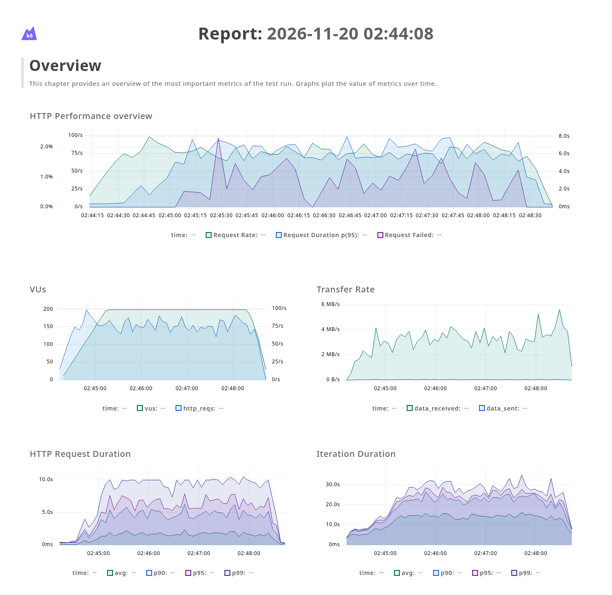
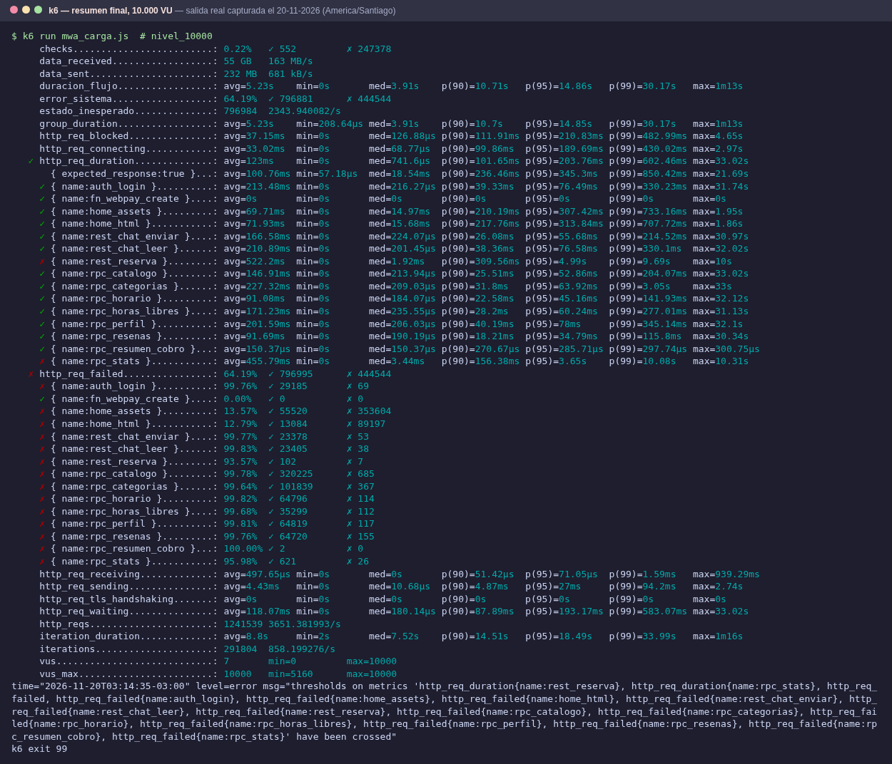

## 6. Punto de quiebre

### 6.1 Quiebre fino con `main` tal cual (la cifra principal)

Subida continua de 0 a 300 VU (+20 VU cada 30 s), con el catálogo actual de `main`.

| Fase | VU | Qué se ve |
|---|---:|---|
| Sano | 0 – ~100 | p95 0,4–0,6 s (el catálogo), 0 % error; el throughput sube parejo hasta ~90 req/s |
| **Se degrada** | **~100** (102 VU) | El p95 pasa de 1 s y ya no baja. El throughput se queda plano en **75–90 req/s** aunque entren más usuarios |
| Errores > 1 % | ~190–205 | Aparecen los 504 de PostgREST (pool sin conexión libre en 10 s) |
| **Cae** | **~280** (279 VU) | p95 pegado en 10 s y errores sobre 5 % (máx. 7,7 %) |

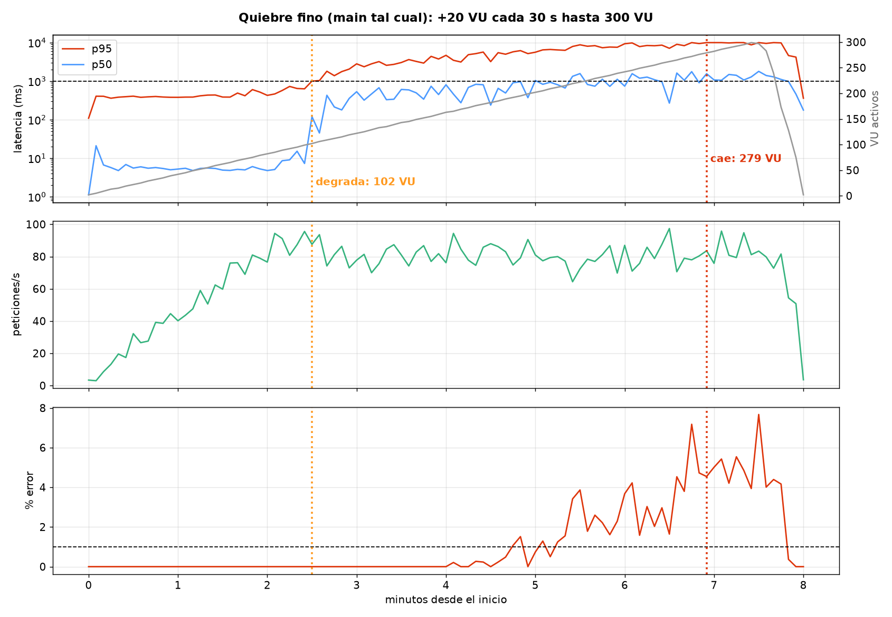
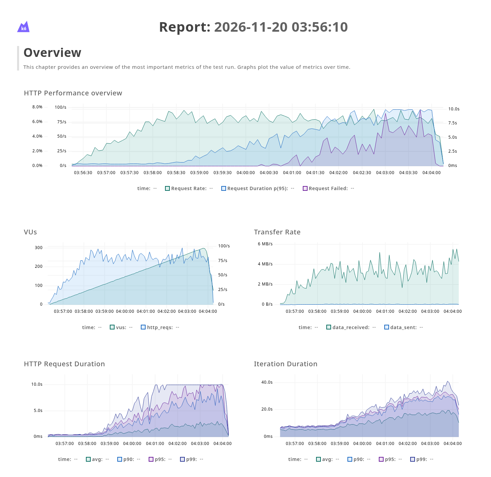

Recursos durante el quiebre fino: CPU de la máquina 85 % en promedio, **Postgres 5,2 núcleos** en promedio,
PostgREST 0,6, conexiones a Postgres 29 como máximo (10 de ellas del pool de PostgREST, que estuvo lleno).

### 6.2 Quiebre con la réplica ajustada

Subida de 0 a 10.000 VU (+1.000 VU por minuto) con gateway ajustado y catálogo optimizado. Como la subida es
mucho más rápida, el punto es aproximado: **se degrada cerca de 490 VU y cae cerca de 570 VU**; desde ahí y hasta
10.000 VU los errores se mantienen entre 40 % y 60 %. El optimizado aguanta unas **5 veces más usuarios** que `main`
antes de degradarse, pero sigue chocando con la misma CPU.

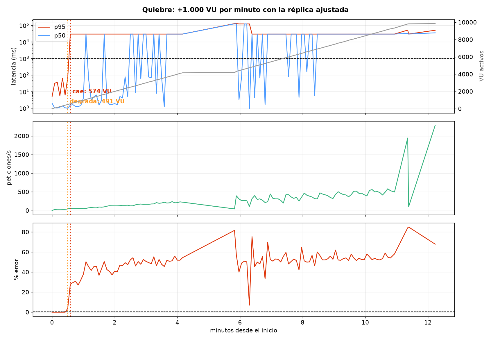

### 6.3 Una corrida descartada (y por qué es un dato útil)

El primer quiebre fino se lanzó justo después del quiebre a 10.000 VU y salió mal desde el inicio (timeouts de
30 s con solo 56 VU). La réplica seguía saturada: PostgREST tenía 2,5 GB de RAM ocupados en cola. Se descartó,
se reinició PostgREST y se repitió (la corrida buena es la de 6.1). Los archivos quedaron como
`k6/resultados/quiebre_catalogo_original_contaminado_*`. **Es la misma «anomalía» que vio el Programador en
producción** (sección 10): después de saturar, el backend queda lento varios minutos. En la réplica la causa fue
la cola acumulada en PostgREST; en producción podría ser lo mismo además de los créditos de CPU.

## 7. Qué se satura primero (cuello de botella)

En orden, de lo que se rompe primero a lo último:

1. **CPU de Postgres, por el catálogo.** A 200 VU Postgres usó en promedio 5,2 de los 8 núcleos. En
   `pg_stat_statements`, el catálogo (`listar_profesionales_catalogo`) se llevó **~2.300 s de CPU** con solo
   3.875 llamadas (~595 ms cada una bajo carga), y adentro hubo **3,88 millones** de llamadas a
   `stats_profesional()`: ~1.000 por cada catálogo, una por profesional. Todo lo demás (perfil, horario, reseñas,
   horas libres, chat) cuesta entre 1 y 6 ms (sección 8).
2. **Pool de PostgREST (10 conexiones).** Como cada catálogo ocupa una conexión ~0,4–0,6 s, 10 conexiones se
   llenan rápido y el resto espera en cola. A los 10 s de espera PostgREST responde 504 (`PGRST003`). Por eso
   incluso endpoints de 2 ms se ponen lentos: esperan turno detrás del catálogo.
3. **Gateway Kong de la réplica (solo prueba A).** Con 512 conexiones por proceso, sobre ~500 conexiones
   simultáneas corta con `EOF` (log: «512 worker_connections are not enough»), y su DNS interno de Docker se
   satura. Es un límite de la réplica, no de producción.
4. **La máquina de pruebas (desde 5.000 VU).** Generador y sistema comparten 8 núcleos. A 10.000 VU k6 usó
   **7,1 GB de RAM** (la primera vez lo mató el sistema por memoria, a 7,5 GB). A esa escala parte del límite es
   el generador: **las cifras de 5.000 y 10.000 VU sirven para ver que el sistema está caído, no para medir
   cuánto aguantaría con más hardware.**

Lo que **no** fue el límite: Auth (login p95 ~75–110 ms hasta 1.000 VU ajustado), la web estática (p95 < 5 ms a
200 VU), el mock de Transbank y el número de conexiones de Postgres (máx. 30, lejos del límite).

## 8. Análisis de consultas (EXPLAIN ANALYZE)

Medido en la réplica en reposo, con los datos sintéticos (1.000 profesionales). Archivos en `explain/`.

| Consulta (RPC) | Tiempo | Plan | Comentario |
|---|---:|---|---|
| `listar_profesionales_catalogo` (20 filas) | **412 ms** | Llama a `stats_profesional()` por cada uno de los 1.000 profesionales (cada llamada ~0,2–0,6 ms, con 2 agregados y un join) | **El problema.** Crece con el número de profesionales, no con las filas que muestra |
| `listar_profesionales_catalogo_v2` (prototipo) | **76 ms** | Un solo agregado de `calificaciones` por profesional (CTE `MATERIALIZED`) y join | Mismos resultados. Bajo carga, ~125 ms. Sin `MATERIALIZED` el planificador estimó 1 fila y tardó 1,1 s (`catalogo_v2_explain.txt`) |
| `resenas_publicas_profesional` | 6,5 ms | Índice | Bien |
| `categorias_con_disponibles` | 5,2 ms | `DISTINCT` sobre `trabajador_servicios` | Bien; buen candidato a caché (cambia poco) |
| `perfil_publico_profesional` | 4,6 ms | Índice | Bien |
| `horarios_libres_profesional` (14 días) | 4,0 ms | Índices `trabajador_horarios_usuario_dia_uidx` y `trabajos_trabajador_minuto_activo_uidx` | Bien |
| `horario_publico_profesional` | 3,8 ms | Índice | Bien |
| Chat: mensajes de un trabajo | 0,16 ms | Índice `mensajes_trabajo_creado_idx (id_trabajo, creado_en)` | Bien |

**Recomendaciones de índices y consultas:**

1. **Catálogo:** no hace falta un índice nuevo, hace falta dejar de calcular por fila. La tabla `trabajadores`
   **ya guarda** `calificacion` y `trabajos_completados` (los mantiene `recomputar_agregados_profesional`). El
   catálogo puede leer esas columnas directamente; eso debería dejarlo en pocos milisegundos (no medido: es la
   siguiente prueba sugerida). Si se quiere seguir calculando en vivo, usar el prototipo v2.
2. `stats_profesionales(p_ids)` (las tarjetas) también llama a `stats_profesional()` por id: ~4,8 ms por
   llamada; mismo arreglo.
3. **Eliminar** `idx_trabajos_id_trabajador` (redundante con `trabajos_trabajador_estado_idx`).
4. Los índices de chat, horarios y reseñas están bien; no se recomiendan índices nuevos ahí.

## 9. Hallazgos

| # | Gravedad | Hallazgo | Evidencia | Qué hacer |
|---|---|---|---|---|
| H1 | **Alta** | El trigger `trabajador_horarios_desde_alta` (migración `20261118230000`) usa `generate_series(time, time, interval)`, que no existe en Postgres 17. **Todo `INSERT` en `trabajadores` falla**, o sea, no se pueden dar de alta profesionales. | Error al cargar el seed en la réplica; test `alta_profesional_agenda.sql` | Aplicar la migración del parche `20261120180000_agenda_alta_sin_generate_series_time.sql`. **Revisar en producción** si la migración ya está aplicada y si hubo altas fallidas desde el 18-11 (no se verificó: la prueba A no toca producción). |
| H2 | **Alta (rendimiento)** | `listar_profesionales_catalogo` llama a `privado.stats_profesional()` (SECURITY DEFINER, no se puede «aplanar») **una vez por cada profesional**, aunque solo devuelva 20. Con 1.000 profesionales cuesta ~400 ms por llamada. | `pg_stat_statements` a 200 VU: 3.875 llamadas al catálogo → 3,88 millones de llamadas a `stats_profesional`; el catálogo se llevó ~2.300 s de CPU de la base | Ver sección 8: versión por conjuntos (`explain/catalogo_v2_prototipo.sql`), ~400 ms → 78 ms con resultados idénticos. |
| H3 | Media | Las migraciones no aplican desde cero (orden de fechas, `DROP TRIGGER` y `ALTER POLICY` sobre objetos que no existen). | `replica/supabase/migrations/REORDEN_MIGRACIONES.txt` | Consolidar una base reproducible; hoy un entorno nuevo (staging, recuperación ante desastre) no se puede levantar con `supabase db push`. |
| H4 | Media | 5 Edge Functions (`invitar-colaborador`, `webpay-refund`, `webpay-refund-cancellation`, `webpay-release`, `webpay-resolve-dispute`) no pasan `deno check` (TS2345, `Promise` vs `PromiseLike`). | `logs/deno_check.log` | Commit `fix(functions)` del parche: 18 / 18 OK. |
| H5 | Baja | Los triggers de `calificaciones` recalculan los agregados del profesional dos veces por fila. | Revisión del código y tiempos del seed | Dejar un solo trigger `AFTER … FOR EACH STATEMENT` o unificar. |
| H6 | Baja | El índice `idx_trabajos_id_trabajador` es redundante con `trabajos_trabajador_estado_idx` (mismo primer campo). | Definición de índices | Eliminarlo; ahorra escritura en cada cambio de `trabajos`. |
| H7 | Info | `consola_moderar_resena` revisa el estado antes que el rol; `fichas_sensibles_admin` devuelve 0 filas a quien no es admin. Ambos son seguros. | `permisos_consola_y_comision.sql` | Nada urgente; si se quiere, revisar el rol primero para dar un mensaje más claro. |
| H8 | Info | 27 avisos de lint en la web (dependencias de efectos de React). | `logs/web_lint.log` | Revisar los `exhaustive-deps`: pueden dejar datos desactualizados en pantalla. |

## 10. Contraste con la prueba B (producción, solo lecturas, la corrió el Programador)

> **Esta sección resume una prueba que NO hizo el equipo de pruebas.** La hizo el Programador el 20-11-2026
> entre las 02:29 y las 03:05 (America/Santiago), contra **producción**: Supabase `wxqrfcqifkfgawrnqmnj`
> (plan gratis, instancia Micro según su informe) y `myworksapp.cl` en Vercel. Según él tenía el OK de Mathias;
> **eso no se pudo verificar**. Su informe original: `/workspace/mwa_carga/INFORME_escalonada_2026-11-20.md`;
> scripts en `/workspace/mwa_carga/escalonada/`. Las cifras de esta sección son las de ese informe, no se
> volvieron a medir, y **no se apuntó nada nuevo a producción** para escribir este informe.

### 10.1 Qué midió (prueba B)

Solo lecturas públicas (catálogo, categorías, perfil, horario, reseñas) y `GET /auth/v1/user`; sin escrituras,
sin Edge Functions, sin correos ni Webpay. Escalones de 200 a 500 VU con pausas de 1–3 s, desde una sola IP.

| VU | req/s REST | p95 | % error HTTP | Veredicto (del Programador) |
|---:|---:|---:|---:|---|
| 200 | 167–169 | 0,22–0,26 s | 0 % | OK (repetido 2 veces) |
| 300 | 186 | **1,6 s** | 0 % | Saturado: la tasa se aplana |
| 400 | ~30 (rampa) | > 5 s | 0 % | Cortado a los 23 s |
| 500 | ~150 | 6,4 s | 0 % | Cortado (p95 > 5 s) |

Su conclusión: techo de **~200–250 VU (~170–190 req/s)**; el cuello de botella es la **CPU de la instancia Micro
de Supabase y la cola de PostgREST, no Vercel** (la CDN respondió con p95 ~0,2 s y solo bloqueó por IP única).

### 10.2 Lado a lado

| | **A. Réplica local (`main` tal cual)** | **B. Producción (solo lecturas)** |
|---|---|---|
| Quién / cuándo | Equipo de pruebas, 19–20-11 | Programador, 20-11, 02:29–03:05 |
| Destino | `127.0.0.1` (Docker) | Supabase real + Vercel |
| Tipo de tráfico | Lecturas + login + chat + reservas + pago simulado | Solo lecturas + `/auth/v1/user` |
| Datos | 1.000 profesionales sintéticos | Datos reales del proyecto |
| Niveles corridos | 10, 20, 200, 1.000, 5.000, 10.000 + quiebre | 200, 300, 400, 500 |
| Sano hasta | ~100 VU | ~200 VU |
| Se degrada (p95 > 1 s) | **~100 VU** | **entre 200 y 300 VU** |
| Techo de throughput | 75–90 req/s total (~50–60 de API) | 170–190 req/s |
| Cae | ~280 VU (errores > 5 %, 504 de PostgREST) | 400–500 VU (p95 > 5 s, pero 0 % de error) |
| Qué se satura | CPU de Postgres (catálogo) → pool de PostgREST | CPU de la Micro → cola de PostgREST |
| Después de saturar | Queda lento hasta reiniciar PostgREST (6.3) | Queda lento varios minutos |

### 10.3 Cómo leer la diferencia

- **Coinciden en lo importante:** en los dos casos lo primero que se rompe es la CPU de la base de datos, y la
  cola de PostgREST (pool de ~10–11 conexiones) hace que **todo** se ponga lento, incluso endpoints triviales.
  En ninguno de los dos el problema fue la web estática ni Vercel.
- **La réplica se degrada antes (~100 VU contra ~200–300 VU)**, aunque tiene más CPU, por tres razones:
  1. **El catálogo cuesta según cuántos profesionales hay.** Con 1.000 profesionales sintéticos tarda ~410 ms;
     producción hoy tiene muchos menos (no se contó, para no consultar producción), así que allí el catálogo es
     barato. **A medida que crezca el número de profesionales, el techo de producción va a bajar hacia lo que
     muestra la réplica**, salvo que se arregle el catálogo (sección 8).
  2. La prueba A incluye escrituras, login (bcrypt), chat y pagos; la B solo lecturas.
  3. En la prueba A el generador comparte los 8 núcleos con el sistema.
- **Errores:** en producción todo terminó en 200 pero lento; en la réplica, PostgREST corta a los 10 s con 504.
  Para un usuario el efecto es el mismo: la app no responde a tiempo.
- **La prueba B no midió 1.000 a 10.000 VU** (se detuvo al llegar al techo, como correspondía). Esos niveles solo
  están en la prueba A, contra la réplica.
- Salvedades que el propio Programador anotó: un piloto con un error de script mandó ~570 req/s durante ~40 s a
  `myworksapp-cl.vercel.app` (Vercel respondió con challenge 403 a la IP del box; según él, los usuarios reales no
  se vieron afectados), se hizo 1 login con el usuario demo (1 sesión creada) y se corrieron consultas de
  diagnóstico de solo lectura. Hay que tenerlo presente al revisar los registros de producción de esa noche.

## 11. Límites de los planes (documentación oficial)

Consultado el 20-11-2026. Los precios y cupos pueden cambiar; revisar los enlaces antes de decidir.

**Supabase — cómputo y conexiones** ([Compute and Disk](https://supabase.com/docs/guides/platform/compute-and-disk))

| Instancia | CPU | RAM | Conexiones directas | Clientes del pooler |
|---|---|---|---:|---:|
| Nano (plan gratis) | compartida | 0,5 GB | 60 | 200 |
| Micro (~US$10/mes de cómputo) | compartida | 1 GB | 60 | 200 |
| Small | compartida | 2 GB | 90 | 400 |
| Medium | compartida | 4 GB | 120 | 600 |
| Large | 2 núcleos dedicados | 8 GB | 160 | 800 |
| XL | 4 núcleos dedicados | 16 GB | 240 | 1.000 |
| 2XL | 8 núcleos dedicados | 32 GB | 380 | 1.500 |

**Supabase — cupos del plan** ([Pricing](https://supabase.com/pricing))

| | Gratis | Pro (US$25/mes, incluye US$10 de cómputo) |
|---|---|---|
| Usuarios activos al mes (MAU) | 50.000 | 100.000 |
| Base de datos | 500 MB | 8 GB de disco |
| Egreso | 5 GB | 250 GB |
| Invocaciones de Edge Functions | 500.000 | 2 millones (luego US$2 por millón) |
| Pausa por inactividad | Sí, tras 1 semana | No |

**Supabase — Edge Functions** ([Limits](https://supabase.com/docs/guides/functions/limits)): 256 MB de memoria,
2 s de CPU por petición, 150 s de espera sin actividad, tiempo total de 150 s (gratis) o 400 s (pago).

**Supabase — Auth** ([Rate limits](https://supabase.com/docs/guides/auth/rate-limits)): registros e inicios por
enlace u OTP, 30 cada 5 min por IP; `/auth/v1/token` (login con clave y refresco), 150 cada 5 min por IP;
correos con el proveedor integrado, 2 por hora (con SMTP propio se puede subir). Si muchos usuarios comparten una
IP (por ejemplo, una oficina o un NAT de operador), el límite de login se alcanza antes.

**Vercel — plan Hobby** ([Hobby plan](https://vercel.com/docs/plans/hobby), [Limits](https://vercel.com/docs/limits)):
100 GB de transferencia rápida, 1.000.000 de peticiones al CDN, 1.000.000 de invocaciones de funciones y
4 horas de CPU activa al mes. Mitigación de DDoS activa por defecto. Tiempo máximo de una petición proxied: 120 s.

## 12. Recomendaciones de capacidad (en orden de prioridad)

| # | Acción | Costo | Efecto esperado | Evidencia |
|---|---|---|---|---|
| 1 | **Aplicar la corrección de H1** (alta de profesionales) y revisar producción | Gratis | Sin esto no se pueden sumar profesionales | Sección 9 |
| 2 | **Catálogo sin cálculo por fila:** leer `trabajadores.calificacion` y `trabajos_completados` (ya guardados) o usar el prototipo v2 | Gratis | Catálogo de ~410 ms a 76 ms (v2, medido) o menos; quiebre de ~100 a ~490 VU en la réplica (medido con v2 + gateway) | Secciones 6.2 y 8 |
| 3 | **Caché en el CDN** de catálogo y categorías (`s-maxage=60`), como propone también el Programador | Gratis | Saca de la base la mayor parte de las lecturas públicas | Secciones 7 y 10 |
| 4 | Menos llamadas por vista (perfil + horario + reseñas en un RPC) y caché más larga en el cliente | Gratis | Menos peticiones por usuario | Prueba B |
| 5 | Usar el pooler (Supavisor) para conexiones de servidor y revisar el pool de PostgREST | Gratis | Más margen de conexiones; no arregla la CPU | Sección 11 |
| 6 | Arreglar las migraciones para que apliquen desde cero (H3) | Gratis | Poder levantar staging y recuperar ante desastres | Sección 9 |
| 7 | Quitar el índice redundante y el doble recálculo de calificaciones (H5, H6) | Gratis | Escrituras más livianas | Sección 9 |
| 8 | Recién después, **subir de cómputo** (Pro + Small/Medium; Large si se necesitan núcleos dedicados) | US$25/mes + cómputo | Más CPU; no corrige el catálogo por fila | Sección 11 |

**Capacidad estimada hoy:** con `main` tal cual, unos **100 VU sostenidos en la réplica** y **~200–250 VU en
producción** (prueba B, con pocos profesionales). Un VU con pausas de 1–8 s genera más carga que una persona
real, así que en personas es bastante más (el Programador estima ~1.000–1.500 personas navegando; es una
estimación, no una medición). **1.000, 5.000 y 10.000 usuarios simultáneos no los soporta hoy ninguna de las dos
configuraciones:** en la réplica, a esos niveles fallan entre el 98 % y el 100 % de las peticiones a la API
(`main`) o entre el 9 % y el 82 % (réplica ajustada).

## 13. Limitaciones (dicho con honestidad)

- **Una sola máquina:** generador y sistema compartieron 8 vCPU y 16 GB. Desde 5.000 VU el generador es parte del
  límite (7,1 GB de RAM a 10.000 VU). Para medir de verdad 5.000–10.000 VU hacen falta generadores aparte y una
  base de mayor tamaño.
- **Datos sintéticos:** 1.000 profesionales y 20.000 clientes inventados. El costo del catálogo depende de esa
  cantidad.
- **La réplica no es producción:** el gateway Kong, el pool de PostgREST, el hardware y la red son distintos. Por
  eso se mostraron dos series («tal cual» y «ajustada»). Las cifras de la réplica sirven para comparar y encontrar
  cuellos de botella, no como promesa de capacidad en producción.
- **Una sola IP de origen:** se simularon IP distintas con cabeceras y se subieron los límites de Auth en la
  réplica; en producción los límites por IP sí aplican.
- **Edge Functions y Transbank:** el pago usó un mock con 250 ms fijos; el rendimiento real de Transbank no se probó.
- **Prueba corta contra producción:** el equipo de pruebas no la hizo. La prueba B la hizo el Programador; su
  autorización no se pudo verificar.
- **Cobertura de Flutter (39,97 %):** se mide solo sobre los archivos que cargan los tests (177 de 415).

## 14. Cómo repetir las pruebas

```bash
# 1. Réplica local (nunca producción)
cd /workspace/mwa_tests/replica && supabase start
psql "$DB_URL_LOCAL" -f /workspace/mwa_tests/seed/seed_sintetico_carga.sql   # datos SINTÉTICOS
# mock de Transbank: contenedor Node con replica/tbk-mock/server.js (puerto 8080, red de Supabase)
# 2. Sesiones de prueba
node /workspace/mwa_tests/k6/gen_tokens.mjs
# 3. Un nivel (reinicia la réplica, monitorea y guarda todo en k6/resultados/)
cd /workspace/mwa_tests/k6 && ./correr_nivel.sh 1000
./correr_nivel.sh quiebre -e MAX_VU=300 -e PASO_VU=20 -e PASO_DUR=30s
# 4. Tablas y gráficos
python3 analizar.py && python3 graficos.py
```

Dejar al menos 5 minutos (o reiniciar PostgREST) entre corridas pesadas: ver sección 6.3.

Al terminar (20-11-2026, 04:11) se detuvieron y borraron los contenedores de la réplica (`supabase stop --no-backup`,
`mwa-web`, `tbk-mock`). Los resultados quedaron en disco; para repetir hay que levantar la réplica y cargar el seed
de nuevo.

## Anexo: dónde está cada cosa

| Qué | Ruta (en `/workspace/mwa_tests/`) |
|---|---|
| Este informe | `INFORME_PRUEBAS.md` |
| Capturas y gráficos | `capturas/` (`t*` tests, `c*` cobertura, `g*` gráficos, `d_*` dashboards k6, `k_resumen_*` consola k6) |
| Parche de tests y correcciones | `pruebas-carga-unitarias.patch` y `patch/0001…0004` |
| Logs de tests unitarios | `logs/` |
| Cobertura HTML | `coverage/` |
| Reporte Playwright | `reportes/playwright-html/` |
| Scripts k6 y datos | `k6/` (`mwa_carga.js`, `correr_nivel.sh`, `monitor.py`, `analizar.py`, `graficos.py`) |
| Resultados crudos k6 | `k6/resultados/` (`*_resumen.json`, `*_serie.ndjson.gz`, `*_monitor.ndjson`, `*_dashboard.html`, `*_pg_top.json`, `tabla_resumen.json`, `puntos_quiebre.json`) |
| EXPLAIN | `explain/` |
| Seed sintético | `seed/seed_sintetico_carga.sql` |
| Réplica | `replica/` (config, migraciones ajustadas, mock Transbank, nginx) |
| Prueba B (Programador) | `/workspace/mwa_carga/INFORME_escalonada_2026-11-20.md`, `/workspace/mwa_carga/escalonada/` |
