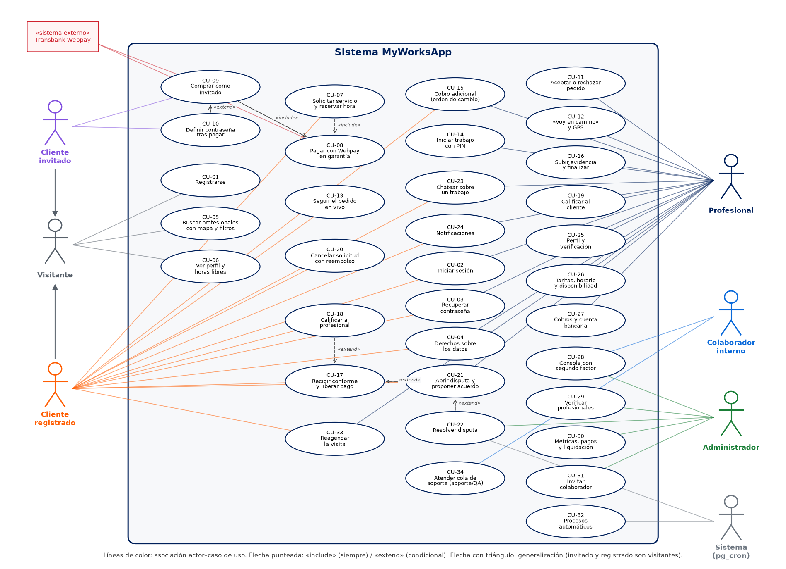
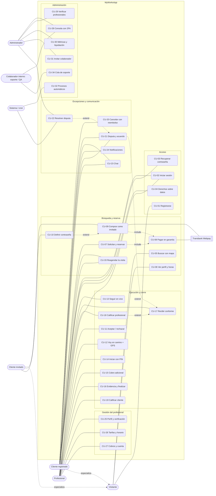

# Especificación de casos de uso — MyWorksApp

| Campo | Valor |
|---|---|
| Versión del código analizada | `main` en `b3d944e` (15 de noviembre de 2026), actualizada con los cambios de cierre del 15-nov-2026 (versión 1.0.3: reagendar, recuperar contraseña en la web, cancelar y calificar en la web, roles `soporte` y `qa` en la consola) |
| Fuentes | Código de `myworksapp_app` (Flutter), `myworksapp_web` (React/Vite), `myworksapp_desktop` (Tauri), `shared/` (TypeScript), `myworksapp_app/supabase/migrations` (SQL) y `myworksapp_app/supabase/functions` (Edge Functions). Se contrastó con la base en vivo y con las pruebas E2E del 15-nov-2026 en https://myworksapp-cl.vercel.app |
| Diagrama | [`casos_de_uso_diagrama.png`](casos_de_uso_diagrama.png) (fuente Mermaid en §3) |

Cada caso de uso se escribió a partir de lo que el código **hace hoy**, no de lo que se planificó. Las rutas de la trazabilidad son relativas a `MyWorksAppProyect/`. Cuando un comportamiento depende de una regla del servidor, se cita la función SQL o la Edge Function que la impone, porque esa es la regla que no se puede saltar desde un cliente modificado.

---

## 1. Actores

| Actor | Tipo | Descripción | Cliente que usa |
|---|---|---|---|
| **Visitante** | Primario | Persona sin sesión que navega el catálogo | Web y app |
| **Cliente invitado** | Primario | Visitante que compra sin crear cuenta antes de pagar | Web |
| **Cliente registrado** | Primario | Usuario con rol `cliente` que contrata servicios | Web y app |
| **Profesional** (rol `trabajador`, «Especialista» en la app) | Primario | Ofrece y ejecuta servicios | Solo app móvil |
| **Administrador** (rol `administrador`) | Primario | Opera la plataforma: verificación, disputas, pagos y personal | Consola de escritorio (Tauri) |
| **Colaborador interno** (rol `soporte` o `qa`) | Primario | Persona invitada por RRHH. Entra a la consola con mínimo privilegio (CU-34) | Consola de escritorio |
| **Sistema (planificador)** | Secundario | Tareas `pg_cron` y Edge Functions automáticas | Backend Supabase |
| **Transbank Webpay** | Externo | Pasarela de pago (ambiente de integración) | — |
| **Supabase Auth / correo** | Externo | Autenticación, correos de alta y recuperación | — |

**Generalización.** Cliente invitado y Cliente registrado especializan a Visitante (heredan CU-05 y CU-06). Un Cliente invitado pasa a ser Cliente registrado al completar CU-10.

## 2. Resumen de casos de uso

| ID | Nombre | Actor principal | Módulo | Clientes |
|---|---|---|---|---|
| CU-01 | Registrarse | Visitante | Acceso | Web, app |
| CU-02 | Iniciar sesión | Cliente, Profesional | Acceso | Web, app |
| CU-03 | Recuperar contraseña | Cliente, Profesional | Acceso | Web, app |
| CU-04 | Ejercer derechos sobre los datos (exportar / eliminar cuenta) | Cliente, Profesional | Acceso | App |
| CU-05 | Buscar profesionales con mapa y filtros | Visitante | Búsqueda | Web, app |
| CU-06 | Ver perfil del profesional y horas libres | Visitante | Búsqueda | Web, app |
| CU-07 | Solicitar servicio y reservar hora | Cliente registrado | Reserva | Web, app |
| CU-08 | Pagar con Webpay en garantía | Cliente registrado | Pago | Web, app |
| CU-09 | Comprar como invitado | Cliente invitado | Pago | Web |
| CU-10 | Definir contraseña tras pagar como invitado | Cliente invitado | Acceso / pago | Web |
| CU-11 | Aceptar o rechazar un pedido | Profesional | Ejecución | App |
| CU-12 | Avisar «voy en camino» y compartir ubicación | Profesional | Ejecución | App |
| CU-13 | Seguir el pedido en vivo | Cliente | Ejecución | Web, app |
| CU-14 | Iniciar el trabajo con PIN | Profesional | Ejecución | App |
| CU-15 | Solicitar y aprobar un cobro adicional (orden de cambio) | Profesional, Cliente | Ejecución / pago | App |
| CU-16 | Subir evidencia y finalizar el trabajo | Profesional | Ejecución | App |
| CU-17 | Recibir conforme y liberar el pago | Cliente | Cierre / pago | Web, app |
| CU-18 | Calificar al profesional | Cliente | Reputación | Web, app |
| CU-19 | Calificar al cliente | Profesional | Reputación | App |
| CU-20 | Cancelar una solicitud con reembolso | Cliente | Excepción / pago | Web, app |
| CU-21 | Abrir disputa y proponer un acuerdo | Cliente, Profesional | Excepción | Web, app |
| CU-22 | Resolver una disputa | Administrador, Sistema | Excepción / pago | Escritorio, backend |
| CU-23 | Chatear sobre un trabajo | Cliente, Profesional | Comunicación | Web, app |
| CU-24 | Recibir y gestionar notificaciones | Cliente, Profesional | Comunicación | Web, app |
| CU-25 | Completar perfil y solicitar verificación | Profesional | Gestión del profesional | App |
| CU-26 | Configurar tarifas, horario y disponibilidad | Profesional | Gestión del profesional | App |
| CU-27 | Consultar cobros y registrar cuenta bancaria | Profesional | Gestión del profesional | App |
| CU-28 | Acceder a la consola con segundo factor | Administrador, Colaborador interno | Administración | Escritorio |
| CU-29 | Verificar profesionales | Administrador | Administración | Escritorio |
| CU-30 | Supervisar métricas, pagos y liquidar al profesional | Administrador | Administración | Escritorio |
| CU-31 | Invitar colaborador interno | Administrador | Administración | Escritorio |
| CU-32 | Ejecutar procesos automáticos de pagos y soporte | Sistema | Backend | — |
| CU-33 | Reagendar la visita | Cliente registrado, Profesional | Reserva | Web, app |
| CU-34 | Atender la cola de soporte con mínimo privilegio | Colaborador interno (`soporte`, `qa`) | Administración | Escritorio |

**Total: 34 casos de uso** (4 de acceso, 2 de búsqueda, 5 de reserva y pago, 9 de ejecución y cierre, 3 de excepciones, 2 de comunicación, 3 de gestión del profesional, 5 de administración y 1 de sistema).

## 3. Diagrama de casos de uso



La imagen se genera con `docs/_gen_diagrama_casos_de_uso.py` (notación UML: actores, límite del sistema, asociaciones, generalización, «include» y «extend»). La misma estructura en Mermaid, editable y visible directamente en GitHub (también en `casos_de_uso.mmd`):



Notas del diagrama: «include» significa que el caso base siempre ejecuta al incluido (reservar siempre pasa por el pago en garantía). «extend» significa que el caso que extiende se agrega al base solo bajo una condición: definir la contraseña después de una compra como invitado, calificar o abrir una disputa al momento de recibir el trabajo, y resolver por un tercero cuando las partes no llegan a acuerdo. La flecha apunta al caso base. Las relaciones de precedencia (por ejemplo, que iniciar con PIN requiere que el cliente vea su seguimiento) se documentan como precondiciones, no como «include».

## 4. Estados del trabajo (referencia para todos los casos)

La única forma de cambiar el estado de un trabajo es el RPC `transicionar_trabajo` (`SECURITY DEFINER`). El `UPDATE` directo a `trabajos` está revocado y protegido por los triggers `trabajos_proteger_campos` y `trabajos_bloquear_en_curso_directo`. Las transiciones válidas las define `transicion_trabajo_permitida` (`supabase/migrations/20261006000001_gps_y_base_profesional.sql`):

```
esperando_pago → pendiente → aceptado → en_camino → en_curso → esperando_aprobacion_cliente → completado
                                  └──────────────→ en_curso ⇄ pausado_orden_cambio
Terminales: completado, cancelado, expirado, no_asistio
```

Reglas transversales que impone el servidor:

- **RN-01.** Solo el profesional del trabajo pasa a `aceptado`, `en_camino`, `esperando_aprobacion_cliente`, `pausado_orden_cambio` y `no_asistio`.
- **RN-02.** Nadie pasa a `completado` con `transicionar_trabajo` salvo el administrador. El cliente cierra con `cerrar_trabajo_conforme` (CU-17).
- **RN-03.** En las modalidades con cobro, `aceptado`, `en_curso` y `pendiente` exigen un pago en garantía (`retenido` o `autorizado`).
- **RN-04.** Con una disputa activa, solo el administrador puede mover el trabajo.
- **RN-05.** No se puede cancelar con el pago retenido: primero hay que devolverlo (CU-20).
- **RN-06.** Comisión de la plataforma: 15 % (`shared/src/metrics/period.ts`, `PLATFORM_COMMISSION_RATE`).

---

## 5. Especificación detallada

### CU-01 Registrarse

| Campo | Detalle |
|---|---|
| **Actor(es)** | Visitante (principal); Supabase Auth (secundario) |
| **Descripción** | La persona crea una cuenta como cliente (web o app) o como profesional (solo app). |
| **Precondiciones** | No tiene sesión. El correo no está registrado. |
| **Postcondiciones** | Se crean el usuario en `auth.users` y su fila en `perfiles` con el rol elegido. Si es profesional, su ficha en `trabajadores` se completa después, en CU-25, y parte sin verificar. |

**Flujo principal**
1. El visitante elige «Registrarse» (web: modal «Crear cuenta» en `AuthModal.tsx`; app: `register_page.dart`).
2. En la app elige el tipo de cuenta: Cliente («Busco servicios profesionales») o Especialista («Ofrezco servicios profesionales»).
3. Ingresa nombre completo, correo, contraseña y su confirmación, y acepta los Términos y la Política de Privacidad.
4. El sistema valida la contraseña: al menos 8 caracteres, con una letra y un número.
5. El sistema crea la cuenta en Supabase Auth y el perfil.
6. Según la configuración del proyecto, el sistema inicia la sesión o envía un correo de confirmación.

**Flujos alternativos / excepciones**
- 3a. El correo ya existe: el sistema muestra el error de Supabase traducido al español (`translateAuthError`) y no crea nada.
- 4a. La contraseña no cumple la regla: se indica qué falta y se vuelve al paso 3.
- 3b. No aceptó los términos: el botón «Registrarse» no avanza.
- 1a. En la web solo hay registro de clientes. El texto aclara: «Los trabajadores usan la app móvil».

**Reglas de negocio**: RN-07, contraseña mínima de 8 caracteres con letras y dígitos (`supabase/config.toml`: `minimum_password_length = 8`, `password_requirements = "letters_digits"`).

**Trazabilidad**: `myworksapp_web/src/components/AuthModal.tsx`; `myworksapp_app/lib/features/auth/presentation/pages/register_page.dart`; `myworksapp_app/lib/core/domain/user_role.dart`; `shared/src/auth.ts`.

---

### CU-02 Iniciar sesión

| Campo | Detalle |
|---|---|
| **Actor(es)** | Cliente registrado, Profesional |
| **Descripción** | El usuario entra con su correo y contraseña y llega a la vista de su rol. |
| **Precondiciones** | Tiene una cuenta activa. |
| **Postcondiciones** | Hay una sesión JWT de Supabase activa y el sistema cargó el perfil (`perfiles`). |

**Flujo principal**
1. El usuario abre «Ingresar» (web) o la pantalla «Iniciar sesión» (app), donde elige Cliente o Especialista.
2. Ingresa su correo y contraseña y presiona «Entrar».
3. Supabase Auth valida las credenciales y el sistema lee el perfil con `getProfile`.
4. El sistema dirige al usuario según su rol: cliente → inicio o «Mis pedidos»; profesional → panel del profesional.

**Flujos alternativos / excepciones**
- 3a. Credenciales inválidas: se muestra un mensaje en español y no se revela si el correo existe.
- 3b. Correo sin confirmar: se avisa y se ofrece «Reenviar correo de confirmación».
- 4a. Un profesional intenta entrar en la web: la web es solo para clientes y lo deriva a la app.
- 4b. Un cliente tenía un pedido abierto en esta pestaña (`sessionStorage` `mwa-active-job`): la web abre directo su seguimiento (CU-13).

**Reglas de negocio**: la consola de escritorio tiene su propio acceso (CU-28).

**Trazabilidad**: `shared/src/auth.ts` (`getSessionProfile`, `translateAuthError`); `myworksapp_app/lib/features/auth/presentation/pages/login_page.dart`; `myworksapp_web/src/App.tsx` (restaurar el pedido activo).

---

### CU-03 Recuperar contraseña

| Campo | Detalle |
|---|---|
| **Actor(es)** | Cliente registrado, Profesional; Supabase Auth (correo) |
| **Descripción** | El usuario pide un enlace para restablecer su contraseña y luego define una nueva. |
| **Precondiciones** | Tiene una cuenta. Supabase tiene configurado el envío de correos (SMTP propio; ver la observación). |
| **Postcondiciones** | Se envía un correo con el enlace. Al abrirlo, el usuario define una contraseña nueva que cumple RN-07. |

**Flujo principal**
1. En «Iniciar sesión» (app o web) el usuario toca «¿Olvidaste tu contraseña?».
2. Ingresa su correo y confirma («Enviar enlace» en la web).
3. El sistema valida el correo y llama a `auth.resetPasswordForEmail`. En la web el enlace vuelve a `https://myworksapp-cl.vercel.app/?restablecer=1`.
4. El sistema confirma el envío sin revelar si el correo existe.
5. Al abrir el enlace, la web recibe el evento `PASSWORD_RECOVERY` y muestra «Crea tu nueva contraseña». El usuario la escribe dos veces y presiona «Guardar contraseña».
6. El sistema la guarda con `auth.updateUser` y muestra «Contraseña actualizada».

**Flujos alternativos / excepciones**
- 2a. El correo es de un dominio de ejemplo (`example.com`, etc.): «Ese correo es de ejemplo y no recibe mensajes…» y no se llama a Supabase.
- 3a. Supabase no puede enviar el correo (dirección inválida o SMTP no configurado): «No pudimos enviar el correo a esa dirección…».
- 3b. El límite de correos por hora está agotado: el sistema informa el error y el usuario reintenta más tarde.
- 5a. La contraseña nueva es igual a la anterior: «La nueva contraseña debe ser distinta a la anterior.»
- 5b. No cumple RN-07 o las dos no coinciden: el formulario lo indica antes de enviar.

**Observación**: con el SMTP por defecto de Supabase solo llegan correos a miembros del equipo. Para usuarios reales falta configurar un SMTP propio en Supabase Auth (pendiente del responsable del proyecto).

**Trazabilidad**: `myworksapp_app/lib/features/auth/presentation/pages/forgot_password_page.dart`; `myworksapp_web/src/components/AuthModal.tsx` (modo `forgot`), `PasswordRecoveryModal.tsx`, `src/context/AuthContext.tsx`; `shared/src/auth.ts` (`requestPasswordReset`, `passwordResetRedirect`), `shared/src/emailDomain.ts`.

---

### CU-04 Ejercer derechos sobre los datos (exportar / eliminar cuenta)

| Campo | Detalle |
|---|---|
| **Actor(es)** | Cliente registrado, Profesional |
| **Descripción** | El usuario exporta sus datos personales o elimina su cuenta («derecho al olvido»). |
| **Precondiciones** | Tiene una sesión iniciada en la app. |
| **Postcondiciones** | Exportar: se generan los datos exportados. Eliminar: el perfil queda anonimizado, con `estado_cuenta = eliminado`, sin consentimientos; los mensajes y reportes propios quedan anonimizados. |

**Flujo principal (eliminar)**
1. El usuario abre «Mis Derechos» desde Configuración.
2. Elige eliminar su cuenta. El sistema pide una primera confirmación («Confirmar Eliminación» → «Eliminar Permanentemente»).
3. El sistema pide una segunda confirmación («Última Confirmación»).
4. El sistema anonimiza los datos personales, elimina consentimientos y bloqueos, anonimiza mensajes y reportes, y marca la cuenta como eliminada.

**Flujos alternativos / excepciones**
- 2a / 3a. El usuario cancela («Cancelar» o «No, cancelar»): no se modifica nada.
- 1a. Exportar sin sesión: «Debes iniciar sesión para exportar tus datos».

**Reglas de negocio**: se conserva la integridad histórica de trabajos y pagos (borrado lógico con anonimización, no físico).

**Trazabilidad**: `myworksapp_app/lib/features/gdpr/presentation/pages/user_rights_page.dart`; `lib/core/services/account_deletion_service.dart`; `lib/core/services/gdpr_service.dart`.

---

### CU-05 Buscar profesionales con mapa y filtros

| Campo | Detalle |
|---|---|
| **Actor(es)** | Visitante (incluye Cliente invitado y Cliente registrado) |
| **Descripción** | El usuario elige un oficio y ve los profesionales disponibles en tarjetas y en un mapa, con filtros y orden. |
| **Precondiciones** | Ninguna (funciona sin sesión). |
| **Postcondiciones** | Ninguna. Es solo lectura. |

**Flujo principal**
1. El sistema muestra los oficios que tienen al menos un profesional disponible y con precio (RPC `categorias_con_disponibles`). Los oficios sin profesionales se ocultan.
2. El usuario elige un oficio o escribe el problema («plomería»).
3. El sistema pide la primera página del catálogo (RPC `listar_profesionales_catalogo`, máximo 20 por página, ordenada por `score_listado`, solo profesionales verificados, disponibles y con precios configurados).
4. El sistema muestra tarjetas con foto, nombre, oficio, nota, número de trabajos, «Desde $X / visita», «Disponible ahora» u «Ocupado» e insignia «Élite».
5. El sistema dibuja el mapa (OpenFreeMap Positron) con un pin por profesional en su ubicación aproximada.
6. El usuario fija la ubicación del trabajo: dirección («Buscar»), «Usar GPS» o un punto en el mapa.
7. El usuario filtra por calificación mínima (4,5 / 4,0 / 3,5), por «Disponible ahora», y ordena por relevancia, precio o calificación.

**Flujos alternativos / excepciones**
- 3a. Hay más resultados: el sistema pagina con cursor (`p_cursor_calificacion`, `p_cursor_id`).
- 3b. Falla el RPC: la consulta REST equivalente sobre `trabajadores` actúa como respaldo.
- 6a. El usuario niega el GPS: puede escribir la dirección o marcar en el mapa.
- 4a. Un profesional tiene un trabajo activo: aparece «Ocupado» (RPC `profesionales_ocupados`, que devuelve solo identificadores).

**Reglas de negocio**: el catálogo no expone correos ni la ubicación exacta (migración `20261113000002_catalogo_ubicacion_aproximada_anon.sql`). Fuera del radio sin recargo se cobra un recargo por km (`shared` → `transportSurcharge`, `withinTravelRange`).

**Trazabilidad**: `shared/src/repositories/workers.ts` (`fetchCategoriesWithPros`, `fetchWorkersCatalog`); `myworksapp_web/src/components/SearchResultsView.tsx`, `PremiumSearchMap.tsx`; `myworksapp_app/lib/features/user/presentation/pages/worker_list_page.dart`, `worker_search_map.dart`. Medido en la prueba de carga (`docs/pruebas/prueba_carga_rendimiento.md`).

---

### CU-06 Ver perfil del profesional y horas libres

| Campo | Detalle |
|---|---|
| **Actor(es)** | Visitante |
| **Descripción** | El usuario abre un profesional y ve su información, su cobertura y las horas que tiene libres. |
| **Precondiciones** | CU-05 mostró al profesional. |
| **Postcondiciones** | Ninguna (solo lectura). |

**Flujo principal**
1. El usuario selecciona una tarjeta o un pin.
2. El sistema dibuja el círculo de cobertura (radio sin recargo) y muestra el resumen (nota, tarifa y radio).
3. En la app, el sistema muestra «Sobre mí», especialidad, portafolio (antes y después), «Opiniones de clientes» y cobertura.
4. El sistema consulta las horas libres de los próximos 14 días (RPC `horarios_libres_profesional`).
5. El sistema muestra solo las horas publicadas por el profesional que siguen libres. Cada bloque aparece una sola vez.

**Flujos alternativos / excepciones**
- 5a. El profesional no tiene horas libres: el selector queda vacío y no se puede continuar con la reserva rápida.

**Reglas de negocio**: RN-08, solo se ofrecen horas publicadas y libres. El servidor vuelve a validarlo al reservar (trigger `trabajos_horario_unico`: «elige un horario publicado por el profesional»).

**Trazabilidad**: `shared/src/repositories/workers.ts` (`fetchWorkerFreeSlots`); `myworksapp_web/src/components/QuickBookingBar.tsx`; `myworksapp_app/lib/features/user/presentation/pages/worker_detail_page.dart`, `time_slot_selector.dart`, `worker_reviews_section.dart`.

---

### CU-07 Solicitar servicio y reservar hora

| Campo | Detalle |
|---|---|
| **Actor(es)** | Cliente registrado |
| **Descripción** | El cliente define qué necesita, cuándo y dónde, y confirma el pedido. |
| **Precondiciones** | Tiene sesión. Eligió un profesional verificado y disponible y una hora libre (CU-06). |
| **Postcondiciones** | Hay un trabajo en `esperando_pago` asociado al cliente, al profesional, al servicio y a la hora (`fecha_programada`). Se continúa en CU-08. |

**Flujo principal**
1. El cliente elige una hora en «Reserva rápida» (web) o en «Agendar visita» (app: fecha, horario, dirección y notas).
2. Presiona «Continuar con la reserva» o «Continuar al pago».
3. El sistema muestra «Confirmar pedido» con el total y el aviso «El pago queda retenido hasta que recibas el trabajo».
4. El cliente confirma. El sistema crea el trabajo en `esperando_pago` (`createJob`). El servidor genera en ese momento el PIN de inicio (trigger `trabajos_crear_pin_inicio`).
5. Se incluye CU-08.

**Flujos alternativos / excepciones**
- 1a. App, «Solicitar Servicio»: descripción (mínimo 10 caracteres), ubicación en el mapa y cuestionario de forma de cobro (precio fijo, bloque de horas o cotización).
- 4a. Otra persona tomó la hora: el trigger `trabajos_horario_unico` rechaza el pedido y el cliente elige otra.
- 4b. El profesional no está verificado: «Este profesional todavía no está verificado para cobrar».
- 4c. El cliente no tiene sesión: el sistema ofrece iniciar sesión (CU-02) o comprar como invitado (CU-09).

**Reglas de negocio**: RN-03, RN-08. El trabajo no se ofrece al profesional hasta que el pago queda retenido.

**Trazabilidad**: `shared/src/repositories/jobs.ts` (`createJob`); `myworksapp_web/src/components/PaymentCheckoutModal.tsx`, `QuickBookingBar.tsx`; `myworksapp_app/lib/features/user/presentation/pages/quick_booking_page.dart`, `service_request_page.dart`; migración `20261115180001_inicio_trabajo_requiere_pin.sql`.

---

### CU-08 Pagar con Webpay en garantía (escrow)

| Campo | Detalle |
|---|---|
| **Actor(es)** | Cliente registrado (principal); Transbank Webpay (externo) |
| **Descripción** | El cliente paga en Transbank. El dinero queda **retenido** y se libera solo con su conformidad (CU-17), por plazo o por una disputa. |
| **Precondiciones** | Hay un trabajo en `esperando_pago` (CU-07). |
| **Postcondiciones** | Éxito: el pago queda en `retenido` y el trabajo en `pendiente`, visible para el profesional. Rechazo o cancelación: el pago queda en `anulado` y el trabajo en `cancelado`. |

**Flujo principal**
1. El sistema invoca la Edge Function `webpay-create`, que valida el monto contra la tarifa, crea el pago `pendiente` y devuelve una URL firmada de traspaso. El `token_ws` no se entrega al cliente.
2. El cliente es redirigido al formulario de Transbank, ingresa la tarjeta y autoriza en el banco.
3. Transbank vuelve a `webpay-commit`, que confirma la transacción.
4. El sistema marca el pago como `retenido` y abre el trabajo: `esperando_pago` → `pendiente` (`open_job_after_hold.ts`).
5. El cliente vuelve a la web o la app y ve «Pedido confirmado · Pago protegido» o «Pago retenido en garantía».
6. Se notifica al profesional (CU-24).

**Flujos alternativos / excepciones**
- 2a. App, Oneclick: el cliente inscribe su tarjeta («Inscribir tarjeta en Transbank») y después confirma con la tarjeta guardada (`oneclick-charge`). La app no guarda el número de tarjeta.
- 2b. El cliente cancela en Webpay: «Pago cancelado. No se realizó ningún cargo.» El pago queda `anulado` y el trabajo `cancelado`.
- 3a. El retorno se pierde (el cliente cierra el navegador): la reconciliación automática cada 5 min (CU-32) consulta a Transbank y fija el estado.
- 3b. Nadie paga en 30 min: el pedido `esperando_pago` se cierra solo (CU-32).
- 1a. Más de 20 intentos por minuto desde una IP o 10 por usuario: el servidor responde 429.

**Reglas de negocio**: RN-09, la plataforma nunca pide ni guarda el número de tarjeta. RN-10, el monto se valida en el servidor contra la tarifa del profesional. RN-03.

**Trazabilidad**: `supabase/functions/webpay-create`, `webpay-commit`, `webpay-handoff`, `webpay-status`, `oneclick-*`, `_shared/open_job_after_hold.ts`; `myworksapp_web/src/components/PaidReturnView.tsx`; `myworksapp_app/lib/core/widgets/escrow_checkout_sheet.dart`, `features/payments/...`.

---

### CU-09 Comprar como invitado

| Campo | Detalle |
|---|---|
| **Actor(es)** | Cliente invitado (principal); Transbank (externo); Cloudflare Turnstile (secundario) |
| **Descripción** | Un visitante sin cuenta reserva y paga entregando solo sus datos de contacto. |
| **Precondiciones** | Eligió un profesional y una hora (CU-06). No tiene sesión. |
| **Postcondiciones** | Hay una cuenta de cliente creada para su correo, un trabajo `pendiente` y un pago `retenido`. El retorno trae un token de alta para CU-10. |

**Flujo principal**
1. En «Pedido sin sesión — Datos para la visita» el invitado ingresa nombre, correo, teléfono (+56 9) y dirección.
2. Resuelve la verificación anti-robots (Turnstile).
3. Presiona «Continuar a Webpay».
4. La Edge Function `guest-checkout` verifica Turnstile, los límites de tasa, que el profesional esté verificado y que el monto coincida con la tarifa. Después crea la cuenta, el trabajo y el pago.
5. Se incluye CU-08 desde el paso 2.
6. Al volver pagado, la web muestra «Crea tu contraseña» y «Ver mi pedido» (se extiende a CU-10).

**Flujos alternativos / excepciones**
- 4a. Más de 5 intentos por minuto desde la misma IP o más de 3 con el mismo correo: 429.
- 4b. Turnstile falla: no se crea nada.
- 4c. El monto no coincide con la tarifa: «Monto X no coincide con tarifa Y».
- 4d. El profesional no está verificado: «Este profesional todavía no está verificado para cobrar».

**Reglas de negocio**: RN-09, RN-10. El correo del invitado debe ser real, porque Supabase rechaza dominios reservados como `example.com`.

**Trazabilidad**: `myworksapp_web/src/components/GuestCheckoutForm.tsx`; `supabase/functions/guest-checkout/index.ts`, `_shared/turnstile_gate.ts`, `_shared/rate_limit.ts`.

---

### CU-10 Definir contraseña tras pagar como invitado

| Campo | Detalle |
|---|---|
| **Actor(es)** | Cliente invitado |
| **Descripción** | El invitado elige una contraseña para su cuenta nueva y queda como cliente registrado. |
| **Precondiciones** | Completó CU-09. La URL de retorno trae `invitado=1` y un token `alta` firmado por `webpay-commit`. |
| **Postcondiciones** | La cuenta queda con contraseña. Con `demo_modo = 1` el correo se marca como confirmado; con `demo_modo = 0` se envía el correo de confirmación. |

**Flujo principal**
1. La web muestra «Crea tu contraseña».
2. El invitado escribe una contraseña que cumpla la regla y confirma.
3. La Edge Function `definir-clave-invitado` verifica el token firmado y fija la contraseña.
4. El sistema muestra «Contraseña lista. Entra con tu correo en la próxima visita.» o «Te enviamos un correo para confirmar.»

**Flujos alternativos / excepciones**
- 3a. Token inválido o vencido: no se cambia nada. El invitado puede usar CU-03 si hay SMTP configurado.
- 3b. Más de 8 intentos por minuto por IP: 429.
- 2a. La contraseña no cumple la regla: «Incluye al menos una letra / un número / 8 caracteres».

**Trazabilidad**: `myworksapp_web/src/components/PaidReturnView.tsx`; `supabase/functions/definir-clave-invitado/index.ts`; `app_config.demo_modo`.

---

### CU-11 Aceptar o rechazar un pedido

| Campo | Detalle |
|---|---|
| **Actor(es)** | Profesional |
| **Descripción** | El profesional revisa un pedido pendiente, con la reputación del cliente, y lo acepta o lo rechaza. |
| **Precondiciones** | Hay un trabajo `pendiente` con pago `retenido` asignado a él. |
| **Postcondiciones** | Aceptar: el trabajo pasa a `aceptado` y el cliente ve su PIN. Rechazar: el pago se devuelve a la tarjeta y el trabajo pasa a `cancelado`. |

**Flujo principal**
1. El profesional ve la tarjeta PENDIENTE en su panel y abre «Ver detalles del trabajo».
2. Revisa la descripción, la dirección, la hora y la reputación del cliente.
3. Presiona «Aceptar Trabajo».
4. `transicionar_trabajo(..., 'aceptado')` valida RN-01 y RN-03.
5. Se notifica al cliente.

**Flujos alternativos / excepciones**
- 3a. Rechazar: presiona «Rechazar» y confirma con «Sí, rechazar». La Edge Function `webpay-refund-rejection` devuelve el pago (una sola vez, `refund_once.ts`) y cancela el trabajo.
- 4a. Hay una disputa abierta: no se permite (RN-04).

**Trazabilidad**: `myworksapp_app/lib/features/jobs/presentation/widgets/job_detail_actions_section.dart`; `lib/features/worker/presentation/pages/worker_home_page.dart`; `supabase/functions/webpay-refund-rejection`; SQL `transicionar_trabajo`.

---

### CU-12 Avisar «voy en camino» y compartir ubicación

| Campo | Detalle |
|---|---|
| **Actor(es)** | Profesional |
| **Descripción** | El profesional indica que va al domicilio y la app publica su posición. |
| **Precondiciones** | El trabajo está en `aceptado`. Dio permiso de ubicación. |
| **Postcondiciones** | El trabajo queda en `en_camino` y hay posiciones en `ubicacion_en_vivo`. |

**Flujo principal**
1. El profesional presiona «Voy en camino».
2. `transicionar_trabajo(..., 'en_camino')`.
3. La app publica la posición GPS **solo en primer plano**, como máximo cada 20 s o cada 40 m.
4. El cliente ve el pin moverse (CU-13).

**Flujos alternativos / excepciones**
- 3a. Sin permiso de GPS: el cliente ve «Sin GPS» y el trabajo avanza igual.
- 3b. El profesional cierra la app: la publicación se detiene («Se detiene si cierras la app o termina el trabajo»).

**Reglas de negocio**: al terminar el trabajo se borra la ubicación (trigger `trabajos_borrar_gps`).

**Trazabilidad**: `myworksapp_app/lib/core/services/gps_publish_gate.dart`, `worker_gps_publisher.dart`; `myworksapp_web/src/hooks/useLiveJobLocation.ts`.

---

### CU-13 Seguir el pedido en vivo

| Campo | Detalle |
|---|---|
| **Actor(es)** | Cliente registrado (o el invitado ya con cuenta) |
| **Descripción** | El cliente ve el estado, la llegada estimada, al profesional, su PIN de inicio, la evidencia y el chat. |
| **Precondiciones** | Tiene un trabajo propio que no está cerrado. |
| **Postcondiciones** | Ninguna (lectura). |

**Flujo principal**
1. El cliente abre «Mis pedidos» y elige el trabajo (o vuelve directo desde el pago).
2. El sistema muestra el servicio, el ID, la dirección, la ficha del profesional y el «ESTADO ACTUAL».
3. Con el trabajo `en_camino`, el sistema calcula la llegada a 28 km/h («sin tráfico en vivo»).
4. Con el trabajo `aceptado` o `en_camino`, muestra «PIN PARA INICIAR» (4 dígitos, RPC `obtener_pin_inicio`).
5. La web refresca el estado cada 8 s.

**Flujos alternativos / excepciones**
- 4a. El trabajo está en `en_curso` o después: el PIN deja de mostrarse.
- 1a. El pedido no es del usuario: RLS no lo devuelve («No encontramos ese pedido»).

**Reglas de negocio**: RN-11, solo el cliente ve el PIN (`START_PIN_VISIBLE_STATUSES = ['aceptado','en_camino']`).

**Trazabilidad**: `myworksapp_web/src/components/TrackingDashboard.tsx`; `shared/src/jobs/startPin.ts`, `shared/src/geo/distance.ts`; `myworksapp_app/lib/features/jobs/.../client_start_pin_card.dart`, `client_live_tracking.dart`.

---

### CU-14 Iniciar el trabajo con PIN

| Campo | Detalle |
|---|---|
| **Actor(es)** | Profesional (principal); Cliente (le dicta el PIN) |
| **Descripción** | Al llegar, el profesional ingresa el PIN que le dice el cliente. Sin un PIN válido no puede pasar a «en curso». |
| **Precondiciones** | El trabajo está en `aceptado` o `en_camino`. El cliente tiene el PIN (CU-13). |
| **Postcondiciones** | El trabajo queda en `en_curso`. Cada intento queda registrado en `intentos_pin_inicio`. |

**Flujo principal**
1. El profesional presiona «Iniciar trabajo».
2. El sistema abre «Pide al cliente el PIN de 4 dígitos que aparece en su pedido».
3. El profesional ingresa los 4 dígitos y presiona «Confirmar PIN».
4. `intentar_pin_inicio` compara el PIN, guardado en una tabla privada que el profesional no puede leer.
5. Si es correcto, abre una **ventana de 2 minutos** (`pin_ok_hasta = now() + 2 min`).
6. La app llama a `transicionar_trabajo(..., 'en_curso')`, que verifica la ventana vigente para ese mismo profesional y la consume.

**Flujos alternativos / excepciones**
- 4a. PIN incorrecto: «PIN incorrecto», con los intentos restantes.
- 4b. **5 intentos fallidos**: bloqueo de **15 minutos** por trabajo («Demasiados intentos fallidos. Espera 15 minutos para volver a ingresar el PIN.»).
- 6a. La ventana de 2 min venció: hay que ingresar el PIN otra vez.
- 6b. Intento de `UPDATE` directo a `en_curso`: lo bloquea el trigger `trabajos_bloquear_en_curso_directo`.
- 6c. El administrador puede iniciar sin PIN (excepción operativa).

**Reglas de negocio**: RN-12 (PIN obligatorio, 5 intentos, bloqueo de 15 min, ventana de 2 min).

**Trazabilidad**: migración `supabase/migrations/20261115180001_inicio_trabajo_requiere_pin.sql` (`intentar_pin_inicio`, `obtener_pin_inicio`, `bloqueos_pin_inicio`); `shared/src/jobs/startPin.ts`; `myworksapp_app/lib/core/widgets/design_system/service_pin_dialog.dart`; pruebas `docs/PRUEBAS_PIN_INICIO.sql`.

---

### CU-15 Solicitar y aprobar un cobro adicional (orden de cambio)

| Campo | Detalle |
|---|---|
| **Actor(es)** | Profesional (solicita); Cliente registrado (aprueba o rechaza); Transbank |
| **Descripción** | Durante el trabajo, el profesional pide un cobro extra por trabajo adicional y el cliente lo paga aparte o lo rechaza. |
| **Precondiciones** | El trabajo está en `en_curso` y el usuario es el profesional asignado. |
| **Postcondiciones** | Aprobada: un segundo pago retenido vinculado a la orden (`id_orden_cambio`) y el trabajo de vuelta en `en_curso`. Rechazada: la orden queda rechazada y el trabajo vuelve a `en_curso`. |

**Flujo principal**
1. El profesional presiona «Solicitar cobro adicional» (o «Solicitar horas extra» en bloques por hora) e ingresa título, descripción y monto.
2. El sistema crea la orden `pendiente` y el trabajo pasa a `pausado_orden_cambio`.
3. El cliente ve la orden con el monto más la tarifa de plataforma (8 %) y presiona «Aprobar y pagar».
4. Se incluye CU-08 con un pago de tipo orden de cambio.
5. Con el pago retenido, el trabajo vuelve a `en_curso`.

**Flujos alternativos / excepciones**
- 1a. El trabajo no está en curso: «Solo se pueden enviar órdenes de cambio con el trabajo en curso».
- 3a. El cliente rechaza: la orden queda rechazada y el trabajo vuelve a `en_curso`.
- 3b. La orden ya fue respondida: «La orden de cambio ya fue respondida».

**Trazabilidad**: `myworksapp_app/lib/core/services/change_order_service.dart`; `features/jobs/presentation/pages/job_detail_workflows.dart`; `supabase/functions/webpay-create`, `webpay-commit` (`id_orden_cambio`); migración `20261109000002_orden_cambio_webpay.sql`.

---

### CU-16 Subir evidencia y finalizar el trabajo

| Campo | Detalle |
|---|---|
| **Actor(es)** | Profesional |
| **Descripción** | El profesional sube fotos o videos del trabajo terminado y lo marca como finalizado. |
| **Precondiciones** | El trabajo está en `en_curso`. |
| **Postcondiciones** | Hay archivos en `fotos_trabajo` (depósito privado) y el trabajo queda en `esperando_aprobacion_cliente`. |

**Flujo principal**
1. El profesional abre «Subir evidencia» y elige «Tomar foto», «Elegir foto de galería» o «Elegir video».
2. El sistema convierte las fotos a WebP y las sube al depósito privado `evidencias` (videos de hasta 20 MB).
3. El profesional presiona «Finalizar Trabajo» y confirma.
4. `transicionar_trabajo(..., 'esperando_aprobacion_cliente')`.
5. Se notifica al cliente para que revise (CU-17).

**Flujos alternativos / excepciones**
- 3a. Finalizar sin evidencia: el trigger `trabajos_exigir_evidencia` lo impide («sube al menos una evidencia antes de declarar el trabajo terminado»).
- 2a. La foto no está en WebP: el trigger `fotos_trabajo_exigir_webp` la rechaza.
- 1a. El cliente no se presentó: el profesional puede marcar `no_asistio` si no hay pago retenido. Si lo hay, debe abrir una disputa.

**Trazabilidad**: `myworksapp_app/lib/features/jobs/presentation/pages/job_photos_page.dart`; `shared/src/evidence/save.ts`; migraciones `20261108000001_evidencia_webp.sql`, `20261115051455_bucket_evidencias.sql`, `20261115051532_evidencias_video_20mb.sql`.

---

### CU-17 Recibir conforme y liberar el pago

| Campo | Detalle |
|---|---|
| **Actor(es)** | Cliente registrado (principal); Sistema (liberación por plazo) |
| **Descripción** | El cliente revisa la evidencia y declara que recibió conforme. El pago retenido se libera al profesional. **No es un segundo cargo.** |
| **Precondiciones** | El trabajo está en `esperando_aprobacion_cliente`, con evidencia y un pago retenido. |
| **Postcondiciones** | El trabajo queda en `completado` y el pago en `liberado` (`marcar_pago_liberado`). El monto queda por transferir al profesional (CU-27 y CU-30). |

**Flujo principal**
1. El cliente abre «Ver evidencia (fotos y videos)», con enlaces temporales.
2. Presiona «Recibo conforme» (web) o «Segunda confirmación: recibo conforme» → «Liberar fondos» (app).
3. `cerrar_trabajo_conforme` verifica que sea el cliente, el estado, la evidencia, que no haya disputa y que exista un pago en garantía.
4. El sistema libera el pago y cierra el trabajo.
5. El sistema muestra «Pago liberado — Recibiste conforme».
6. Se ofrece calificar (se extiende a CU-18).

**Flujos alternativos / excepciones**
- 2a. «No estoy conforme»: se extiende a CU-21 (disputa). El pago sigue retenido.
- 3a. No hay evidencia: «falta la evidencia del especialista; el pago sigue retenido».
- 3b. Hay una disputa abierta: «hay una disputa abierta; el pago sigue retenido».
- 2b. **El cliente no responde en 48 h** y hay evidencia: el Sistema libera el pago («El cliente no respondió dentro del plazo. El pago queda liberado.», CU-32).

**Reglas de negocio**: RN-02, RN-13 (silencio de 48 h, `soporte_plazo_silencio_horas`). En estado `esperando_aprobacion_cliente` no se puede cancelar: hay que abrir una disputa.

**Trazabilidad**: SQL `cerrar_trabajo_conforme` (migración `20261112000001_soporte_automatico.sql`); `shared/src/repositories/jobs.ts`; `myworksapp_web/src/components/TrackingDashboard.tsx`; `myworksapp_app/lib/features/jobs/.../job_detail_client_approval_card.dart`.

---

### CU-18 Calificar al profesional

| Campo | Detalle |
|---|---|
| **Actor(es)** | Cliente registrado |
| **Descripción** | El cliente pone de 1 a 5 estrellas y un comentario. La nota alimenta el ranking y el «Élite del mes». |
| **Precondiciones** | El trabajo está `completado` y no hay una disputa abierta. |
| **Postcondiciones** | Hay una fila en `calificaciones` (`direccion = cliente_a_trabajador`). Los triggers recalculan la nota del profesional y evalúan la reseña (`senales_resena`). |

**Flujo principal**
1. El cliente abre «Calificar Trabajo — ¿Cómo fue tu experiencia?» en la app, o la tarjeta «Califica a …» en el seguimiento web de un trabajo completado.
2. Elige las estrellas y escribe un comentario opcional.
3. Presiona «Enviar calificación».
4. El sistema guarda la nota. Los triggers `calificaciones_refrescar_trabajador` y `calificaciones_evaluar_resena` actualizan la reputación.

**Flujos alternativos / excepciones**
- 1a. Hay una disputa abierta: la calificación queda bloqueada.
- 4a. Una reseña sospechosa (por ejemplo, un 1 o un 5 con señales de abuso) queda `en_revision` con menor peso de confianza.
- 4b. El trabajo ya tiene una calificación del cliente: el índice único `calificaciones_trabajo_direccion_uidx` la rechaza y la web muestra la nota ya enviada.
- 4c. El trabajo no está completado (por ejemplo, cancelado): la política RLS de `calificaciones` rechaza la fila.

**Trazabilidad**: `myworksapp_app/lib/features/ratings/presentation/pages/rating_page.dart`; `myworksapp_web/src/components/JobClientActions.tsx`, `shared/src/jobs/clientActions.ts` (`rateJobAsClient`); tabla `calificaciones` y sus triggers; `docs/AUTOMATIZACION_RANKING_Y_RESENAS.md`.

---

### CU-19 Calificar al cliente

| Campo | Detalle |
|---|---|
| **Actor(es)** | Profesional |
| **Descripción** | El profesional califica al cliente. La nota se muestra a otros profesionales antes de aceptar. |
| **Precondiciones** | El trabajo está `completado`, es suyo y no hay una disputa abierta. |
| **Postcondiciones** | Una sola fila por trabajo en `calificaciones_cliente` (`UNIQUE (id_trabajo)`). Se actualiza `perfiles.reputacion_cliente`. |

**Flujo principal**
1. El profesional presiona «Calificar al cliente».
2. Elige de 1 a 5 y un comentario. La pantalla aclara: «Esta nota queda en el perfil del cliente. No mueve el pago.»
3. `calificar_cliente` valida y guarda.

**Flujos alternativos / excepciones**
- 3a. Nota fuera de 1–5: «la nota va de 1 a 5».
- 3b. El trabajo no está completado: «califica al cliente cuando el trabajo ya esta completado».
- 3c. Hay una disputa abierta: «la reputacion queda en pausa».

**Trazabilidad**: SQL `calificar_cliente` (migraciones `20261025000001_revision_patrocinante.sql` y `20261115051507_calificacion_bidireccional.sql`).

---

### CU-20 Cancelar una solicitud con reembolso

| Campo | Detalle |
|---|---|
| **Actor(es)** | Cliente registrado |
| **Descripción** | El cliente cancela un pedido que el profesional todavía no acepta y el dinero vuelve a su tarjeta. |
| **Precondiciones** | El trabajo está en `pendiente` y no hay una disputa abierta. |
| **Postcondiciones** | El pago queda reembolsado y el trabajo en `cancelado`. |

**Flujo principal**
1. En el detalle del trabajo en la app, o en el seguimiento web, el cliente presiona «Cancelar solicitud».
2. El sistema pregunta por el motivo («¿Por qué cancelas?») y el cliente presiona «Sí, cancelar».
3. La Edge Function `webpay-refund-cancellation` devuelve la garantía a la tarjeta (una sola vez).
4. `transicionar_trabajo(..., 'cancelado')` cierra el trabajo.

**Flujos alternativos / excepciones**
- 1a. El trabajo ya fue aceptado o va más avanzado: el botón no aparece para el cliente. Debe hablar con el profesional (CU-23) o abrir una disputa (CU-21).
- 4a. El reembolso no se completó: la transición falla («devuelve el pago a la tarjeta antes de cancelar», RN-05) y el sistema lo reintenta (CU-32).

**Postcondición adicional**: se registra el motivo en `cancelaciones_trabajo` y se notifica al profesional. En la web, el trabajo cancelado ya no ofrece reagendar, disputar ni subir evidencia.

**Trazabilidad**: `myworksapp_app/lib/features/jobs/presentation/widgets/job_detail_actions_section.dart` (condición `!isWorker && status == pendiente`); `myworksapp_web/src/components/JobClientActions.tsx`, `shared/src/jobs/clientActions.ts` (`cancelJobAsClient`); `supabase/functions/webpay-refund-cancellation`, `_shared/refund_once.ts`.

---

### CU-21 Abrir disputa y proponer un acuerdo

| Campo | Detalle |
|---|---|
| **Actor(es)** | Cliente registrado, Profesional |
| **Descripción** | Una de las partes reclama. El pago sigue retenido y las partes pueden resolverlo entre ellas. |
| **Precondiciones** | Hay un trabajo con pago retenido y sin una disputa activa. |
| **Postcondiciones** | Hay una disputa en `disputas`, clasificada automáticamente (resolución simple o `requiere_humano`). El trabajo queda congelado para las partes (RN-04). |

**Flujo principal**
1. La parte presiona «Abrir disputa» (o «No estoy conforme» → «Abrir ticket») e ingresa el motivo y la descripción.
2. `abrir_disputa` valida que sea una parte del trabajo, que haya motivo y que no exista otra disputa activa.
3. El sistema clasifica la disputa según el monto y el historial.
4. Una parte propone un acuerdo: «Aceptar la entrega», «Pedir que lo rehaga» o «Anular y devolver el pago» (`proponer_acuerdo`).
5. La otra parte acepta o rechaza (`responder_acuerdo`). Si acepta, el sistema aplica el resultado: liberar, volver a `en_curso` o reembolsar.

**Flujos alternativos / excepciones**
- 2a. Ya existe una disputa abierta: «Ya existe una disputa abierta para este trabajo».
- 4a. Ya hay un acuerdo pendiente: «ya hay un acuerdo pendiente».
- 5a. Sin acuerdo dentro del plazo: se extiende a CU-22.
- 1a. Comentar el expediente (`comentar_disputa`).

**Reglas de negocio**: RN-04. Con la disputa abierta, la calificación queda en pausa (CU-18 y CU-19).

**Trazabilidad**: SQL `abrir_disputa`, `proponer_acuerdo`, `responder_acuerdo`, `comentar_disputa` (migración `20261112000001_soporte_automatico.sql`); `myworksapp_web/src/App.tsx` (llamadas a esos RPC); `shared/src/repositories/disputes.ts`.

---

### CU-22 Resolver una disputa

| Campo | Detalle |
|---|---|
| **Actor(es)** | Administrador (principal); Sistema (cierre automático) |
| **Descripción** | Se decide si el pago retenido se libera al profesional o se devuelve al cliente. |
| **Precondiciones** | Hay una disputa activa. |
| **Postcondiciones** | La disputa queda cerrada, con el pago `liberado` (trabajo `completado`) o reembolsado (trabajo `cancelado`). |

**Flujo principal (humano)**
1. El administrador abre «Soporte y disputas → Centro de Mediación» y revisa el expediente, la evidencia y el chat.
2. Elige «Resolución del pago retenido»: liberar al profesional o devolver a la tarjeta.
3. La Edge Function `webpay-resolve-dispute` ejecuta la decisión y `admin_actualizar_estado_disputa` cierra el caso.

**Flujos alternativos / excepciones**
- 1a. **Cierre automático**: los casos simples (monto ≤ $80 000, sin señales de conducta ni reincidencia) se cierran solos al vencer el plazo de 24 h (`soporte_plazo_disputa_horas`, `soporte_monto_max_auto`), mediante el cron `mwa_resolver_soporte_automatico`.
- 3a. El reembolso falla en Transbank: queda pendiente y el cron lo reintenta.

**Trazabilidad**: `myworksapp_desktop/src/components/SupportWorkspace.tsx`; `supabase/functions/webpay-resolve-dispute`, `soporte-automatico`; SQL `admin_actualizar_estado_disputa`.

---

### CU-23 Chatear sobre un trabajo

| Campo | Detalle |
|---|---|
| **Actor(es)** | Cliente registrado, Profesional |
| **Descripción** | Las partes de un trabajo intercambian mensajes en tiempo real. |
| **Precondiciones** | Ambos son parte del trabajo. |
| **Postcondiciones** | Hay mensajes en `mensajes`, visibles solo para las partes (RLS). |

**Flujo principal**
1. Un usuario abre «Abrir chat» (web) o «Mensajes» (app).
2. Escribe y envía el mensaje.
3. El sistema lo guarda y la otra parte lo recibe por Supabase Realtime.
4. Al leerlo, el mensaje se marca como leído.

**Flujos alternativos / excepciones**
- 2a. El mensaje incluye datos de contacto u otro contenido no permitido: el trigger `mensajes_bloquear_contacto` lo rechaza («este tipo de contenido no esta permitido»). Esto evita que las partes se salten el pago protegido.
- 4a. Editar un mensaje: el trigger `mensajes_solo_marcar_leido` solo permite marcarlo como leído.

**Trazabilidad**: `shared/src/chat/messages.ts`; `myworksapp_web/src/components/LiveChatWidget.tsx`; `myworksapp_app/lib/features/chat/presentation/pages/chat_page.dart`.

---

### CU-24 Recibir y gestionar notificaciones

| Campo | Detalle |
|---|---|
| **Actor(es)** | Cliente registrado, Profesional |
| **Descripción** | El usuario recibe avisos de cambios en sus trabajos y pagos, y los marca como leídos. |
| **Precondiciones** | Tiene sesión. |
| **Postcondiciones** | Los avisos quedan con `leido = 1`. |

**Flujo principal**
1. Ante un evento (pedido nuevo, aceptado, en camino, finalizado, pago, disputa), la app o el servidor insertan una fila en `notificaciones`.
2. El usuario ve el contador en la campana (web) o en el centro de notificaciones (app).
3. Abre la lista (`fetchMyNotifications`, últimas 20) y toca una para ir al trabajo relacionado.
4. Opcional: «Marcar todas como leídas».

**Flujos alternativos / excepciones**
- 1a. Push: si están configuradas las variables `FCM_*`, un webhook de base de datos invoca `send-push` y llega una notificación al teléfono. Sin esas variables, el aviso queda solo dentro de la app.

**Trazabilidad**: `shared/src/repositories/notifications.ts`; `myworksapp_app/lib/core/services/notification_service.dart`, `job_service.dart`; `supabase/functions/send-push`; `docs/PUSH_NOTIFICACIONES.md`.

---

### CU-25 Completar perfil y solicitar verificación

| Campo | Detalle |
|---|---|
| **Actor(es)** | Profesional (principal); Administrador (revisa, CU-29) |
| **Descripción** | El profesional completa sus datos y envía su identidad a revisión. Sin verificación no aparece en el catálogo ni puede cobrar. |
| **Precondiciones** | Tiene una cuenta con rol `trabajador`. |
| **Postcondiciones** | `trabajadores.estado_verificacion = en_revision` y un evento en `verificacion_eventos`. |

**Flujo principal**
1. En «Completa tu perfil», ingresa su profesión, zona de trabajo, descripción y base geográfica.
2. En la tarjeta de verificación, ingresa RUT, oficio y comuna, o una foto del documento.
3. Presiona «Enviar a revisión».
4. El estado pasa a «En revisión»: «Hasta entonces no apareces como verificado».

**Flujos alternativos / excepciones**
- 4a. El administrador rechaza (CU-29): estado `rechazado` con una nota, y el profesional puede corregir y reenviar.
- 3a. Intenta cambiarse el estado él mismo: el trigger `trabajadores_proteger_verificacion` lo impide.

**Trazabilidad**: `myworksapp_app/lib/features/worker/presentation/pages/worker_register_page.dart`, `worker_verification_card.dart`; migración `20261115051527_verificacion_eventos.sql`.

---

### CU-26 Configurar tarifas, horario y disponibilidad

| Campo | Detalle |
|---|---|
| **Actor(es)** | Profesional |
| **Descripción** | El profesional define sus precios, su horario semanal y si acepta trabajos ahora. |
| **Precondiciones** | Tiene sesión como profesional. |
| **Postcondiciones** | Se actualizan `trabajador_precios`, `trabajador_horarios`, `trabajadores.precios_configurados`, `usa_horario` y `disponible`. |

**Flujo principal**
1. En «Configura tus precios», ingresa las tarifas por servicio, los adicionales y el cobro por m² para proyectos grandes, y presiona «Guardar tarifas».
2. En «Horario semanal», activa los días con su rango horario y presiona «Guardar horario».
3. En su panel, activa «Tu disponibilidad» («Estás disponible para nuevos trabajos»).

**Flujos alternativos / excepciones**
- 1a. Sin precios configurados: no aparece en el catálogo (`precios_configurados = 1` es condición del índice y del RPC del catálogo).
- 3a. Lo desactiva: deja de aparecer como «Disponible ahora».

**Reglas de negocio**: las horas libres del cliente (CU-06) salen de este horario menos los trabajos ya tomados.

**Trazabilidad**: `myworksapp_app/lib/features/worker/presentation/pages/worker_pricing_setup_page.dart`, `worker_schedule_page.dart`, `worker_home_page.dart`; migraciones `20261115051520_horarios_semanales.sql` y `20261115052827_trabajador_horarios_pk_por_dia.sql`.

---

### CU-27 Consultar cobros y registrar cuenta bancaria

| Campo | Detalle |
|---|---|
| **Actor(es)** | Profesional |
| **Descripción** | El profesional ve cuánto le deben, cuánto está en transferencia y cuánto ya recibió, y registra la cuenta donde le pagan. |
| **Precondiciones** | Tiene sesión como profesional. |
| **Postcondiciones** | La cuenta queda registrada en `cuentas_bancarias`. |

**Flujo principal**
1. Abre «Mis cobros».
2. Ve los montos «Por pagar», «Pendiente de transferencia» y «Transferido», calculados desde `liquidaciones`.
3. Registra o edita su cuenta bancaria: banco, tipo de cuenta y RUT del titular.
4. Opcional: revisa «Estadísticas».

**Flujos alternativos / excepciones**
- 2a. Sin trabajos completados: los montos aparecen en cero.

**Reglas de negocio**: hoy la transferencia la registra un administrador de forma manual (CU-30).

**Trazabilidad**: `myworksapp_app/lib/features/worker/presentation/pages/worker_payouts_page.dart`, `statistics_page.dart`; `shared/src/payments/payout.ts`; migración `20261115051513_pagos_cuenta_bancaria.sql`.

---

### CU-28 Acceder a la consola con segundo factor

| Campo | Detalle |
|---|---|
| **Actor(es)** | Administrador, Colaborador interno (`soporte`, `qa`) |
| **Descripción** | El personal entra a la consola de escritorio con contraseña y un código TOTP. |
| **Precondiciones** | Tiene rol `administrador`, `soporte` o `qa` y una app autenticadora. |
| **Postcondiciones** | Hay una sesión con nivel `aal2`. |

**Flujo principal**
1. Abre la consola («Consola operativa — Supervisa. Gestiona. Resuelve.»).
2. Ingresa su correo y contraseña.
3. El sistema verifica que el rol sea de consola (`administrador`, `soporte` o `qa`).
4. El sistema pide el código TOTP. La primera vez muestra un QR para enrolar.
5. Se abre el primer espacio permitido para su rol: el panel ejecutivo para el administrador, la cola de soporte para `soporte` y `qa` (CU-34). La barra lateral solo muestra los espacios permitidos.

**Flujos alternativos / excepciones**
- 3a. Rol de cliente o profesional: el sistema rechaza el acceso y cierra la sesión.
- 4a. Código incorrecto: no se eleva la sesión y las vistas no cargan.

**Reglas de negocio**: `admin_requiere_aal2 = 1` en vivo. Las funciones administrativas y las de consola (`rol_consola`) exigen `aal2`; con `aal1` responden `forbidden`.

**Trazabilidad**: `myworksapp_desktop/src/components/DesktopLoginScreen.tsx`, `AdminMfaGate.tsx`; `src/authAccess.ts`; `src/context/AuthContext.tsx`.

---

### CU-29 Verificar profesionales

| Campo | Detalle |
|---|---|
| **Actor(es)** | Administrador |
| **Descripción** | El administrador aprueba o rechaza a los profesionales en revisión. |
| **Precondiciones** | CU-28 completado. Hay profesionales `en_revision`. |
| **Postcondiciones** | `estado_verificacion` pasa a `verificado` o `rechazado` y se registra el evento. |

**Flujo principal**
1. Abre «Trabajadores» y ve la lista con su estado (`fetchWorkersForAdmin`, hasta 200).
2. Revisa la ficha y los datos sensibles (RPC `fichas_sensibles_admin`, solo administradores).
3. Presiona «Aprobar» o «Rechazar» con una nota.
4. `fijar_verificacion_profesional` actualiza el estado.

**Flujos alternativos / excepciones**
- 4a. Lo intenta alguien que no es administrador: el RPC lo rechaza.

**Trazabilidad**: `shared/src/repositories/workers.ts` (`fetchWorkersForAdmin`, `setWorkerVerification`); consola de escritorio.

---

### CU-30 Supervisar métricas, pagos y liquidar al profesional

| Campo | Detalle |
|---|---|
| **Actor(es)** | Administrador |
| **Descripción** | El administrador revisa los indicadores del negocio y registra la transferencia al profesional. |
| **Precondiciones** | CU-28 completado. |
| **Postcondiciones** | Si liquida: la liquidación queda transferida (`liberar_escrow_manual`). |

**Flujo principal**
1. En el panel ejecutivo elige el período (24 horas, 7, 30 o 90 días).
2. Revisa GMV, comisión (15 %), ticket promedio, CSAT, trabajos completados y activos, disputas abiertas, «Pagos en custodia» y «Cobros que requieren atención» (`admin_metricas_resumen`).
3. Abre «Liquidación manual» de un profesional e ingresa los datos de la transferencia.
4. La Edge Function `webpay-release` ejecuta `liberar_escrow_manual` de forma atómica.

**Flujos alternativos / excepciones**
- 2a. Revisa la salud del sistema en «Seguridad (DevSecOps)»: latencia de Supabase y controles de GitHub Actions.

**Trazabilidad**: `myworksapp_desktop/src/components/ExecutiveWorkspace.tsx`, `ExecutivePeriodPanel.tsx`, `FinancialSettlementModal.tsx`, `DevSecOpsWorkspace.tsx`; `shared/src/repositories/metrics.ts`, `shared/src/metrics/fetchPeriod.ts`; `supabase/functions/webpay-release`; `docs/RUNBOOK_PAYOUT.md`.

---

### CU-31 Invitar colaborador interno

| Campo | Detalle |
|---|---|
| **Actor(es)** | Administrador (principal); Colaborador interno (recibe) |
| **Descripción** | RRHH invita por correo a una persona con un rol de panel (Admin, Soporte o QA). |
| **Precondiciones** | CU-28 completado. |
| **Postcondiciones** | La persona queda invitada en Supabase Auth y su perfil con `rol` = `administrador`, `soporte` o `qa`. |

**Flujo principal**
1. En «RRHH → Invitar colaborador», ingresa el nombre, el correo, el rol y una nota opcional.
2. La Edge Function `invitar-colaborador` verifica que quien invita sea administrador.
3. El sistema envía la invitación (Supabase o el proveedor configurado en `INVITE_PROVIDER`) con el enlace `INVITE_REDIRECT_URL`.
4. El sistema asigna el rol al perfil.
5. La persona abre el enlace, elige su contraseña y, si es administrador, enrola su segundo factor (CU-28).

**Flujos alternativos / excepciones**
- 2a. No es administrador: se rechaza.
- 1a. El rol no está permitido: «Rol no permitido».
- 4a. El perfil no existe o el trigger lo rechaza: «No se pudo asignar el rol del panel».

**Observación**: desde la versión 1.0.3 los colaboradores `soporte` y `qa` entran a la consola con mínimo privilegio (CU-34). El trigger `perfiles_rol_inicial_seguro` impide que un usuario se asigne un rol de consola al registrarse.

**Trazabilidad**: `myworksapp_desktop/src/components/HumanResourcesWorkspace.tsx`; `supabase/functions/invitar-colaborador/index.ts`.

---

### CU-32 Ejecutar procesos automáticos de pagos y soporte

| Campo | Detalle |
|---|---|
| **Actor(es)** | Sistema (planificador `pg_cron`) |
| **Descripción** | Tareas periódicas que mantienen los pagos y los casos de soporte consistentes sin intervención humana. |
| **Precondiciones** | Las tareas están programadas en `cron.job` (verificado en vivo). |
| **Postcondiciones** | Los estados de pagos y trabajos quedan consistentes con Transbank y con los plazos. |

**Flujo principal**

| Tarea | Frecuencia | Qué hace |
|---|---|---|
| `mwa_webpay_reconcile` | cada 5 min | Consulta a Transbank los pagos sin confirmar (retorno perdido) y fija `retenido` o `anulado` (`webpay-reconcile`) |
| `mwa_expirar_pagos_abandonados` | cada 10 min | Pedidos en `esperando_pago` con pago `pendiente` de más de 30 min: el pago pasa a `anulado` y el pedido se cierra |
| `mwa_resolver_soporte_automatico` | cada 10 min | Libera pagos por silencio del cliente (48 h con evidencia), cierra disputas simples vencidas (24 h, ≤ $80 000) y reintenta reembolsos pendientes (`soporte-automatico`) |

**Flujos alternativos / excepciones**
- Transbank no responde: el pago queda como estaba y se reintenta en la siguiente ejecución.

**Trazabilidad**: migraciones `20261115060002_cron_webpay_reconcile.sql`, `20261115160001_reconcile_secret_vault.sql`, `20261112000001_soporte_automatico.sql`; `supabase/functions/webpay-reconcile`, `soporte-automatico`.

---

### CU-33 Reagendar la visita

| Campo | Detalle |
|---|---|
| **Actor(es)** | Cliente registrado, Profesional (uno propone, el otro responde) |
| **Descripción** | Una de las partes propone mover la visita a otra hora publicada por el profesional; la otra parte la acepta o la rechaza. |
| **Precondiciones** | El trabajo está en `pendiente` o `aceptado` (antes de `en_camino`), su hora todavía no llega y no hay una disputa activa. |
| **Postcondiciones** | Si se acepta, `trabajos.fecha_programada` cambia a la hora propuesta. El pago retenido (escrow) no cambia. Cada propuesta queda en `reprogramaciones_trabajo` y cada paso notifica a la otra parte (`job_rescheduled`). |

**Flujo principal**
1. En el seguimiento web («Cambiar la hora») o en el detalle del trabajo en la app, la parte elige una hora libre del profesional y un motivo opcional.
2. `proponer_reprogramacion` valida la regla y que la hora esté publicada y libre (misma fuente que `horarios_libres_profesional`), guarda la propuesta `pendiente` y notifica a la otra parte.
3. La otra parte ve «… propone mover la visita al …» y presiona «Aceptar nueva hora» o «Rechazar».
4. `responder_reprogramacion` registra la respuesta. Si acepta, cambia la hora; el trigger `trabajos_horario_unico` vuelve a validar que no choque con otro trabajo.
5. Ambas partes ven el «Historial de cambios de hora».

**Flujos alternativos / excepciones**
- 2a. La hora no está publicada o ya está tomada: «Esa hora no está publicada o ya está tomada por el profesional».
- 2b. El profesional ya salió en camino: «Solo se puede reagendar antes de que el profesional salga en camino».
- 3a. Quien propuso intenta aceptar su propia propuesta: «La otra parte debe responder tu propuesta». Puede «Retirar mi propuesta» (`retirar_reprogramacion`).
- 4a. El trabajo cambió de estado antes de responder: la propuesta vence (`trabajos_vencer_reprogramaciones`).
- 4b. Un cliente o profesional intenta cambiar `fecha_programada` con un `UPDATE` directo: el trigger `trabajos_fecha_solo_por_rpc` y los permisos lo rechazan.

**Reglas de negocio**: a lo más una propuesta pendiente por trabajo y 6 propuestas en total; el escrow no se toca (RN-17).

**Trazabilidad**: migración `20261115232900_reprogramar_trabajo.sql`; `shared/src/jobs/reschedule.ts`; `myworksapp_web/src/components/JobClientActions.tsx`; `myworksapp_app/lib/core/domain/reschedule_rules.dart`, `lib/core/database/repositories/reschedule_repository.dart`, `lib/features/jobs/presentation/widgets/reschedule_section.dart`.

---

### CU-34 Atender la cola de soporte con mínimo privilegio

| Campo | Detalle |
|---|---|
| **Actor(es)** | Colaborador interno (`soporte` o `qa`) |
| **Descripción** | El colaborador revisa las disputas que necesitan una persona. `soporte` además ve la evidencia y deja notas a las partes; `qa` solo lee. |
| **Precondiciones** | CU-28 completado con rol `soporte` o `qa` (sesión `aal2`). |
| **Postcondiciones** | Las notas de soporte quedan en el hilo de la disputa. Ningún pago cambia. |

**Flujo principal**
1. La consola abre «Soporte» y lista las disputas abiertas (`consola_disputas_abiertas`: nombres de las partes y monto retenido, sin correos ni direcciones).
2. `soporte` abre la evidencia (`evidencia_disputa`) y escribe una nota (`soporte_comentar_disputa`).
3. La consola muestra «Solo administración libera o devuelve el pago».

**Flujos alternativos / excepciones**
- 2a. `qa` intenta ver evidencia o dejar notas: el botón no aparece y el RPC lo rechaza.
- 3a. `soporte` o `qa` intenta liberar un pago, verificar profesionales, ver métricas o invitar personal: la consola no muestra esos espacios y la base lo rechaza (`is_admin()`, «Solo administradores», `permission denied`).

**Trazabilidad**: migración `20261115232902_consola_roles_soporte_qa.sql`; `myworksapp_desktop/src/authAccess.ts` (`consolePermissions`), `src/App.tsx`, `src/components/SupportWorkspace.tsx`; `shared/src/repositories/disputes.ts` (`fetchConsoleDisputes`, `addSupportDisputeNote`).

---

## 6. Matriz de trazabilidad (caso de uso → componente)

| CU | Web | App | Escritorio | Edge Function | RPC / trigger SQL principal |
|---|:-:|:-:|:-:|---|---|
| 01 | ✔ | ✔ | | — | Auth + `perfiles` |
| 02 | ✔ | ✔ | | — | `getProfile` |
| 03 | ✔ | ✔ | | — | `resetPasswordForEmail`, `updateUser` |
| 04 | | ✔ | | — | `account_deletion_service` |
| 05 | ✔ | ✔ | | — | `categorias_con_disponibles`, `listar_profesionales_catalogo`, `profesionales_ocupados` |
| 06 | ✔ | ✔ | | — | `horarios_libres_profesional` |
| 07 | ✔ | ✔ | | — | `trabajos_horario_unico`, `trabajos_crear_pin_inicio` |
| 08 | ✔ | ✔ | | `webpay-create`, `webpay-commit`, `oneclick-*` | `pagos_copiar_estado_trabajo` |
| 09 | ✔ | | | `guest-checkout` | — |
| 10 | ✔ | | | `definir-clave-invitado` | — |
| 11 | | ✔ | | `webpay-refund-rejection` | `transicionar_trabajo` |
| 12 | | ✔ | | — | `ubicacion_en_vivo`, `trabajos_borrar_gps` |
| 13 | ✔ | ✔ | | `webpay-status` | `obtener_pin_inicio` |
| 14 | | ✔ | | — | `intentar_pin_inicio`, `trabajos_bloquear_en_curso_directo` |
| 15 | | ✔ | | `webpay-create`, `webpay-commit` | `ordenes_cambio` |
| 16 | | ✔ | | — | `trabajos_exigir_evidencia`, `fotos_trabajo_exigir_webp` |
| 17 | ✔ | ✔ | | — | `cerrar_trabajo_conforme` |
| 18 | ✔ | ✔ | | — | `calificaciones_refrescar_trabajador`, `calificaciones_evaluar_resena` |
| 19 | | ✔ | | — | `calificar_cliente` |
| 20 | ✔ | ✔ | | `webpay-refund-cancellation` | `transicionar_trabajo` |
| 21 | ✔ | ✔ | | — | `abrir_disputa`, `proponer_acuerdo`, `responder_acuerdo` |
| 22 | | | ✔ | `webpay-resolve-dispute`, `soporte-automatico` | `admin_actualizar_estado_disputa` |
| 23 | ✔ | ✔ | | — | `mensajes_bloquear_contacto` |
| 24 | ✔ | ✔ | | `send-push` | `notificaciones` |
| 25 | | ✔ | | — | `trabajadores_proteger_verificacion` |
| 26 | | ✔ | | — | `trabajador_precios`, `trabajador_horarios` |
| 27 | | ✔ | | — | `liquidaciones`, `cuentas_bancarias` |
| 28 | | | ✔ | — | MFA `aal2`, `rol_consola` |
| 29 | | | ✔ | — | `fijar_verificacion_profesional`, `fichas_sensibles_admin` |
| 30 | | | ✔ | `webpay-release` | `admin_metricas_resumen`, `liberar_escrow_manual` |
| 31 | | | ✔ | `invitar-colaborador` | `perfiles.rol` |
| 32 | | | | `webpay-reconcile`, `soporte-automatico` | `expirar_pagos_abandonados` + `pg_cron` |
| 33 | ✔ | ✔ | | — | `proponer_reprogramacion`, `responder_reprogramacion`, `retirar_reprogramacion`, `trabajos_fecha_solo_por_rpc` |
| 34 | | | ✔ | — | `consola_disputas_abiertas`, `evidencia_disputa`, `soporte_comentar_disputa` |

## 7. Reglas de negocio consolidadas

| ID | Regla | Dónde se impone |
|---|---|---|
| RN-01 | Solo el profesional del trabajo avanza los estados de ejecución | `transicionar_trabajo` |
| RN-02 | El cierre `completado` lo hace el cliente (conformidad), el sistema o el administrador | `transicionar_trabajo`, `cerrar_trabajo_conforme` |
| RN-03 | Sin pago en garantía no se acepta ni se inicia | `transicionar_trabajo` |
| RN-04 | Con una disputa activa, solo el administrador mueve el trabajo | `transicionar_trabajo`, `disputa_esta_activa` |
| RN-05 | No se cancela con el pago retenido sin reembolsar antes | `transicionar_trabajo` |
| RN-06 | Comisión de la plataforma 15 %; tarifa de las órdenes de cambio 8 % | `period.ts`, `change_order_service.dart` |
| RN-07 | Contraseña de al menos 8 caracteres, con letras y dígitos | `config.toml`, `definir-clave-invitado` |
| RN-08 | Solo se reservan horas publicadas y libres | `horarios_libres_profesional`, `trabajos_horario_unico` |
| RN-09 | Nunca se pide ni se guarda la tarjeta (Transbank la custodia) | `webpay-*`, `oneclick-*` |
| RN-10 | El monto se valida en el servidor contra la tarifa | `webpay-create`, `guest-checkout` |
| RN-11 | El PIN solo lo ve el cliente, en `aceptado` y `en_camino` | `obtener_pin_inicio`, `startPin.ts` |
| RN-12 | PIN obligatorio; 5 fallos bloquean 15 min; un acierto abre una ventana de 2 min | `intentar_pin_inicio` |
| RN-13 | 48 h de silencio del cliente con evidencia liberan el pago; las disputas simples (≤ $80 000) se cierran a las 24 h | `soporte_automatico`, `app_config` |
| RN-14 | Límites de tasa: invitado 5/min por IP y 3/min por correo; Webpay 20/min por IP y 10/min por usuario; alta de clave 8/min por IP | `_shared/rate_limit.ts` |
| RN-15 | El chat bloquea datos de contacto | `mensajes_bloquear_contacto` |
| RN-16 | La evidencia se guarda en un depósito privado, con fotos WebP y videos de hasta 20 MB | `fotos_trabajo_exigir_webp`, bucket `evidencias` |
| RN-17 | Reagendar solo antes de `en_camino`, a una hora publicada y libre, con aceptación de la otra parte; el escrow no cambia | `proponer_reprogramacion`, `responder_reprogramacion` |
| RN-18 | Un profesional que quedó «no disponible» por un trabajo vuelve a estar disponible al terminar su último trabajo activo | trigger de `pausa_por_trabajo` (`20261115232858`) |
| RN-19 | Un trabajo cerrado (completado, cancelado, expirado) no admite disputas ni acuerdos nuevos | `20261115232852` |
| RN-20 | La consola aplica mínimo privilegio: solo `administrador` mueve dinero, verifica, invita o ve métricas | `is_admin()`, `rol_consola`, `authAccess.ts` |

## 8. Observaciones encontradas al derivar los casos desde el código

Las cuatro brechas detectadas en la primera versión de este documento quedaron resueltas en la versión 1.0.3 y se probaron en vivo el 15-nov-2026 (ver `docs/pruebas/prueba_carga_rendimiento.md`, §E2E de cierre):

1. ~~Recuperar contraseña solo existía en la app~~ → la web tiene «¿Olvidaste tu contraseña?» y la pantalla «Crea tu nueva contraseña» (CU-03).
2. ~~Los roles `soporte` y `qa` no podían entrar a la consola~~ → entran con mínimo privilegio (CU-28, CU-34).
3. ~~No existía reagendar~~ → CU-33 en la web y en la app.
4. ~~Calificar y cancelar eran solo de la app~~ → la web los ofrece en el seguimiento (CU-18, CU-20). Calificar al cliente (CU-19) sigue siendo del profesional, que usa solo la app.

Pendiente fuera del código: configurar un SMTP propio en Supabase Auth para que los correos de recuperación y confirmación lleguen a cualquier usuario (hoy solo llegan a miembros del equipo).
