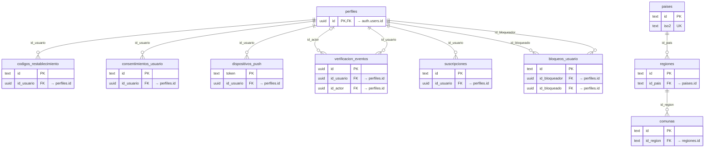
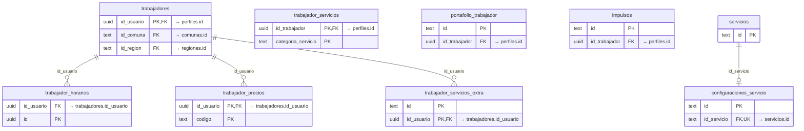
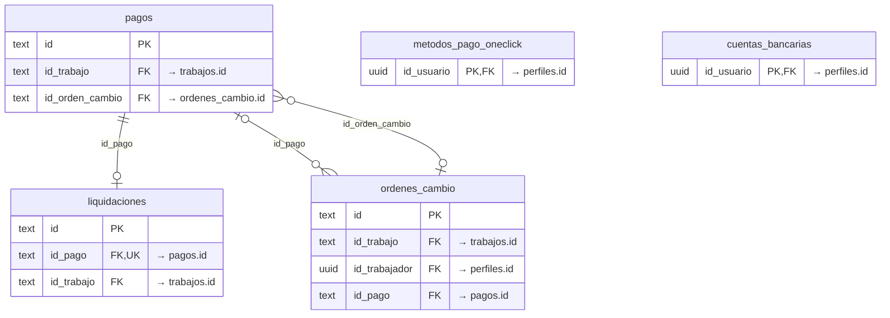
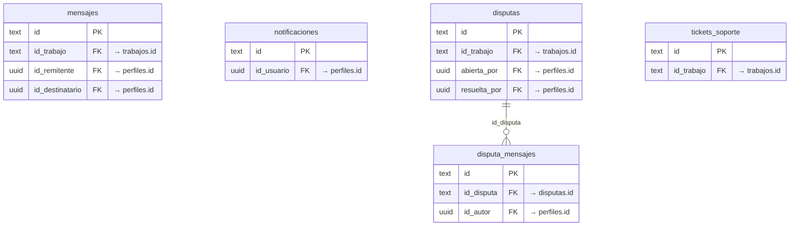
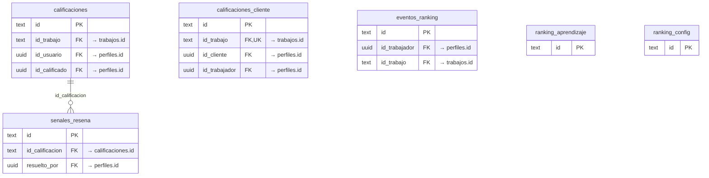

# Modelo de datos de MyWorksApp

> **Total: 53 tablas** en el esquema `public` de la base de datos (PostgreSQL en Supabase), con 449 columnas, 53 claves primarias y 79 claves foráneas (78 entre tablas de `public` y 1 hacia `auth.users`).

## 1. De dónde sale el número

| Fuente | Resultado |
|---|---|
| **Base de datos viva** (proyecto Supabase `wxqrfcqifkfgawrnqmnj`, lectura con `list_tables` y consultas al catálogo, **17-11-2026**, hora de Chile; última migración aplicada `20261116051054`) | **53 tablas** en `public`, todas tablas base (no hay vistas ni tipos ENUM) |
| **Migraciones del repositorio** (`myworksapp_app/supabase/migrations/`, reproducidas en orden con los cambios de nombre y los borrados) | 52 de las 53 tablas coinciden con la base viva. La tabla 53, `encuestas_testing`, está aplicada en la base con la migración `20261116051054_encuestas_testing.sql`, cuyo archivo se agrega al repositorio en paralelo a este documento. Además, la migración inicial (`20250907120000_schema_baseline_documented.sql`) declara la tabla histórica `service_pricing`, que no existe en la base viva y no usa la aplicación; por eso no se cuenta. |

El conteo de la base viva es el que vale: **53 tablas**. Las tablas de otros esquemas no forman parte del modelo de la aplicación y no se cuentan:

- `auth` (usuarios y sesiones), `storage` (archivos), `realtime` y `vault`: esquemas internos de Supabase. La única relación que llega hasta ellos es `perfiles.id` → `auth.users.id` (borrado en cascada): cada perfil es la ficha de una cuenta de Supabase Auth.
- Los esquemas `backup_20261115`, `backup_20261115b` y `backup_20261115c` (26 tablas) son copias de respaldo hechas durante la auditoría del 15-11-2026; no son parte del modelo.

## 2. Resumen por grupo

| N.º | Grupo | Tablas |
|---|---|---|
| 1 | Usuarios, autenticación y territorio | 10 |
| 2 | Profesionales, servicios y precios | 9 |
| 3 | Trabajos, reservas, reprogramación y PIN | 10 |
| 4 | Pagos (Transbank), liquidaciones y cuentas bancarias | 5 |
| 5 | Comunicación, notificaciones, disputas y soporte | 5 |
| 6 | Calificaciones, comentarios y ranking | 6 |
| 7 | Administración, moderación y auditoría | 8 |
| | **Total** | **53** |

Cada tabla pertenece a un solo grupo y los grupos suman 53. Para ubicar un tema rápido:

| Tema | Tablas | Grupo |
|---|---|---|
| Usuarios y perfiles | `perfiles`, `trabajadores`, `suscripciones` | 1 y 2 |
| Geolocalización | `paises`, `regiones`, `comunas` (territorio); `trabajadores.latitud_base/longitud_base` (base de atención); `trabajos.latitud/longitud`; `ubicacion_en_vivo` (GPS durante el trabajo) | 1, 2 y 3 |
| Reservas y trabajos | `trabajos`, `propuestas_cotizacion`, `reprogramaciones_trabajo`, `pines_inicio_trabajo` | 3 |
| Pagos con Transbank | `pagos`, `ordenes_cambio`, `liquidaciones`, `metodos_pago_oneclick`, `cuentas_bancarias` | 4 |
| Comentarios y calificaciones | `calificaciones`, `calificaciones_cliente`, `senales_resena`, `mensajes` (chat) | 6 y 5 |
| Notificaciones | `notificaciones`, `dispositivos_push` | 5 y 1 |
| Catálogos | `servicios`, `configuraciones_servicio`, `paises`, `regiones`, `comunas` | 2 y 1 |
| Administración y auditoría | `reportes`, `eventos_abuso`, `registros_error_app`, `eventos_analitica`, `banderas_funcionalidad`, `app_config` | 7 |

## 3. Notación de los diagramas

- `PK` clave primaria, `FK` clave foránea (el comentario indica a qué tabla y columna apunta), `UK` valor único.
- `||--o{` significa «uno a muchos»: una fila de la tabla de la izquierda se relaciona con cero o más filas de la derecha. `||--o|` es «uno a uno» (la relación opcional del lado derecho) y `|o--o{` indica que la clave foránea admite vacío (la relación es opcional).
- En cada grupo solo se dibujan las **columnas clave** (PK, FK y UK). Las claves foráneas que apuntan a tablas de otro grupo aparecen como columna `FK` y se listan debajo del diagrama.
- Las columnas completas de cada tabla están en [`DICCIONARIO_BASE_DATOS.md`](DICCIONARIO_BASE_DATOS.md) y las figuras de alta resolución en [`Fase 2/modelo_entidad_relacion/`](../../Fase%202/modelo_entidad_relacion/LEEME.txt).

## 4. Grupos

### Grupo 1. Usuarios, autenticación y territorio (10 tablas)

| Tabla | Qué guarda |
|---|---|
| `perfiles` | Cuenta de cada persona (cliente, profesional, administrador, soporte o QA); su id es el mismo de Supabase Auth. |
| `codigos_restablecimiento` | Códigos temporales para restablecer la contraseña de un usuario. |
| `consentimientos_usuario` | Versión de los términos que aceptó cada usuario, con fecha y dispositivo. |
| `dispositivos_push` | Dispositivos de cada usuario a los que se envían avisos push. |
| `verificacion_eventos` | Historial de cambios del estado de verificación de un profesional. |
| `suscripciones` | Plan de suscripción que contrató un usuario, con su estado y vigencia. |
| `bloqueos_usuario` | Pares de usuarios en que uno bloqueó al otro. |
| `paises` | Países en que opera la plataforma (hoy solo Chile). |
| `regiones` | Regiones de cada país. |
| `comunas` | Comunas de cobertura, con su centro geográfico (latitud y longitud). |

Claves foráneas hacia otros grupos:

- `perfiles.id` → `auth.users.id` (esquema `auth` de Supabase, fuera de `public`).

### Grupo 2. Profesionales, servicios y precios (9 tablas)

| Tabla | Qué guarda |
|---|---|
| `trabajadores` | Ficha del profesional: oficio, descripción, verificación, base de atención (ubicación y radio) y datos del ranking. |
| `trabajador_precios` | Precio en pesos que el profesional cobra por cada código de servicio. |
| `trabajador_servicios` | Oficios del catálogo que el profesional declara atender. |
| `trabajador_servicios_extra` | Servicios adicionales con precio propio que define el profesional. |
| `trabajador_horarios` | Disponibilidad semanal del profesional (hora de inicio y de término por día). |
| `portafolio_trabajador` | Fotos o videos del portafolio de cada profesional. |
| `impulsos` | Promociones temporales que dan más visibilidad a un profesional. |
| `servicios` | Catálogo de servicios que ofrece la plataforma, con categoría y modelo de precio. |
| `configuraciones_servicio` | Formulario de preguntas asociado a cada servicio. |

Claves foráneas hacia otros grupos:

- `impulsos.id_trabajador` → `perfiles` (grupo 1).
- `portafolio_trabajador.id_trabajador` → `perfiles` (grupo 1).
- `trabajador_servicios.id_trabajador` → `perfiles` (grupo 1).
- `trabajadores.id_comuna` → `comunas` (grupo 1).
- `trabajadores.id_region` → `regiones` (grupo 1).
- `trabajadores.id_usuario` → `perfiles` (grupo 1).

### Grupo 3. Trabajos, reservas, reprogramación y PIN (10 tablas)

```mermaid
erDiagram
  trabajos {
    text id PK
    uuid id_usuario FK "→ perfiles.id"
    uuid id_trabajador FK "→ perfiles.id"
    text id_servicio FK "→ servicios.id"
    text id_comuna FK "→ comunas.id"
    text id_cotizacion_seleccionada FK "→ propuestas_cotizacion.id"
  }
  propuestas_cotizacion {
    text id PK
    text id_trabajo FK "→ trabajos.id"
    uuid id_trabajador FK "→ perfiles.id"
  }
  acuerdos_trabajo {
    text id PK
    text id_trabajo FK "→ trabajos.id"
    uuid propuesto_por FK "→ perfiles.id"
  }
  cancelaciones_trabajo {
    text id PK
    text id_trabajo FK, UK "→ trabajos.id"
    uuid cancelado_por FK "→ perfiles.id"
  }
  reprogramaciones_trabajo {
    uuid id PK
    text id_trabajo FK "→ trabajos.id"
    uuid propuesta_por FK "→ perfiles.id"
    uuid respondida_por FK "→ perfiles.id"
  }
  pines_inicio_trabajo {
    text id_trabajo PK, FK "→ trabajos.id"
  }
  bloqueos_pin_inicio {
    text id_trabajo PK, FK "→ trabajos.id"
  }
  intentos_pin_inicio {
    int8 id PK
    text id_trabajo FK "→ trabajos.id"
    uuid id_usuario FK "→ perfiles.id"
  }
  fotos_trabajo {
    text id PK
    text id_trabajo FK "→ trabajos.id"
  }
  ubicacion_en_vivo {
    text id_trabajo PK, FK "→ trabajos.id"
    uuid id_trabajador FK "→ trabajadores.id_usuario"
  }
  trabajos ||--o{ acuerdos_trabajo : "id_trabajo"
  trabajos ||--o| bloqueos_pin_inicio : "id_trabajo"
  trabajos ||--o| cancelaciones_trabajo : "id_trabajo"
  trabajos ||--o{ fotos_trabajo : "id_trabajo"
  trabajos ||--o{ intentos_pin_inicio : "id_trabajo"
  trabajos ||--o| pines_inicio_trabajo : "id_trabajo"
  trabajos ||--o{ propuestas_cotizacion : "id_trabajo"
  trabajos ||--o{ reprogramaciones_trabajo : "id_trabajo"
  propuestas_cotizacion |o--o{ trabajos : "id_cotizacion_seleccionada"
  trabajos ||--o| ubicacion_en_vivo : "id_trabajo"
```

| Tabla | Qué guarda |
|---|---|
| `trabajos` | Pedido de un cliente a un profesional: dirección, ubicación, fecha, estado y modalidad de cobro. |
| `propuestas_cotizacion` | Cotizaciones que los profesionales envían para un trabajo. |
| `acuerdos_trabajo` | Acuerdos entre cliente y profesional para rehacer, aceptar o anular un trabajo. |
| `cancelaciones_trabajo` | Cancelación de un trabajo: quién la pidió y por qué motivo. |
| `reprogramaciones_trabajo` | Propuestas para cambiar la fecha de un trabajo y la respuesta a cada una. |
| `pines_inicio_trabajo` | PIN que el cliente entrega al profesional para iniciar el trabajo. |
| `bloqueos_pin_inicio` | Contador de fallos del PIN y bloqueo temporal por trabajo. |
| `intentos_pin_inicio` | Registro de cada intento de ingresar el PIN y su resultado. |
| `fotos_trabajo` | Fotos o videos de evidencia de un trabajo. |
| `ubicacion_en_vivo` | Última ubicación GPS del profesional mientras realiza un trabajo. |

Claves foráneas hacia otros grupos:

- `acuerdos_trabajo.propuesto_por` → `perfiles` (grupo 1).
- `cancelaciones_trabajo.cancelado_por` → `perfiles` (grupo 1).
- `intentos_pin_inicio.id_usuario` → `perfiles` (grupo 1).
- `propuestas_cotizacion.id_trabajador` → `perfiles` (grupo 1).
- `reprogramaciones_trabajo.propuesta_por` → `perfiles` (grupo 1).
- `reprogramaciones_trabajo.respondida_por` → `perfiles` (grupo 1).
- `trabajos.id_servicio` → `servicios` (grupo 2).
- `trabajos.id_usuario` → `perfiles` (grupo 1).
- `trabajos.id_trabajador` → `perfiles` (grupo 1).
- `trabajos.id_comuna` → `comunas` (grupo 1).
- `ubicacion_en_vivo.id_trabajador` → `trabajadores` (grupo 2).

### Grupo 4. Pagos (Transbank), liquidaciones y cuentas bancarias (5 tablas)

| Tabla | Qué guarda |
|---|---|
| `pagos` | Cobro de un trabajo o de una orden de cambio con retención (escrow) en Transbank Webpay u Oneclick. |
| `ordenes_cambio` | Cambios de alcance o de precio que el profesional propone durante un trabajo. |
| `liquidaciones` | Transferencia que paga al profesional el dinero de un pago ya liberado. |
| `metodos_pago_oneclick` | Tarjeta inscrita en Transbank Oneclick de cada usuario. |
| `cuentas_bancarias` | Cuenta bancaria del profesional donde se le transfiere lo que gana. |

Claves foráneas hacia otros grupos:

- `cuentas_bancarias.id_usuario` → `perfiles` (grupo 1).
- `liquidaciones.id_trabajo` → `trabajos` (grupo 3).
- `metodos_pago_oneclick.id_usuario` → `perfiles` (grupo 1).
- `ordenes_cambio.id_trabajo` → `trabajos` (grupo 3).
- `ordenes_cambio.id_trabajador` → `perfiles` (grupo 1).
- `pagos.id_trabajo` → `trabajos` (grupo 3).

### Grupo 5. Comunicación, notificaciones, disputas y soporte (5 tablas)

| Tabla | Qué guarda |
|---|---|
| `mensajes` | Mensajes de texto o imagen del chat de cada trabajo. |
| `notificaciones` | Avisos dentro de la aplicación dirigidos a un usuario. |
| `disputas` | Disputa abierta sobre un trabajo, con su resolución. |
| `disputa_mensajes` | Mensajes del hilo de una disputa, de las partes o de soporte. |
| `tickets_soporte` | Casos de soporte asociados a un trabajo. |

Claves foráneas hacia otros grupos:

- `disputa_mensajes.id_autor` → `perfiles` (grupo 1).
- `disputas.abierta_por` → `perfiles` (grupo 1).
- `disputas.resuelta_por` → `perfiles` (grupo 1).
- `disputas.id_trabajo` → `trabajos` (grupo 3).
- `mensajes.id_destinatario` → `perfiles` (grupo 1).
- `mensajes.id_remitente` → `perfiles` (grupo 1).
- `mensajes.id_trabajo` → `trabajos` (grupo 3).
- `notificaciones.id_usuario` → `perfiles` (grupo 1).
- `tickets_soporte.id_trabajo` → `trabajos` (grupo 3).

### Grupo 6. Calificaciones, comentarios y ranking (6 tablas)

| Tabla | Qué guarda |
|---|---|
| `calificaciones` | Nota y comentario de un trabajo (del cliente al profesional o al revés). |
| `calificaciones_cliente` | Nota y comentario del profesional hacia el cliente de un trabajo. |
| `senales_resena` | Señales de reseñas dudosas detectadas automáticamente. |
| `eventos_ranking` | Eventos que alimentan el puntaje de ranking de un profesional. |
| `ranking_aprendizaje` | Historial de los ajustes de los pesos del ranking. |
| `ranking_config` | Pesos y umbrales con que se calcula el ranking (una sola fila). |

Claves foráneas hacia otros grupos:

- `calificaciones_cliente.id_cliente` → `perfiles` (grupo 1).
- `calificaciones_cliente.id_trabajador` → `perfiles` (grupo 1).
- `calificaciones_cliente.id_trabajo` → `trabajos` (grupo 3).
- `calificaciones.id_calificado` → `perfiles` (grupo 1).
- `calificaciones.id_usuario` → `perfiles` (grupo 1).
- `calificaciones.id_trabajo` → `trabajos` (grupo 3).
- `eventos_ranking.id_trabajador` → `perfiles` (grupo 1).
- `eventos_ranking.id_trabajo` → `trabajos` (grupo 3).
- `senales_resena.resuelto_por` → `perfiles` (grupo 1).

### Grupo 7. Administración, moderación y auditoría (8 tablas)

```mermaid
erDiagram
  acciones_pendientes {
    text id PK
    uuid id_usuario FK "→ perfiles.id"
  }
  reportes {
    text id PK
    uuid id_reportante FK "→ perfiles.id"
    uuid id_usuario_reportado FK "→ perfiles.id"
  }
  eventos_abuso {
    text id PK
    uuid id_usuario FK "→ perfiles.id"
  }
  registros_error_app {
    text id PK
    uuid id_usuario FK "→ perfiles.id"
  }
  eventos_analitica {
    text id PK
    uuid id_usuario FK "→ perfiles.id"
  }
  banderas_funcionalidad {
    text id PK
    uuid id_usuario FK "→ perfiles.id"
  }
  app_config {
    text clave PK
  }
  encuestas_testing {
    uuid id PK
    uuid id_usuario FK "→ perfiles.id"
  }
```

| Tabla | Qué guarda |
|---|---|
| `acciones_pendientes` | Acciones hechas sin conexión que esperan sincronizarse. |
| `reportes` | Denuncias de un usuario contra otro. |
| `eventos_abuso` | Detecciones de abuso y la acción que se tomó. |
| `registros_error_app` | Errores de la aplicación informados por los clientes. |
| `eventos_analitica` | Eventos de uso de la aplicación. |
| `banderas_funcionalidad` | Interruptores para activar funciones por versión, rol o usuario. |
| `app_config` | Configuración general en pares clave y valor (solo la lee el backend). |
| `encuestas_testing` | Respuestas de la encuesta de usabilidad (SUS) de quienes prueban la app. |

Claves foráneas hacia otros grupos:

- `acciones_pendientes.id_usuario` → `perfiles` (grupo 1).
- `banderas_funcionalidad.id_usuario` → `perfiles` (grupo 1).
- `encuestas_testing.id_usuario` → `perfiles` (grupo 1).
- `eventos_abuso.id_usuario` → `perfiles` (grupo 1).
- `eventos_analitica.id_usuario` → `perfiles` (grupo 1).
- `registros_error_app.id_usuario` → `perfiles` (grupo 1).
- `reportes.id_reportante` → `perfiles` (grupo 1).
- `reportes.id_usuario_reportado` → `perfiles` (grupo 1).

## 5. Diagrama completo (53 tablas)

Muestra las 53 tablas y las 78 claves foráneas entre ellas (sin columnas, para que se lea). La relación `perfiles` → `auth.users` queda fuera porque `auth.users` pertenece a Supabase. Cada línea indica la columna que guarda la clave foránea.

```mermaid
erDiagram
  perfiles ||--o{ acciones_pendientes : "id_usuario"
  trabajos ||--o{ acuerdos_trabajo : "id_trabajo"
  perfiles ||--o{ acuerdos_trabajo : "propuesto_por"
  perfiles |o--o{ banderas_funcionalidad : "id_usuario"
  trabajos ||--o| bloqueos_pin_inicio : "id_trabajo"
  perfiles ||--o{ bloqueos_usuario : "id_bloqueado"
  perfiles ||--o{ bloqueos_usuario : "id_bloqueador"
  perfiles ||--o{ calificaciones_cliente : "id_cliente"
  perfiles ||--o{ calificaciones_cliente : "id_trabajador"
  trabajos ||--o| calificaciones_cliente : "id_trabajo"
  perfiles ||--o{ calificaciones : "id_calificado"
  perfiles |o--o{ calificaciones : "id_usuario"
  trabajos ||--o{ calificaciones : "id_trabajo"
  perfiles ||--o{ cancelaciones_trabajo : "cancelado_por"
  trabajos ||--o| cancelaciones_trabajo : "id_trabajo"
  perfiles ||--o{ codigos_restablecimiento : "id_usuario"
  regiones ||--o{ comunas : "id_region"
  servicios ||--o| configuraciones_servicio : "id_servicio"
  perfiles ||--o{ consentimientos_usuario : "id_usuario"
  perfiles ||--o| cuentas_bancarias : "id_usuario"
  perfiles ||--o{ dispositivos_push : "id_usuario"
  perfiles |o--o{ disputa_mensajes : "id_autor"
  disputas ||--o{ disputa_mensajes : "id_disputa"
  perfiles ||--o{ disputas : "abierta_por"
  perfiles |o--o{ disputas : "resuelta_por"
  trabajos ||--o{ disputas : "id_trabajo"
  perfiles |o--o{ encuestas_testing : "id_usuario"
  perfiles ||--o{ eventos_abuso : "id_usuario"
  perfiles |o--o{ eventos_analitica : "id_usuario"
  perfiles ||--o{ eventos_ranking : "id_trabajador"
  trabajos |o--o{ eventos_ranking : "id_trabajo"
  trabajos ||--o{ fotos_trabajo : "id_trabajo"
  perfiles ||--o{ impulsos : "id_trabajador"
  trabajos ||--o{ intentos_pin_inicio : "id_trabajo"
  perfiles |o--o{ intentos_pin_inicio : "id_usuario"
  pagos ||--o| liquidaciones : "id_pago"
  trabajos ||--o{ liquidaciones : "id_trabajo"
  perfiles ||--o{ mensajes : "id_destinatario"
  perfiles ||--o{ mensajes : "id_remitente"
  trabajos ||--o{ mensajes : "id_trabajo"
  perfiles ||--o| metodos_pago_oneclick : "id_usuario"
  perfiles ||--o{ notificaciones : "id_usuario"
  trabajos ||--o{ ordenes_cambio : "id_trabajo"
  pagos |o--o{ ordenes_cambio : "id_pago"
  perfiles ||--o{ ordenes_cambio : "id_trabajador"
  ordenes_cambio |o--o{ pagos : "id_orden_cambio"
  trabajos ||--o{ pagos : "id_trabajo"
  trabajos ||--o| pines_inicio_trabajo : "id_trabajo"
  perfiles ||--o{ portafolio_trabajador : "id_trabajador"
  trabajos ||--o{ propuestas_cotizacion : "id_trabajo"
  perfiles ||--o{ propuestas_cotizacion : "id_trabajador"
  paises ||--o{ regiones : "id_pais"
  perfiles |o--o{ registros_error_app : "id_usuario"
  perfiles ||--o{ reportes : "id_reportante"
  perfiles ||--o{ reportes : "id_usuario_reportado"
  perfiles ||--o{ reprogramaciones_trabajo : "propuesta_por"
  perfiles |o--o{ reprogramaciones_trabajo : "respondida_por"
  trabajos ||--o{ reprogramaciones_trabajo : "id_trabajo"
  calificaciones ||--o{ senales_resena : "id_calificacion"
  perfiles |o--o{ senales_resena : "resuelto_por"
  perfiles ||--o{ suscripciones : "id_usuario"
  trabajos |o--o{ tickets_soporte : "id_trabajo"
  trabajadores ||--o{ trabajador_horarios : "id_usuario"
  trabajadores ||--o{ trabajador_precios : "id_usuario"
  trabajadores ||--o{ trabajador_servicios_extra : "id_usuario"
  perfiles ||--o{ trabajador_servicios : "id_trabajador"
  comunas |o--o{ trabajadores : "id_comuna"
  regiones |o--o{ trabajadores : "id_region"
  perfiles ||--o| trabajadores : "id_usuario"
  servicios |o--o{ trabajos : "id_servicio"
  perfiles ||--o{ trabajos : "id_usuario"
  perfiles |o--o{ trabajos : "id_trabajador"
  comunas |o--o{ trabajos : "id_comuna"
  propuestas_cotizacion |o--o{ trabajos : "id_cotizacion_seleccionada"
  trabajos ||--o| ubicacion_en_vivo : "id_trabajo"
  trabajadores ||--o{ ubicacion_en_vivo : "id_trabajador"
  perfiles |o--o{ verificacion_eventos : "id_actor"
  perfiles ||--o{ verificacion_eventos : "id_usuario"
  ranking_aprendizaje
  ranking_config
  app_config
```

## 6. Relaciones lógicas sin clave foránea

Algunas columnas guardan el identificador de otra tabla pero no tienen `FOREIGN KEY` en la base, porque apuntan a más de una tabla o guardan texto:

| Columna | Apunta a |
|---|---|
| `liquidaciones.id_trabajador` | `perfiles.id` |
| `liquidaciones.id_operador` | `perfiles.id` (administrador que confirmó la transferencia) |
| `metodos_pago_oneclick.id_trabajo_pendiente` | `trabajos.id` |
| `bloqueos_pin_inicio.pin_ok_usuario` | `perfiles.id` |
| `trabajos.id_trabajador` + `id_sku_servicio` | `trabajador_precios.id_usuario` + `codigo` |
| `trabajador_servicios.categoria_servicio` | `servicios.categoria` |
| `notificaciones.id_relacionado` | trabajo, pago, disputa u otro objeto, según `tipo` |
| `acciones_pendientes.id_entidad` | la entidad indicada en `tipo_entidad` |

## 7. Cómo se verificó

1. `list_tables` sobre todos los esquemas del proyecto: `public` tiene 53 tablas.
2. Consultas de solo lectura al catálogo de PostgreSQL (`information_schema.columns`, `pg_constraint`, `pg_indexes`): 449 columnas, 53 claves primarias y 79 claves foráneas.
3. Reproducción de las migraciones del repositorio y comparación de los nombres de tabla con la base viva.
4. Comprobación automática de este documento: las 53 tablas aparecen en un solo grupo, los grupos suman 53 y las 78 claves foráneas internas están en el diagrama completo.
