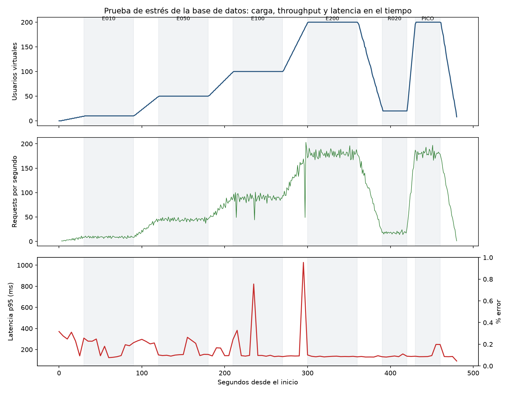
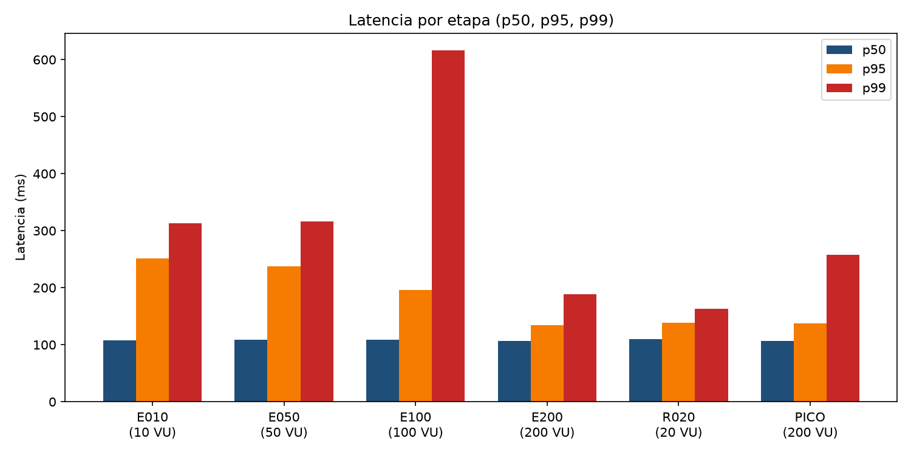
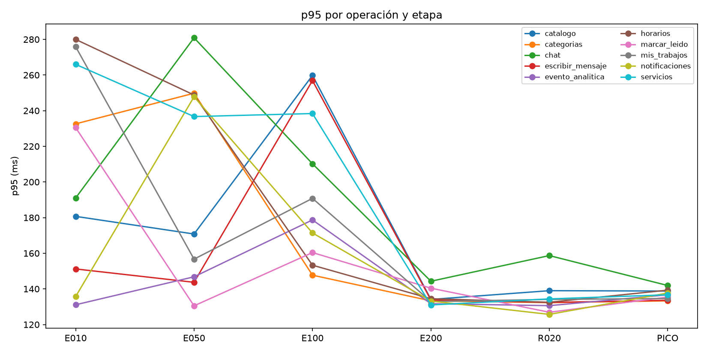
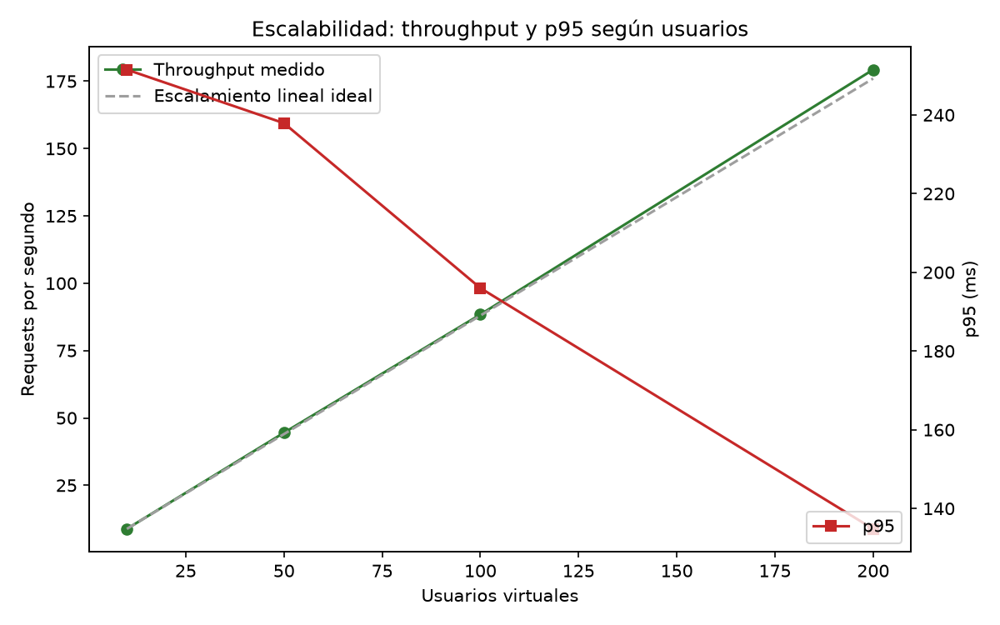

# Prueba de estrés de la base de datos

**Proyecto:** My Works App · **Base:** Supabase `wxqrfcqifkfgawrnqmnj` (plan gratuito, us-west-2) a través de su API real (PostgREST y RPC)
**Fecha:** 16 de noviembre de 2026, de 01:37:31 a 01:45:33 (hora de Chile, UTC−3). Duración: 8 minutos.
**Herramienta:** k6 1.4.2 desde el computador de pruebas (Linux, fuera de Chile)
**Parte 3 de 4** de la auditoría de base de datos.

## 1. Objetivo

Saber cómo responde la base cuando muchos usuarios la usan al mismo tiempo: si la latencia se mantiene, cuántas solicitudes por segundo atiende, si aparecen errores y cómo se recupera después de un pico brusco.

La prueba de carga anterior (`prueba_carga_rendimiento.md`) midió la web completa. Esta mide solo la base de datos: cada solicitud va directo a la API de Supabase, sin pasar por la web.

## 2. Método

### 2.1 Mezcla de operaciones

Cada usuario virtual repite una operación elegida al azar con esta distribución, que imita el uso real (la mayoría mira el catálogo, menos personas escriben), y espera entre 0,5 y 1,5 segundos antes de la siguiente:

| Operación | Peso | Quién | Tipo |
|-----------|------|-------|------|
| Catálogo por oficio (RPC `listar_profesionales_catalogo`) | 25 % | anónimo | lectura |
| Oficios con profesionales (RPC `categorias_con_disponibles`) | 10 % | anónimo | lectura |
| Horas libres de un profesional, 14 días (RPC `horarios_libres_profesional`) | 15 % | anónimo | lectura |
| Lista de servicios | 10 % | anónimo | lectura |
| Mis pedidos / mi agenda (con RLS) | 12 % | cliente o profesional | lectura |
| Notificaciones (con RLS) | 8 % | usuario con sesión | lectura |
| Chat de un trabajo (con RLS) | 10 % | cliente o profesional del trabajo | lectura |
| Enviar un mensaje | 5 % | cliente o profesional del trabajo | escritura |
| Registrar un evento de analítica | 3 % | usuario con sesión | escritura |
| Marcar un mensaje como leído | 2 % | cliente | actualización |

Las operaciones con sesión usaron los seis usuarios temporales `qa.audit.*` (tokens obtenidos al inicio). **Todas las escrituras fueron sobre datos de prueba** (`id` con prefijo `qa-audit-stress-` en el trabajo `qa-audit-job-1`) y se borraron al final (sección 7).

### 2.2 Escalones de carga

| Tramo | Usuarios virtuales | Duración medida |
|-------|--------------------|-----------------|
| Subida | 0 → 10 | 30 s |
| **E010** | 10 | 60 s |
| **E050** | 50 | 60 s |
| **E100** | 100 | 60 s |
| **E200** | 200 | 60 s |
| **R020** (recuperación) | 20 | 30 s |
| **PICO** | 20 → 200 en 10 s, y 30 s sostenido | 30 s |
| Bajada | 200 → 0 | 20 s |

Entre escalones hay 30 s de subida que no se miden. Cada solicitud lleva la etiqueta de su etapa, así que las métricas de cada escalón salen solo de sus segundos estables.

Como la base es compartida (plan gratuito) y en paralelo corría una prueba E2E del equipo sobre el mismo proyecto, el máximo se fijó en 200 usuarios con pausas entre operaciones (unas 180 solicitudes por segundo), en vez de buscar el punto de quiebre a cualquier costo.

### 2.3 Qué cuenta como error

Una solicitud es un error si responde un código distinto del esperado (200 para lecturas, 201 al crear, 204 al actualizar) o si no responde. Un 401/403 inesperado, un 429 (límite de solicitudes), un 500 o un tiempo agotado cuentan como error.

### 2.4 Umbrales de aceptación

Para cada etapa: p95 menor a 3 segundos (el `statement_timeout` de `anon`) y tasa de error menor a 5 %.

### 2.5 Doble verificación

Las cifras salen de dos fuentes independientes: el resumen oficial de k6 (`resumen_k6.json`) y el análisis propio de las 38.038 solicitudes una a una (`series_k6.csv`, con pandas). Los p95 por etapa coinciden exactamente (diferencia 0,0 ms en las seis), y el total difiere en 8 solicitudes, que son los inicios de sesión de la preparación.

## 3. Resultados

### 3.1 Totales

| Métrica | Valor |
|---------|-------|
| Solicitudes | 38.046 |
| Errores | **0** (0,00 %) |
| Verificaciones de respuesta | 38.038 de 38.038 correctas |
| Códigos HTTP | 34.252 × 200, 2.985 × 201, 801 × 204 |
| Latencia total: mediana / p95 / p99 / máx. | 107,7 / 145,4 / 323,0 / 1.302,7 ms |
| Latencia mínima | 80,8 ms |
| Datos recibidos | 127 MB |

### 3.2 Por etapa

| Etapa | Usuarios | Solicitudes | Solicitudes/s | Mediana | p95 | p99 | Máx. | Errores |
|-------|----------|-------------|---------------|---------|-----|-----|------|---------|
| E010 | 10 | 530 | 8,8 | 107,5 ms | 251,5 ms | 313,4 ms | 435,8 ms | 0 |
| E050 | 50 | 2.672 | 44,5 | 108,5 ms | 237,9 ms | 315,8 ms | 450,5 ms | 0 |
| E100 | 100 | 5.305 | 88,4 | 109,2 ms | 196,0 ms | 615,8 ms | 1.302,7 ms | 0 |
| E200 | 200 | 10.757 | 179,3 | 106,7 ms | 134,8 ms | 188,5 ms | 424,5 ms | 0 |
| R020 | 20 | 538 | 17,9 | 110,0 ms | 138,1 ms | 163,1 ms | 220,1 ms | 0 |
| PICO | 200 | 5.422 | 180,7 | 106,9 ms | 138,0 ms | 257,2 ms | 422,1 ms | 0 |

Todas las etapas cumplen los umbrales con amplio margen: el peor p95 (251,5 ms) es 12 veces menor que el límite de 3 s.

### 3.3 Por operación (p95 en ms)

| Operación | E010 | E050 | E100 | E200 | R020 | PICO |
|-----------|------|------|------|------|------|------|
| catálogo | 180,7 | 170,8 | 259,8 | 134,1 | 139,0 | 138,8 |
| oficios | 232,6 | 249,8 | 147,7 | 133,3 | 132,3 | 133,3 |
| horas libres | 280,0 | 248,8 | 153,3 | 134,5 | 132,5 | 139,3 |
| servicios | 266,0 | 236,7 | 238,4 | 131,0 | 134,4 | 136,7 |
| mis pedidos | 275,9 | 156,7 | 190,8 | 132,9 | 134,1 | 134,6 |
| notificaciones | 135,7 | 247,8 | 171,4 | 133,2 | 125,7 | 137,7 |
| chat | 191,0 | 280,9 | 210,2 | 144,3 | 158,7 | 141,9 |
| enviar mensaje | 151,2 | 143,7 | 256,9 | 133,8 | 132,4 | 133,6 |
| evento analítica | 131,1 | 146,8 | 178,7 | 131,7 | 130,6 | 136,7 |
| marcar leído | 230,5 | 130,5 | 160,4 | 140,4 | 126,9 | 135,4 |

## 4. Análisis

### 4.1 La base escala linealmente hasta 200 usuarios

El throughput crece en proporción directa a los usuarios: 8,8 → 44,5 → 88,4 → 179,3 solicitudes por segundo para 10, 50, 100 y 200 usuarios. Es decir, 0,88–0,90 solicitudes por segundo por usuario en todos los escalones, que es exactamente lo que permite la pausa de 0,5–1,5 s entre operaciones. Si la base se estuviera saturando, el throughput dejaría de crecer y la latencia subiría; no pasó ninguna de las dos cosas.

### 4.2 La latencia es casi toda red

La mediana se mantuvo entre 106,7 y 110,0 ms en todas las etapas, y la solicitud más rápida tardó 80,8 ms. Ese piso es el viaje de ida y vuelta entre el computador de pruebas y la región del proyecto (us-west-2, Oregón). Dentro de Postgres estas consultas tardan entre 0,06 y 1,4 ms (ver el documento de rendimiento, `pg_stat_statements`): menos del 2 % del tiempo total.

### 4.3 Más carga, mejor p95

El p95 fue más alto con 10 usuarios (251,5 ms) que con 200 (134,8 ms). No es un error de medición: con poca carga las conexiones quedan inactivas entre solicitudes y algunas pagan de nuevo el costo de reabrirse (en Cloudflare y en el pool de conexiones de Supabase); con carga alta, las conexiones HTTP/2 y del pool se mantienen abiertas y todas las solicitudes van por un camino "caliente". En la recuperación (R020) el p95 quedó en 138 ms, porque el sistema venía caliente del escalón anterior.

### 4.4 Dos pausas breves, sin errores

El gráfico de línea de tiempo muestra dos momentos (a los 237 y a los 298 segundos) en los que el throughput cae durante un segundo y la latencia de ese segundo sube a cerca de 1 s (el máximo absoluto, 1.302,7 ms, ocurrió en el primero). En ambos casos todas las operaciones se demoraron juntas, de lectura y de escritura, y al segundo siguiente todo volvió a ~110 ms. Ese patrón (todo a la vez, un instante, sin errores) corresponde a una pausa de la red o del gateway, no a una saturación de la base, que se vería como un aumento progresivo. Ninguna solicitud falló.

### 4.5 El pico se absorbió sin degradación

Pasar de 20 a 200 usuarios en 10 segundos no produjo errores ni colas: el p95 del pico (138,0 ms) es igual al de 200 usuarios sostenidos (134,8 ms).

### 4.6 Conexiones y memoria durante el pico

Una consulta a `pg_stat_activity` tomada con 200 usuarios activos (01:42:14) mostró 31 conexiones abiertas de 60 permitidas, solo 4 ejecutando algo en ese instante, 11 del pool de PostgREST, 0 esperando bloqueos y 100 % de acierto de caché. PostgREST reutiliza un pool pequeño, así que 200 usuarios no significan 200 conexiones.

### 4.7 Límite encontrado

**No se alcanzó el límite** a 200 usuarios simultáneos (unas 180 solicitudes por segundo): 0 errores, latencia estable, la mitad de las conexiones libres. El límite práctico de este plan está más arriba, y lo más probable es que lo marquen primero los topes del plan gratuito (cantidad de solicitudes del gateway, CPU compartida) y no las consultas, que tardan menos de 2 ms. No se buscó el punto de quiebre para no afectar la prueba E2E que corría en paralelo ni el proyecto compartido.

## 5. Conclusiones

1. Con 200 usuarios simultáneos y una mezcla realista de lecturas y escrituras, la base respondió 38.046 solicitudes sin un solo error.
2. El throughput creció linealmente con los usuarios y la latencia no se degradó; el p95 se mantuvo entre 135 y 252 ms en todas las etapas, muy lejos del límite de 3 s.
3. El tiempo de respuesta está dominado por la red (unos 105 ms); el trabajo de la base es menos del 2 %. Para usuarios en Chile, la mejora más grande sería un proyecto en una región más cercana (por ejemplo `sa-east-1`, São Paulo).
4. Las correcciones de la auditoría de rendimiento (índices y RLS) no se notan aún con estos volúmenes, pero evitan que la latencia crezca cuando crezcan los datos.

## 6. Limitaciones

- El computador de pruebas no está en Chile; desde Chile la latencia de red hacia us-west-2 sería distinta (probablemente mayor).
- La carga no pasa por la web (Vercel) ni por las Edge Functions; eso lo cubrió la prueba de carga anterior.
- Las escrituras usan un solo trabajo de prueba; no reproducen bloqueos entre muchos trabajos distintos.
- La prueba E2E del equipo corrió al mismo tiempo, lo que suma algo de carga real a la medición (más realista, pero no aislada).

## 7. Limpieza y verificación de datos

Al terminar se borraron, filtrando solo por los ids de los usuarios `qa.audit.*` y el prefijo `qa-audit-`:

| Tabla | Filas borradas |
|-------|----------------|
| mensajes | 1.847 (1.845 de estrés + 2 de seguridad) |
| eventos_analitica | 1.155 |
| trabajos, pagos, pines_inicio_trabajo | 1 cada una |
| trabajadores, trabajador_horarios, trabajador_servicios, verificacion_eventos | 2 cada una |
| trabajador_servicios_extra | 1 |
| perfiles, auth.identities, auth.users | 6 cada una |

Después quedaron 0 usuarios y 0 filas de prueba. Las tablas que tocaron las pruebas volvieron a su conteo inicial (por ejemplo `mensajes` 8, `eventos_analitica` 0, `trabajadores` 64). Las diferencias con la línea base de las 01:10 (+3 trabajos, +3 pagos, +1 perfil, +1 usuario de Auth, +4 notificaciones, entre otras) son filas de la prueba E2E que corría en paralelo (`E2E-16NOV`), que no se tocaron. El único cambio intencional en datos es la comuna duplicada `santiago_centro`, que quedó inactiva sin borrarse (ver la auditoría de integridad).

## 8. Archivos

- `docs/pruebas/estres/mwa_estres_bd.js`: script de k6 (`k6 run -e SB_URL=… -e SB_ANON=… -e QA_PW=… mwa_estres_bd.js`).
- `docs/pruebas/estres/analizar_estres.py`: análisis y gráficos.
- `docs/pruebas/estres/resultados/`: `resumen_k6.json`, `salida_k6_resumen.txt`, `analisis_salida.txt`, `inicio.txt`, `resumen_por_etapa.csv`, `p95_por_operacion.csv`, `pg_stat_activity_pico.json`, `limpieza_resultado.json`. La serie completa (`series_k6.csv`, 126 MB) no se sube al repositorio por su tamaño; se regenera ejecutando el script.
- `docs/pruebas/graficos/estres_01…04_*.png`.
