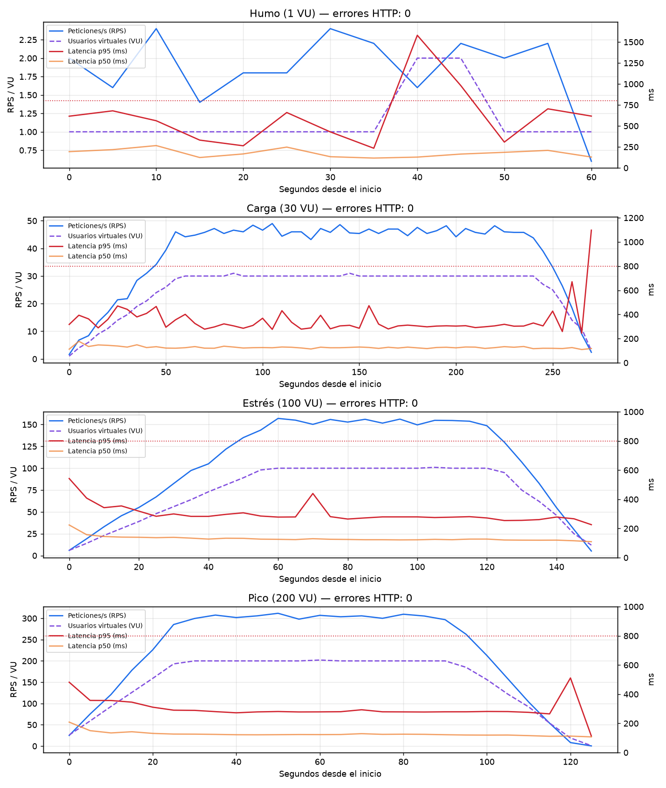
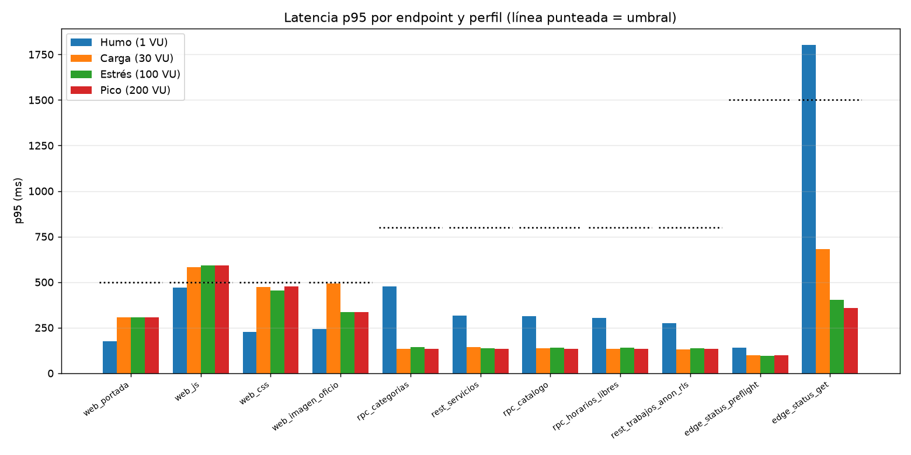
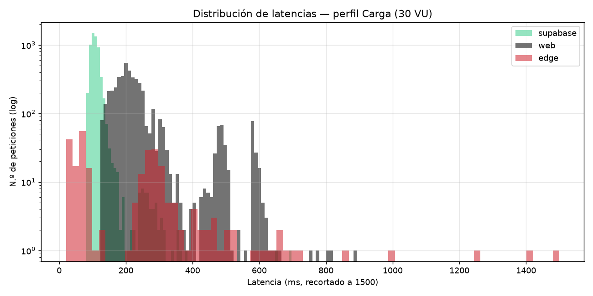
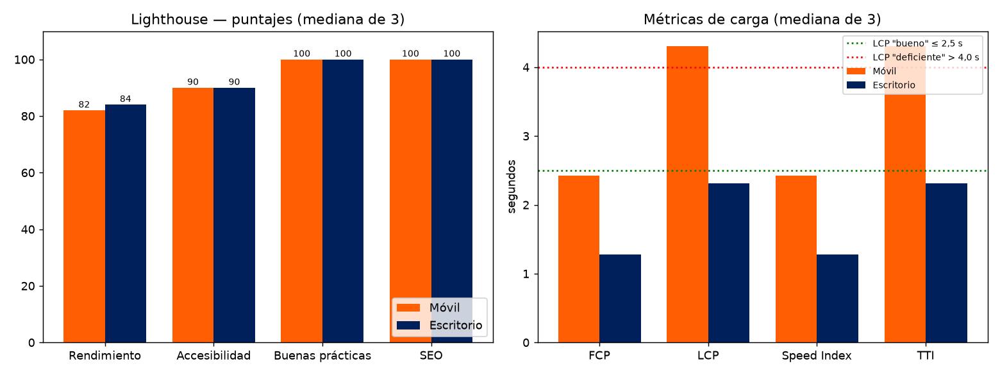

# Prueba de carga y rendimiento — MyWorksApp

> **Documento histórico.** Registra el estado del proyecto a la fecha de su última revisión (15-11-2026) y no se actualiza. Las cifras, URL y pantallas que nombra pueden haber cambiado. El estado vigente (20-11-2026, `main` `d9d2c7c`) está en [`ESTADO_DEL_PROYECTO.md`](../../ESTADO_DEL_PROYECTO.md).

| Campo | Valor |
|---|---|
| Fecha de ejecución | 15 de noviembre de 2026, 19:29–19:47 (hora de Chile, UTC-3) |
| Versión probada | `main` en `b3d944e` (web publicada en Vercel ese mismo día) |
| Web pública | https://myworksapp-cl.vercel.app (Vercel Hobby, nodo `gru1` São Paulo) |
| Backend | Supabase plan Free, proyecto `wxqrfcqifkfgawrnqmnj`, región `us-west-2` (Oregón) |
| Herramientas | k6 v1.4.2 (carga), Lighthouse 13.6.0 (rendimiento de la página), Python/pandas (análisis) |
| Script | [`k6/mwa_carga.js`](k6/mwa_carga.js) |
| Resultados crudos | [`resultados/`](resultados/) (resúmenes JSON de k6, series de tiempo CSV, resumen Lighthouse) |
| Gráficos | [`graficos/`](graficos/) |

> **Resumen ejecutivo.** Se enviaron **55 537 peticiones HTTP** en cuatro perfiles (1, 30, 100 y 200 usuarios virtuales simultáneos) y se evaluaron **141 878 verificaciones** de contenido. Resultado: **0 peticiones fallidas, 0 verificaciones fallidas, 0 respuestas 429 (límite de tasa) y 0 respuestas 5xx**. Con 200 usuarios simultáneos el sistema sostuvo **224 peticiones/s de promedio (312/s en el pico de 5 s)** con una latencia **p95 de 283 ms**, prácticamente igual que con 30 usuarios (p95 312 ms). **No se encontró el punto de quiebre** dentro del volumen que permiten los planes gratuitos. De 23 umbrales definidos antes de correr, **falló uno de forma sistemática**: la descarga del bundle JavaScript principal (p95 ≈ 590 ms contra un objetivo de 500 ms). En Lighthouse la web obtiene **82/100 en móvil y 84/100 en escritorio** (mediana de 3 corridas). En móvil, el LCP de 4,3 s es la principal oportunidad de mejora.

---

## 1. Objetivo y preguntas que responde la prueba

1. **Carga:** ¿responde la plataforma de forma correcta y rápida cuando muchas personas buscan profesionales al mismo tiempo?
2. **Estrés:** ¿empeora la latencia o aparecen errores al subir a 100 y a 200 usuarios simultáneos? ¿Dónde está el límite?
3. **Rendimiento percibido:** ¿qué tan rápido carga la web pública en un teléfono y en un computador?

La prueba mide **usuarios usando la aplicación a la vez** (concurrencia). No mide cuántas cuentas puede almacenar la base de datos, que es un tema de capacidad de disco.

## 2. Alcance

### 2.1 Qué se probó

El script reproduce, solo con **lecturas**, el recorrido real de un visitante en la web. Las consultas se copiaron del código de la web y del paquete compartido, no se inventaron:

| # | Paso del usuario | Petición | Origen en el código |
|---|---|---|---|
| 1 | Abre la portada | `GET /` (HTML), bundle `index-*.js`, hoja `index-*.css` y una imagen de oficio `/categories/*.webp` | `myworksapp_web/index.html`, `public/categories/` |
| 2 | La web carga los oficios disponibles | `POST /rest/v1/rpc/categorias_con_disponibles` | `shared/src/repositories/workers.ts` → `fetchCategoriesWithPros` |
| 3 | La web carga el catálogo de servicios | `GET /rest/v1/servicios?select=id,nombre,descripcion,categoria,activo,modelo_precio&activo=eq.1&order=nombre.asc&limit=80` | `shared/src/repositories/services.ts` → `fetchActiveServices` |
| 4 | Elige un oficio y ve profesionales (tarjetas y mapa) | `POST /rest/v1/rpc/listar_profesionales_catalogo` con `p_categoria`, `p_limit=20` | `workers.ts` → `fetchWorkersCatalog` |
| 5 | Abre un profesional y ve sus horas libres | `POST /rest/v1/rpc/horarios_libres_profesional` con `p_dias=14` | `workers.ts` → `fetchWorkerFreeSlots` |
| 6 | Control de seguridad | `GET /rest/v1/trabajos` como anónimo: **debe ser rechazado** | Política RLS / grants de `trabajos` |
| 7 | Estado de pago (Edge Function) | `OPTIONS` (preflight CORS) y `GET /functions/v1/webpay-status?paymentId=…&jobId=…` de un pago ya existente | `supabase/functions/webpay-status/index.ts`, `PaidReturnView.tsx` |

Cada usuario virtual (VU) recorre los pasos 1→6 con **pausas aleatorias de 1 a 2 s** entre bloques, como una persona que mira la pantalla. El oficio consultado rota entre gasfitería, electricidad, plomería, limpieza, cerrajería y pintura, y el profesional del paso 5 sale de la respuesta real del paso 4.

El paso 7 corre en un **escenario aparte a tasa fija y baja** (0,5 a 2 llamadas por segundo), porque cada llamada consume una invocación de Edge Function del plan gratuito.

### 2.2 Qué no se probó, y por qué

| Fuera de alcance | Motivo |
|---|---|
| Crear pedidos, pagos Webpay o cuentas en masa | Crearía datos reales y golpearía el ambiente de integración de Transbank, que no es nuestro |
| Inicio de sesión y lecturas autenticadas | La clave de las cuentas demo no estaba disponible en el equipo de prueba. No se crearon usuarios temporales para no alterar la base. Las lecturas autenticadas usan las mismas tablas, con RLS por usuario |
| Chat en tiempo real, GPS y notificaciones push | Usan WebSocket o servicios externos (FCM), no el mismo camino HTTP |
| App Flutter y consola de escritorio | Usan el mismo backend Supabase medido aquí. Para la app solo se informa el tamaño de la APK (§7) |
| Geocodificación (Nominatim/Photon) y teselas del mapa (OpenFreeMap) | Son servicios de terceros. Cargarlos en masa viola sus políticas de uso |

## 3. Ambiente y metodología

### 3.1 Ambiente

| Elemento | Detalle |
|---|---|
| Generador de carga | Un solo equipo Linux (8 vCPU, 15 GB RAM) con salida a internet a través de un proxy; Vercel lo atendió desde `gru1` (São Paulo) |
| Distancia a Supabase | El backend está en Oregón (EE. UU.). Solo el viaje de ida y vuelta suma unos 80–100 ms a cada consulta |
| Datos | Base de demostración real: 64 profesionales, 13 servicios, 233 trabajos |
| Clave usada | Clave **anon publicable** (la misma que descarga cualquier navegador). No se usó `service_role`. La clave se pasó por variable de entorno y no queda en el repositorio |

### 3.2 Perfiles de carga

| Perfil | Usuarios virtuales | Forma | Duración | Edge Function |
|---|---|---|---|---|
| Humo (`smoke`) | 1 | constante | 1 min | 0,5 llamadas/s |
| Carga (`load`) | 0 → 30 → 30 → 0 | rampa 1 min, meseta 3 min, bajada 30 s | 4 min 30 s | 1 llamada/s |
| Estrés (`stress`) | 0 → 50 → 100 → 100 → 0 | rampas de 30 s, meseta de 1 min a 100 | 2 min 30 s | 2 llamadas/s |
| Pico (`pico`) | 0 → 200 → 200 → 0 | rampa 30 s, meseta 1 min, bajada 30 s | 2 min | 2 llamadas/s |

Los perfiles se corrieron uno tras otro y en ese orden. Antes de empezar se fijó una regla de corte: **detener si la tasa de error superaba el 5 % o aparecían respuestas 429**. En el script quedó como el umbral `http_req_failed rate<0.05` con `abortOnFail`. No se activó en ningún perfil. El pico se agregó porque el estrés a 100 VU no mostró degradación, y no se subió de 200 para no agotar las cuotas de los planes gratuitos.

### 3.3 Qué cuenta como error (definición operacional)

Esta definición se fijó en el script **antes** de correr. Hay tres niveles, del más grueso al más fino:

1. **Petición fallida (`http_req_failed`).** Una respuesta HTTP fuera de lo esperado: cualquier código distinto de 2xx/3xx, o una petición sin respuesta (timeout de 30 s, error de conexión o TLS, que k6 registra con código 0). La única excepción es el control de seguridad del paso 6: ahí lo **esperado** es 401/403, así que se declaró con `responseCallback: http.expectedStatuses(401, 403)`. Si ese endpoint respondiera **200** (es decir, si un anónimo pudiera leer pedidos), contaría como error.
2. **Verificación fallida (`checks`).** Además del código HTTP, se revisa el **contenido** de cada respuesta. Un `200` con contenido incorrecto también es un error:

   | Endpoint | Verificaciones de contenido |
   |---|---|
   | Portada | `200`; `Content-Type: text/html`; contiene `<div id="root">`; referencia un bundle JS y una hoja CSS |
   | Bundle JS | `200`; `Content-Type` JavaScript; tamaño > 50 KB (descarta una página de error) |
   | CSS / imagen | `200`; `Content-Type` `text/css` / `image/webp` (descarta que el SPA devuelva el HTML como respaldo) |
   | Oficios | `200`; arreglo JSON con al menos un oficio |
   | Servicios | `200`; arreglo no vacío; todas las filas `activo = 1` y con nombre |
   | Catálogo | `200`; arreglo JSON; todas las filas son del oficio pedido; **ninguna expone `correo`/`email`** |
   | Horas libres | `200`; arreglo donde cada elemento trae `inicio` |
   | RLS trabajos | respuesta 401/403 **y** el cuerpo no es una lista de filas |
   | Edge preflight | `200`; `Access-Control-Allow-Origin` igual al dominio público |
   | Edge estado | `200`; el pago devuelto es el pedido; **no** aparece `token_tbk` ni `url_tbk` |

3. **Iteración con error (`mwa_errores`).** Un recorrido completo de un usuario cuenta como fallido si **cualquiera** de sus verificaciones falló.

También se cuentan aparte las respuestas **429** (límite de tasa de Supabase o Vercel), las **5xx** (falla del servidor) y los **timeouts** (código 0).

### 3.4 Umbrales de aceptación (definidos antes de la ejecución)

| Métrica | Umbral | Justificación |
|---|---|---|
| Peticiones fallidas | < 1 % (corte de seguridad al 5 %) | Estándar habitual para un servicio web en producción |
| Verificaciones correctas | > 99 % | Se exige contenido correcto, no solo un `200` |
| Iteraciones con error | < 1 % | Mide la experiencia completa del usuario |
| Respuestas 429 / 5xx | 0 | Cualquier límite de tasa o error de servidor se considera un hallazgo |
| RLS anónimo denegado | 100 % | Requisito de seguridad, no de rendimiento |
| Latencia global | p95 < 800 ms; p99 < 1500 ms | Con 80–100 ms de viaje hasta Oregón, 800 ms deja margen para la red móvil chilena |
| Recursos web (Vercel) | p95 < 500 ms por recurso | CDN con caché: debe ser más rápido que el backend |
| Supabase (REST/RPC) | p95 < 800 ms por endpoint | Consultas cortas e indexadas |
| Edge Function | p95 < 1500 ms | Deno puede tener arranque en frío |

### 3.5 Cómo se calcularon las cifras

- **Latencias.** k6 mide cada petición desde que envía el primer byte hasta que recibe el último (`http_req_duration` = envío + espera + recepción, sin DNS ni conexión). Los percentiles p50/p90/p95/p99 salen de **todas** las muestras, sin muestreo. El p95 significa que el 95 % de las peticiones tardó eso o menos.
- **RPS.** Peticiones totales divididas por la duración del perfil (promedio). El **pico** es el máximo de peticiones contadas en una ventana de 5 s.
- **Doble verificación.** Las cifras del resumen de k6 (`resultados/*.json`) se recalcularon de forma independiente a partir de la salida CSV petición por petición (un registro por petición), agrupando con pandas. Ambas fuentes coinciden: mismo conteo de peticiones y diferencias de percentil menores a 1 ms. Las series de tiempo de 5 s están en `resultados/ts_*.csv`.
- **Lectura de `http_req_failed` en el JSON.** En el resumen de k6 aparece, por ejemplo, `"passes": 0, "fails": 10522`. Esa métrica es una tasa de *fallos*: `passes` cuenta las peticiones fallidas (0) y `fails` las que **no** fallaron. En los umbrales, `true` significa que el umbral se **cruzó**.

## 4. Resultados de carga (k6)

### 4.1 Resumen por perfil

| Perfil | VU máx. | Peticiones | RPS prom. | RPS pico (5 s) | Lat. prom. | p50 | p90 | p95 | p99 | máx. | Fallidas | Checks OK | 429 | 5xx |
|---|---:|---:|---:|---:|---:|---:|---:|---:|---:|---:|---:|---:|---:|---:|
| Humo | 1 (+1 edge) | 121 | 1,9 | 2,4 | 257 ms | 182 | 609 | 667 | 1 526 | 2 077 | 0 | 307/307 | 0 | 0 |
| Carga | 30 | 10 522 | 38,4 | 49 | 167 ms | 125 | 254 | 312 | 579 | 1 950 | 0 | 26 874/26 874 | 0 | 0 |
| Estrés | 100 | 16 582 | 107,7 | 157 | 160 ms | 127 | 248 | 282 | 504 | 1 484 | 0 | 42 358/42 358 | 0 | 0 |
| Pico | 200 | 28 312 | 224,4 | 312 | 161 ms | 124 | 250 | 283 | 502 | 2 849 | 0 | 72 339/72 339 | 0 | 0 |
| **Total** | | **55 537** | | | | | | | | | **0** | **141 878/141 878** | **0** | **0** |

Datos transferidos: 6 MB (humo), 240 MB (carga), 381 MB (estrés) y 657 MB (pico). Casi todo es el bundle JS servido por Vercel. Supabase entrega respuestas de 0,2 a 5 KB.



*Figura 1. Al subir los usuarios, las peticiones por segundo crecen en proporción (curva azul) y la latencia p95 (roja) se mantiene plana bajo el umbral de 800 ms (línea punteada). Es la señal de un sistema que no está saturado. En humo la curva p95 salta porque, con 1 usuario, cada ventana de 5 s tiene pocas muestras y una sola llamada lenta a la Edge Function la mueve.*

### 4.2 Desglose por endpoint (p95 en ms)

| Endpoint | Humo | Carga | Estrés | Pico | Umbral |
|---|---:|---:|---:|---:|---:|
| `web_portada` (HTML) | 175 | 308 | 307 | 308 | 500 |
| `web_js` (bundle 518 KB, 151 KB comprimido) | 470 | **583** | **591** | **593** | 500 |
| `web_css` | 228 | 474 | 454 | 476 | 500 |
| `web_imagen_oficio` (webp 24–42 KB) | 242 | 491 | 335 | 337 | 500 |
| `rpc_categorias` | 477 | 134 | 144 | 135 | 800 |
| `rest_servicios` | 316 | 142 | 137 | 135 | 800 |
| `rpc_catalogo` | 314 | 136 | 140 | 135 | 800 |
| `rpc_horarios_libres` | 303 | 133 | 139 | 135 | 800 |
| `rest_trabajos_anon_rls` (401 esperado) | 276 | 130 | 138 | 132 | 800 |
| `edge_status_preflight` (OPTIONS) | 140 | 97 | 97 | 99 | 1500 |
| `edge_status_get` | **1 803** | 682 | 403 | 358 | 1500 |

Número de muestras por endpoint de navegación: 10 (humo), 1 139 (carga), 1 809 (estrés) y 3 119 (pico). Edge: 15–152 por perfil. Detalle completo con promedio, p50, p90, p99 y máximo en `resultados/resumen_k6.json`.



*Figura 2. Las barras de Supabase (centro) quedan entre 130 y 145 ms en todos los perfiles con carga. La única barra que pasa su umbral de forma estable es `web_js`.*



*Figura 3. Distribución de latencias con 30 VU (escala logarítmica). Supabase se concentra en torno a 105 ms. Los recursos de Vercel muestran dos modos, uno en ~200 ms y otro en ~450–600 ms (ver §5.3).*

### 4.3 Códigos HTTP observados

En los cuatro perfiles, **todas** las respuestas fueron `200`, salvo `rest_trabajos_anon_rls`, que respondió **siempre `401`** (1 139 / 1 809 / 3 119 veces), con el mensaje de Postgres `42501 permission denied for table trabajos`. No apareció ningún otro código: ni 3xx, ni 404, ni 429, ni 5xx, ni 0 (timeout).

### 4.4 Umbrales: pasa / falla

| Umbral | Humo | Carga | Estrés | Pico |
|---|---|---|---|---|
| Peticiones fallidas < 1 % | PASA (0 %) | PASA (0 %) | PASA (0 %) | PASA (0 %) |
| Verificaciones > 99 % | PASA (100 %) | PASA (100 %) | PASA (100 %) | PASA (100 %) |
| Iteraciones con error < 1 % | PASA (0 %) | PASA (0 %) | PASA (0 %) | PASA (0 %) |
| 429 = 0 / 5xx = 0 | PASA | PASA | PASA | PASA |
| RLS anónimo denegado = 100 % | PASA | PASA | PASA | PASA |
| Latencia global p95 < 800 ms | PASA (667) | PASA (312) | PASA (282) | PASA (283) |
| Latencia global p99 < 1500 ms | **FALLA** (1 526) | PASA (579) | PASA (504) | PASA (502) |
| Web p95 < 500 ms (agregado) | PASA | PASA (487) | PASA (352) | PASA (370) |
| Supabase p95 < 800 ms (agregado y por endpoint) | PASA | PASA | PASA | PASA |
| Edge p95 < 1500 ms (agregado) | PASA | PASA | PASA | PASA |
| `edge_status_get` p95 < 1500 ms | **FALLA** (1 803) | PASA | PASA | PASA |
| `web_js` p95 < 500 ms | PASA (470) | **FALLA** (583) | **FALLA** (591) | **FALLA** (593) |
| Resto de endpoints por separado | PASA | PASA | PASA | PASA |

Se definieron 23 umbrales por perfil. El de `web_js` falló en tres perfiles. Las dos fallas de humo (p99 global y `edge_status_get`) tienen la misma causa: el arranque en frío de la Edge Function con muy pocas muestras (§5.4).

## 5. Análisis e interpretación

### 5.1 Por qué el resultado es «0 errores»

El 0 no significa que no se haya medido nada. Se obtuvo así:

1. **Qué se contó.** 55 537 peticiones, cada una evaluada contra su código HTTP esperado. Sobre esas respuestas se ejecutaron 141 878 verificaciones de contenido (§3.3). Una respuesta `200` con contenido equivocado también habría contado como error: por ejemplo, que el SPA devolviera `index.html` en vez de la imagen, un catálogo con filas de otro oficio o un pago con `token_tbk`.
2. **Qué se observó.** En el CSV petición por petición (no solo en el resumen) aparecen únicamente dos códigos: `200` en todos los endpoints y `401` en el control RLS, donde es el valor esperado. Hubo **0** timeouts, **0** 429 y **0** 5xx. Las 141 878 verificaciones dieron verdadero.
3. **Por qué ocurrió.** Hay tres razones técnicas:
   - **Las consultas son livianas y están acotadas.** Los RPC del catálogo devuelven como máximo 20 filas, apoyados en índices parciales como `trabajadores_catalog_list_idx (categoria_servicio, calificacion, id_usuario) WHERE disponible = 1 AND precios_configurados = 1`. `horarios_libres_profesional` recorre como máximo 14 días de plantilla. Con 200 VU, Supabase recibió unas 125 peticiones por segundo de este tipo, lejos de su capacidad. La prueba es que la p95 de Supabase **no cambió** entre 30 y 200 VU (134 → 135 ms).
   - **El pool de conexiones absorbe la concurrencia.** PostgREST, detrás del gateway de Supabase, reutiliza un número fijo de conexiones a Postgres. Muchos usuarios HTTP no significan muchas conexiones a la base.
   - **Vercel sirve contenido estático desde su CDN**, con caché (`x-vercel-cache: HIT`, `cache-control: max-age=86400`). La portada y los recursos no ejecutan código en el servidor.
4. **El 0 también valida la seguridad.** El control negativo se ejecutó 6 077 veces (contando todos los perfiles) y en el 100 % de los casos la base **negó** a un anónimo la lectura de `trabajos`. Además, ninguna respuesta del catálogo expuso correos y ninguna respuesta de `webpay-status` expuso tokens de Transbank.

**Límites de esta afirmación.** El 0 vale para este alcance: lecturas anónimas, hasta 200 VU, desde un solo origen y durante pocos minutos. No demuestra que no haya errores en escrituras (crear pedido, pagar, subir evidencia) ni con miles de usuarios. Tampoco cubre cargas sostenidas por horas (pruebas *soak*), que no se hicieron por las cuotas del plan gratuito. Con 0 fallos en n = 55 537, la regla estadística del «tres sobre n» acota la tasa de error real por debajo de **3/55 537 ≈ 0,0054 %**, con 95 % de confianza, para este mismo tipo de tráfico.

### 5.2 Límite encontrado

**Con 200 VU no se alcanzó el límite.** Entre 30 y 200 VU (7 veces más carga) las peticiones por segundo crecieron 5,8 veces (38 → 224), proporcionalmente a los usuarios activos. La latencia p95 global **bajó** de 312 a 283 ms y no hubo errores. Un sistema saturado muestra lo contrario: la latencia sube y las RPS se estancan. Por eso el techo real está **por encima de ~310 peticiones/s y 200 usuarios navegando a la vez**. No se siguió subiendo por dos razones:

- **Cuotas.** El pico ya transfirió 657 MB desde Vercel. El plan Hobby incluye 100 GB al mes y Supabase Free tiene límites de egress e invocaciones mensuales que la demo también necesita.
- **El generador.** Un solo equipo genera la carga. Sobre ~300 RPS, parte de la latencia empieza a reflejar al propio generador o a su proxy de salida, y no al sistema probado.

Como referencia, la medición anterior del equipo (anexo `docs/anexos/2026-11-08-rendimiento-carga/`) llegó a 300 VU solo contra Supabase, con 0 % de error y unas 302 RPS.

### 5.3 Única falla sistemática: el bundle JavaScript de la web

El archivo `index-*.js` pesa 518 KB, o 151 KB comprimido con gzip. Su p95 fue de unos 590 ms, contra un umbral de 500 ms. Al analizar los datos crudos se ve que **no es un problema de carga**:

- El efecto también aparece con **1 usuario** (p95 470 ms, 10 % de las descargas sobre 450 ms).
- La proporción de descargas lentas **no crece** con la carga: 12 % con 30 VU, 6,1 % con 100 y 6,6 % con 200.
- El mismo segundo modo, unos 250–300 ms más lento, afecta **por igual** al HTML, al CSS y a las imágenes. Es decir, viene del camino de red entre el generador y la CDN, no del tamaño de cada recurso. Al JS lo empuja sobre el umbral porque su tiempo base de descarga es mayor (p50 234 ms).
- En una primera corrida del perfil de carga sin pedir compresión (archivo `resultados/load_sin_compresion.json`), el JS se descargaba entero, 518 KB, y la p95 del JS fue de 561 ms. El total transferido fue de 706 MB contra 240 MB comprimido. Esa corrida también tuvo 0 errores en 10 521 peticiones. Se repitió el perfil pidiendo `Accept-Encoding: gzip, br`, como hace cualquier navegador, y esa repetición es la que se informa.

En un navegador real el bundle se descarga una sola vez, porque Vite le pone un hash en el nombre y queda en caché. Aun así, achicarlo mejora la primera visita. Lighthouse estima 91 KiB de JavaScript sin usar (§6). Recomendación: dividir el código por ruta (*code splitting*) y cargar el mapa y el checkout solo cuando se necesitan.

### 5.4 Edge Function `webpay-status`

En humo, la p95 fue de 1,8 s con solo 15 muestras. Las primeras llamadas pagan el **arranque en frío** del aislado Deno y la validación del usuario (`auth.getUser()`) antes de consultar `pagos`. Con tráfico constante la función queda «tibia» y la p95 bajó a 682 ms (carga), 403 ms (estrés) y 358 ms (pico). El preflight CORS no toca la base y siempre respondió en menos de 100 ms (p95). En producción, la primera consulta de estado después de un período sin uso puede tardar 1–2 s. La pantalla de retorno de Webpay ya muestra un estado de «confirmando pago», así que la experiencia no se rompe.

### 5.5 Supabase: estable

Los cinco endpoints de Supabase tuvieron una p50 de ~105 ms y una p95 de ~135 ms con 30, 100 y 200 VU. Casi todo ese tiempo es el viaje de ida y vuelta hasta Oregón. Mover el proyecto a la región `sa-east-1` (São Paulo) reduciría esa latencia para usuarios chilenos.

## 6. Rendimiento de la página (Lighthouse)

Se hicieron 3 corridas por formato contra la URL pública y se informa la **mediana**. El formato móvil simula un teléfono de gama media con 4G lenta: RTT de 150 ms, 1,6 Mbps y CPU 4 veces más lenta. El de escritorio, una conexión cableada sin limitar la CPU.

| Métrica | Móvil (mediana) | Rango móvil | Escritorio (mediana) | Rango escritorio | Referencia «bueno» (Core Web Vitals) |
|---|---:|---|---:|---|---|
| Puntaje de rendimiento | **82** | 79–91 | **84** | 81–98 | ≥ 90 |
| Accesibilidad | 90 | 90 | 90 | 90 | ≥ 90 |
| Buenas prácticas | 100 | 100 | 100 | 100 | ≥ 90 |
| SEO | 100 | 100 | 100 | 100 | ≥ 90 |
| First Contentful Paint | 2,42 s | 1,67–2,56 s | 1,28 s | 0,61–1,38 s | ≤ 1,8 s |
| Largest Contentful Paint | **4,31 s** | 3,47–4,66 s | 2,31 s | 1,01–2,56 s | ≤ 2,5 s |
| Total Blocking Time | 0 ms | 0–32 ms | 0 ms | 0 ms | ≤ 200 ms |
| Cumulative Layout Shift | 0 | 0 | 0 | 0 | ≤ 0,1 |
| Speed Index | 2,42 s | | 1,28 s | | ≤ 3,4 s |
| Respuesta del servidor (TTFB) | 139 ms | | 148 ms | | ≤ 800 ms |
| Peso total de la página | 424 KiB | | 520 KiB | | |



**Interpretación.** No hay bloqueo del hilo principal (TBT 0) ni saltos de diseño (CLS 0), y el servidor responde rápido (TTFB < 150 ms). El punto débil es el **LCP en móvil**: con la red 4G simulada, la hoja CSS propia y la hoja de Google Fonts (DM Sans) bloquean el primer pintado, y el bundle JS retrasa el contenido principal. Lighthouse estima que solo la hoja de Google Fonts cuesta unos 780 ms y que hay 91 KiB de JavaScript sin usar. En escritorio el LCP cumple el umbral «bueno». La variación entre corridas (79–91 en móvil) es normal en Lighthouse y por eso se informa la mediana. Hallazgos menores de accesibilidad: contraste insuficiente en algunos textos y falta un elemento `<main>`.

### 6.1 Re-medición tras optimizar el bundle (15-nov-2026, 21:00–21:20 hora de Chile)

Después de esta prueba se aplicaron las recomendaciones de §5.3 y §6 (versión web desplegada en Vercel el 15-nov-2026, `dpl_7JyenRukjzBYXMBc7J7RYn3HYMH7`):

- **División del código.** `vite.config.ts` separa `vendor-react`, `vendor-supabase` y `vendor-query`, y las vistas pesadas (mapa, seguimiento, acciones del cliente, chat, resultados) se cargan con `lazy()` solo cuando se usan. El chunk principal bajó de **526 kB a 74 kB** (25 kB comprimido). El mapa (MapLibre, ~1,2 MB) ya no se descarga en la portada.
- **Fuente propia.** DM Sans se sirve desde el mismo dominio (`@fontsource-variable/dm-sans`) y se quitó Google Fonts del HTML y de la CSP. Desaparece la hoja externa que bloqueaba el primer pintado (~780 ms estimados).
- **Imagen principal.** La foto del encabezado se sirve en WebP de 480/640/960 px con `srcset`, `preload` y `fetchpriority="high"`.
- **Accesibilidad.** Elemento `<main>`, contrastes corregidos, títulos en orden y etiquetas en los marcadores del mapa. axe-core: 0 violaciones en portada, inicio de sesión, recuperación de contraseña y búsqueda.

| Métrica (mediana de 3, mismo comando que §11) | Móvil antes | Móvil después | Escritorio antes | Escritorio después |
|---|---:|---:|---:|---:|
| Puntaje de rendimiento | 82 | **94** (93–94) | 84 | **99** (99–100) |
| Accesibilidad | 90 | **100** | 90 | **100** |
| Buenas prácticas / SEO | 100 / 100 | 100 / 100 | 100 / 100 | 100 / 100 |
| First Contentful Paint | 2,42 s | **1,10 s** | 1,28 s | **0,43 s** |
| Largest Contentful Paint | 4,31 s | **3,10 s** | 2,31 s | **0,92 s** |
| Total Blocking Time | 0 ms | 4 ms | 0 ms | 0 ms |
| Cumulative Layout Shift | 0 | 0 | 0 | 0 |
| Speed Index | 2,42 s | 1,91 s | 1,28 s | 0,85 s |
| Peso total de la página | 424 KiB | 465 KiB | 520 KiB | 532 KiB |

**Lectura.** El rendimiento móvil sube de 82 a 94 y el de escritorio de 84 a 99. El FCP móvil queda bajo el umbral «bueno» (1,8 s). El LCP móvil mejora 1,2 s, pero con 4G lenta simulada sigue sobre 2,5 s: el elemento LCP es la foto del encabezado y el tiempo restante es sobre todo espera de render mientras se ejecuta React. El peso total sube unos 40 KiB porque la fuente ahora viaja desde el mismo dominio en vez de una hoja externa, a cambio de no bloquear el primer pintado. Una corrida aislada justo antes del despliegue, en el mismo equipo, dio 87 en móvil (LCP 3,7 s); las cifras «antes» de la tabla son las de §6 para comparar con el mismo procedimiento. Resumen crudo: [`resultados/lighthouse_tras_optimizacion_20261115.json`](resultados/lighthouse_tras_optimizacion_20261115.json).

### 6.2 Pruebas E2E de cierre en producción (15-nov-2026)

Con dos cuentas de prueba dedicadas (un cliente y un profesional, creadas solo para esto y eliminadas al terminar) se recorrieron en https://myworksapp-cl.vercel.app, con Playwright, los flujos nuevos de la versión 1.0.3. Webpay en ambiente de integración (tarjeta de prueba de Transbank).

| Flujo | Resultado |
|---|---|
| Reservar y pagar (web) | Trabajo creado, Webpay de integración aprobado, pago `retenido`, vuelta al seguimiento con la hora en horario de Chile. Sin errores de consola |
| Reagendar (web + backend de la app) | El cliente propuso otra hora desde la web; no pudo aceptar su propia propuesta; un `UPDATE` directo de la fecha fue rechazado; el profesional aceptó por RPC y la hora cambió. Luego el profesional propuso otra, una hora no publicada fue rechazada, y el cliente la rechazó desde la web. Historial con 2 filas, 4 notificaciones `job_rescheduled`, pago siempre `retenido` |
| Reagendar en camino | Rechazado: «Solo se puede reagendar antes de que el profesional salga en camino» |
| Cancelar (web) | Reembolso por `webpay-refund-cancellation`, trabajo `cancelado`, pago `reembolsado`; la vista ya no ofrece reagendar, disputar ni subir evidencia |
| Ciclo completo + calificar (web) | Aceptar, en camino, PIN, en curso, evidencia y «Recibo conforme» desde la web: pago `liberado`. Calificación de 5 estrellas desde la web; una segunda calificación y calificar un trabajo cancelado fueron rechazadas por la base. El profesional volvió a «disponible» al terminar |
| Recuperar contraseña (web) | El formulario envía la solicitud; Supabase rechaza el envío al dominio de prueba y la web muestra «No pudimos enviar el correo…». Un correo `@example.com` se rechaza antes de llamar a Supabase. La pantalla «Crea tu nueva contraseña» guardó una clave nueva y rechazó repetir la anterior. El envío real del correo depende de configurar un SMTP propio en Supabase Auth |
| Consola `soporte` / `qa` | Con sesión `aal2`: ven la cola de disputas; métricas, verificación y liberación de pagos rechazadas; las fichas sensibles vuelven vacías. Con `aal1`: `forbidden` |

## 7. App móvil (artefacto)

| Dato | Valor |
|---|---|
| APK de prueba arm64 (1.0.2, 15-nov-2026) | 31,4 MB (17,3 MB comprimida en zip) |
| APK universal (todas las arquitecturas) | 77,8 MB |
| Mayores componentes (arm64) | motor Flutter `libflutter.so` 11,7 MB; código Dart AOT `libapp.so` 10,9 MB; `classes.dex` 3,8 MB; videos de demostración del portafolio 3,6 MB; imágenes de servicios PNG ~1,2 MB |

El tiempo de arranque no se midió: requiere un dispositivo físico instrumentado. Para bajar unos 5 MB, se pueden quitar los videos de demostración y pasar las imágenes PNG de servicios a WebP. La app consume los mismos endpoints de Supabase medidos en §4, así que su rendimiento de red es el mismo.

## 8. Limitaciones

1. **Un solo origen de carga.** Todo el tráfico salió de un equipo, por un proxy, y fue atendido desde el nodo `gru1` de Vercel. No es una prueba distribuida desde varias ciudades ni redes móviles.
2. **Solo lecturas anónimas.** No se midieron escrituras ni lecturas con sesión (§2.2).
3. **Duraciones cortas** (de 1 a 4,5 min por perfil). No se detectan fugas de memoria ni degradación en horas.
4. **Planes gratuitos.** Supabase Free comparte recursos y puede variar según la hora. Los resultados son una foto del 15-nov-2026.
5. **Pausas de usuario simuladas.** 30 VU no equivalen a 30 personas exactas, pero el ritmo (una visita completa cada ~5 s por VU) es más intenso que el de un usuario real, así que la estimación es conservadora.

## 9. Integridad de los datos (antes y después)

La prueba no escribió en la base. Se comprobó con un conteo antes (19:25) y después (19:46) de las corridas:

| Tabla / dato | Antes | Después |
|---|---:|---:|
| `trabajos` | 233 | 233 |
| `pagos` | 157 | 157 |
| `auth.users` | 67 | 67 |
| `perfiles` | 75 | 75 |
| `notificaciones` | 32 | 32 |
| `calificaciones` | 194 | 194 |
| `eventos_abuso` / `intentos_pin_inicio` | 0 / 0 | 0 / 0 |
| Profesional Mateo (nota / completados / rechazos / disponible) | 4,9 / 8 / 0 / sí | 4,9 / 8 / 0 / sí |
| Pago consultado por `webpay-status` | `liberado` | `liberado` |

## 10. Conclusiones

1. La plataforma soporta **200 usuarios navegando a la vez** (~224 peticiones/s sostenidas, 312/s en el pico) **sin errores** y con una p95 de **283 ms**. Con esta carga no hay señales de saturación.
2. Los 0 errores se respaldan con 141 878 verificaciones de contenido y con los códigos HTTP de cada petición. La cota estadística de la tasa de error es < 0,0054 % para este tipo de tráfico.
3. La seguridad se mantuvo bajo carga: RLS negó el 100 % de las lecturas anónimas de pedidos y no hubo fugas de correos ni de tokens.
4. Mejoras priorizadas:
   1. Dividir el bundle de la web (es el único umbral fallado y mejora el LCP móvil).
   2. Precargar o autoalojar las fuentes para quitar el bloqueo de renderizado.
   3. Evaluar la región São Paulo para Supabase (unos −80 ms por consulta).
   4. Repetir la prueba con escrituras en un proyecto de *staging* separado.

## 11. Cómo reproducir

Desde `MyWorksAppProyect/`, con k6 instalado:

```bash
export SUPABASE_URL="https://wxqrfcqifkfgawrnqmnj.supabase.co"
export SUPABASE_ANON_KEY="<clave anon publicable>"   # Dashboard → Settings → API
export STATUS_PAYMENT_ID="<uuid de un pago existente>"
export STATUS_JOB_ID="<uuid del trabajo de ese pago>"
for p in smoke load stress pico; do
  k6 run -e PROFILE=$p --summary-export=docs/pruebas/resultados/$p.json \
         --out csv=/tmp/raw_$p.csv docs/pruebas/k6/mwa_carga.js
done
# Lighthouse (mediana de 3)
npx lighthouse https://myworksapp-cl.vercel.app/ --output=json --output-path=./mobile_1
npx lighthouse https://myworksapp-cl.vercel.app/ --preset=desktop --output=json --output-path=./desktop_1
```

En Windows (PowerShell) se usan las mismas variables con `$env:NOMBRE = "..."`. No uses la clave `service_role` en estos scripts. Los scripts anteriores del equipo (`scripts/load/k6/`) y el runbook `docs/RUNBOOK_CAPACIDAD_CARGA.md` siguen vigentes como línea base histórica.
