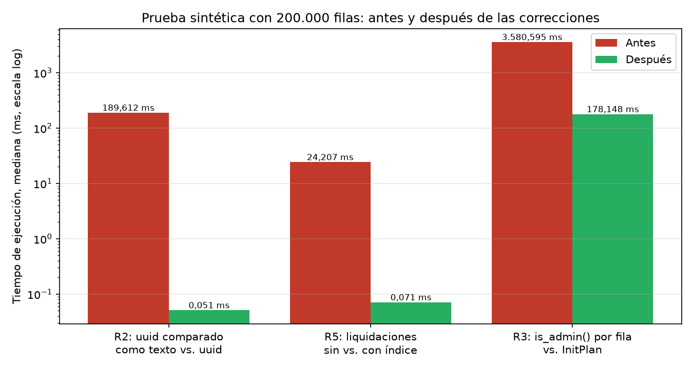

# Rendimiento de la base de datos: planes de ejecución, índices y RLS

> **Documento histórico.** Registra el estado del proyecto a la fecha de su última revisión (16-11-2026) y no se actualiza. Las cifras, URL y pantallas que nombra pueden haber cambiado. El estado vigente (20-11-2026, `main` `08154dfc`) está en [`ESTADO_DEL_PROYECTO.md`](../../ESTADO_DEL_PROYECTO.md).

**Proyecto:** My Works App · **Base:** Supabase `wxqrfcqifkfgawrnqmnj` (PostgreSQL 17.6, plan gratuito: 60 conexiones, `statement_timeout` de 3 s para `anon` y 8 s para `authenticated`, 22 MB de datos)
**Fecha:** 16 de noviembre de 2026, 01:19 (antes) y 01:35 (después), hora de Chile (UTC−3).
**Parte 2 de 4** de la auditoría de base de datos.

## 1. Objetivo

Medir cuánto tardan dentro de Postgres las consultas que la aplicación hace más seguido, encontrar las que recorren tablas completas o repiten trabajo por cada fila, corregirlas y medir de nuevo.

## 2. Método

### 2.1 Qué se midió

1. **Consultas reales de la app (15):** se tomaron del código de las tres aplicaciones (web, app móvil y escritorio) las consultas de las pantallas principales: catálogo, agenda pública, mis pedidos, agenda del profesional, chat, pago, ganancias, liquidaciones, panel de administración, notificaciones, reseñas, marketplace y ficha propia.
2. **Contexto de seguridad real:** cada consulta se ejecutó como el rol `authenticated` con los claims JWT de un usuario de la demo (un cliente con 92 pedidos, un profesional y un administrador), dentro de una transacción que termina en `ROLLBACK`. Así el plan incluye las políticas RLS, que es lo que paga cada request de verdad.
3. **`EXPLAIN (ANALYZE, BUFFERS)`** cinco veces por consulta; se informa la **mediana** del tiempo (planificación + ejecución) para que un valor aislado no distorsione, y los bloques leídos de memoria (buffers).
4. **`pg_stat_statements`**: las consultas que más tiempo total consumen en producción.
5. **Asesor de rendimiento de Supabase** (`get_advisors`).
6. **Prueba de escala sintética:** con unos 240 trabajos, todo cabe en memoria y cualquier plan tarda menos de un milisegundo, así que una mejora casi no se nota. Para ver el efecto real de cada patrón se repitió con 200.000 filas en tablas temporales (que no tocan los datos reales).

### 2.2 Por qué importa el patrón y no solo el tiempo de hoy

El tiempo actual es bajo porque la base es pequeña. Lo que se busca son patrones que crecen con los datos: un `Seq Scan` (recorrer la tabla entera) tarda el doble cuando la tabla duplica su tamaño; un `Index Scan` casi no cambia. Una función evaluada por fila multiplica su costo por la cantidad de filas revisadas.

## 3. Hallazgos

| Id | Hallazgo | Efecto |
|----|----------|--------|
| R1 | `is_admin()` comparaba `p.id::text = auth.uid()::text`. Convertir a texto impide usar la clave primaria de `perfiles`. | Cada llamada recorría perfiles. |
| R2 | 20 políticas RLS comparaban columnas `uuid` como texto: `(id_usuario)::text = (SELECT auth.uid())::text`. | Postgres no puede usar el índice de `id_usuario` / `id_trabajador`. |
| R3 | 42 políticas llamaban `is_admin()` directamente, sin subselect. | Postgres la ejecuta **por cada fila** que revisa, y cada ejecución busca el perfil. |
| R4 | 9 tablas tenían dos políticas permisivas para la misma operación (una `FOR ALL` de escritura y una `FOR SELECT`). | Las dos se evalúan en cada lectura (asesor: `multiple_permissive_policies`, 10 casos). |
| R5 | Faltaban índices para cuatro consultas reales: liquidaciones del profesional, reseñas de un profesional, chat ordenado por fecha y notificaciones ordenadas. | `Seq Scan` en `liquidaciones`, `calificaciones` y `mensajes`. |
| R6 | Tres índices duplicados (iguales a otro índice o prefijo de uno compuesto). | Espacio y costo de escritura sin beneficio. |
| R7 | Las 24 claves foráneas nuevas de la auditoría de integridad no tenían índice. | Borrar un perfil o un trabajo recorrería cada tabla hija para aplicar el `CASCADE` (asesor: `unindexed_foreign_keys`, 24). |

## 4. Correcciones

| Migración | Qué hace |
|-----------|----------|
| `20261116042759_auditoria_bd_rendimiento.sql` | R1: `is_admin()` compara uuid con uuid. R2: reescribe las 20 políticas a `col = (SELECT auth.uid())`. R4: separa las escrituras `FOR ALL` en INSERT/UPDATE/DELETE en 9 tablas. R5: crea `liquidaciones_trabajador_creado_idx`, `calificaciones_calificado_idx`, `mensajes_trabajo_creado_idx` y `notificaciones_usuario_creado_idx` (los dos últimos reemplazan a índices simples). R6: elimina `trabajador_horarios_usuario_idx`, `idx_trabajos_id_usuario` e `idx_pagos_id_trabajo`. |
| `20261116043033_auditoria_bd_indices_fk.sql` | R7: un índice B-tree por cada FK nueva (24). |
| `20261116043212_auditoria_bd_rls_initplan.sql` | R3: envuelve `is_admin()` en `( SELECT is_admin() )` en las 42 políticas restantes. Postgres lo calcula una vez por consulta (*InitPlan*) y reutiliza el resultado. Es un bloque idempotente que solo cambia esa llamada. |

Después de aplicarlas: 0 políticas con cast a texto, 0 políticas con `is_admin()` evaluado por fila (de 108 políticas), y el asesor ya no informa políticas permisivas múltiples, `auth_rls_initplan` ni claves foráneas sin índice.

## 5. Resultados

### 5.1 Prueba de escala sintética (200.000 filas, mediana de 7 ejecuciones)

| Patrón | Antes | Después | Mejora |
|--------|-------|---------|--------|
| R2: buscar los pedidos de un usuario comparando como texto vs. uuid | 189,6 ms (Seq Scan) | 0,051 ms (Index Scan) | ≈ 3.700 veces |
| R5: liquidaciones de un profesional, sin vs. con índice | 24,2 ms (Seq Scan) | 0,071 ms (Index Scan) | ≈ 340 veces |
| R3: política con `is_admin()` por fila vs. InitPlan (3 ejecuciones) | 3.580,6 ms (400.000 bloques) | 178,1 ms (2 bloques) | ≈ 20 veces |

La última fila es la más importante: con `is_admin()` por fila, una consulta de un administrador sobre una tabla de 200.000 filas tardaba 3,6 segundos, por encima del límite de 3 s que Supabase aplica a `anon` y cerca del de 8 s de `authenticated`. Con la corrección baja a 0,18 s; lo que queda es el recorrido de la tabla, que esa consulta de prueba hace a propósito (cuenta todas las filas).

### 5.2 Consultas reales de la app (datos de hoy, mediana de 5 ejecuciones, en ms)

| Id | Consulta | Antes | Después | Buffers | Acceso antes | Acceso después |
|----|----------|-------|---------|---------|--------------|----------------|
| Q01 | Catálogo: profesionales de un oficio (RPC listar_profesionales_catalogo) | 0.816 | 2.384 | 66 → 66 | función | función |
| Q02 | Portada: oficios con profesionales disponibles (RPC categorias_con_disponibles) | 0.200 | 0.206 | 40 → 40 | función | función |
| Q03 | Agenda pública: horas libres de un profesional, 14 días (RPC horarios_libres_profesional) | 1.100 | 1.128 | 52 → 52 | función | función |
| Q04 | Mis pedidos (cliente con 92 trabajos), orden por fecha | 0.255 | 0.238 | 35 → 35 | Index trabajos_usuario_creado_idx | Index trabajos_usuario_creado_idx |
| Q05 | Agenda del profesional: sus trabajos por fecha | 0.235 | 0.262 | 6 → 6 | Bitmap Heap trabajos, Bitmap Index trabajos_trabajador_estado_idx | Bitmap Heap trabajos, Bitmap Index trabajos_trabajador_estado_idx |
| Q06 | Chat de un trabajo, orden cronológico | 0.402 | 0.349 | 13 → 14 | Seq mensajes | Index mensajes_trabajo_creado_idx |
| Q07 | Pago/escrow de un trabajo | 0.286 | 0.275 | 5 → 6 | Index idx_pagos_id_trabajo | Index pagos_trabajo_estado_idx |
| Q08 | Ganancias del profesional: pagos de sus trabajos (autorizado/retenido/liberado) | 1.084 | 1.098 | 73 → 88 | Bitmap Heap trabajos, Bitmap Index trabajos_trabajador_estado_idx, Index idx_pagos_id_trabajo | Bitmap Heap trabajos, Bitmap Index trabajos_trabajador_estado_idx, Index pagos_trabajo_estado_idx |
| Q09 | Liquidaciones del profesional | 0.439 | 0.381 | 17 → 11 | Seq liquidaciones | Index liquidaciones_trabajador_creado_idx |
| Q10 | Panel admin: métricas resumen (RPC admin_metricas_resumen) | 0.295 | 0.292 | 63 → 61 | función | función |
| Q11 | Panel admin: trabajos activos | 0.905 | 0.456 | 103 → 17 | Index idx_trabajos_estado | Index idx_trabajos_estado |
| Q12 | Notificaciones del usuario | 0.142 | 0.531 | 2 → 6 | Index idx_notificaciones_id_usuario | Seq notificaciones |
| Q13 | Reseñas públicas de un profesional | 0.202 | 0.219 | 16 → 3 | Seq calificaciones | Index calificaciones_calificado_idx |
| Q14 | Marketplace de trabajos abiertos (RPC listar_trabajos_marketplace) | 0.182 | 0.449 | 1 → 3 | función | función |
| Q15 | Ficha propia del profesional (RPC mi_ficha_propia) | 0.160 | 0.174 | 2 → 2 | función | función |

**Cómo leer la tabla.** Con datos tan pequeños, las diferencias de décimas de milisegundo son ruido (por ejemplo, Q01 tuvo una ejecución aislada de 18 ms después, y su mínimo fue 0,84 ms, igual que antes). Lo que importa es la columna de acceso:

- **Q06, Q09 y Q13** pasaron de `Seq Scan` a `Index Scan`; los buffers de Q13 bajan de 16 a 3 y los de Q09 de 17 a 11. Estas son las consultas que más iban a crecer: cada profesional acumula reseñas y liquidaciones, y cada trabajo acumula mensajes.
- **Q11** (panel del administrador) bajó de 0,905 a 0,456 ms y de **103 a 17 buffers**: es el efecto de R1 y R3 (`is_admin()` ya no se evalúa por fila).
- **Q12** (notificaciones) muestra `Seq Scan` después porque la tabla tiene 36 filas y al planificador le sale más barato leerla entera que abrir el índice nuevo. Con más filas usará `notificaciones_usuario_creado_idx` (es el mismo comportamiento que se ve en la prueba sintética).
- **Q14** (marketplace) sube de 0,18 a 0,45 ms porque ahora valida que quien llama sea profesional (hallazgo de seguridad S6). Es un costo fijo y pequeño.

### 5.3 `pg_stat_statements` (acumulado del proyecto)

| Consulta | Llamadas | Media | Acierto de caché |
|----------|----------|-------|------------------|
| RPC `horarios_libres_profesional` (anon) | 28.153 | 1,41 ms | 100 % |
| RPC `listar_profesionales_catalogo` (anon) | 31.815 | 1,22 ms | 100 % |
| Ficha pública de `trabajadores` (anon) | 291.922 | 0,063 ms | 100 % |
| RPC `categorias_con_disponibles` (anon) | 28.588 | 0,50 ms | 100 % |
| `trabajos` con RLS (authenticated) | 5.301 | 0,97 ms | 100 % |
| `SELECT name FROM pg_timezone_names` (authenticator) | 362 | 628 ms | — |

Ninguna consulta de la app supera 1,5 ms de media y todas se sirven desde memoria (100 % de acierto de caché). La consulta más cara del proyecto, `pg_timezone_names`, no es de la app: la hace PostgREST cada vez que recarga su caché de esquema, que ocurre después de cada migración. Es un costo conocido de Supabase y no afecta a los usuarios, porque no corre por request.

### 5.4 Asesor de rendimiento

| Aviso | Antes | Después | Al cierre (16-nov 02:05) |
|-------|-------|---------|--------------------------|
| `multiple_permissive_policies` | 10 | 0 | 0 |
| `unindexed_foreign_keys` | 0 | 0 (24 creadas e indexadas) | 0 |
| `auth_rls_initplan` | 0 | 0 | 0 |
| `unused_index` | 13 | 13 | 18 |
| `no_primary_key` | 26 | 26 | 26 |

Al cierre, `unused_index` sube de 13 a 18 porque el asesor ya registra algunos de los índices de claves foráneas creados en la auditoría (por ejemplo `idx_disputas_resuelta_por_fkey` o `idx_pagos_id_orden_cambio_fkey`). Es esperable: se crearon hace minutos y protegen los borrados y uniones por esas claves, que hoy casi no ocurren. Ninguno de esos índices se elimina. Los 13 índices "sin uso" originales tampoco se eliminaron: las estadísticas son recientes y la base es pequeña, así que el planificador aún no los necesita, pero cubren filtros reales del catálogo (zona, disponibilidad, región, comuna). Los 26 avisos de tablas sin clave primaria están en los esquemas de respaldo `backup_20261115*`, no en `public`; no los usa la aplicación y se pueden borrar cuando el equipo confirme que ya no los necesita.

## 6. Conclusiones

1. Ninguna consulta de la app tarda más de 1,5 ms dentro de Postgres hoy, y el 100 % se sirve desde memoria. La latencia que ve un usuario es casi toda red (ver la prueba de estrés: unos 105 ms de ida y vuelta desde el cliente de prueba).
2. Se corrigieron tres patrones que habrían crecido con los datos: comparar uuid como texto, `is_admin()` por fila y consultas sin índice. En la prueba de 200.000 filas eso significa pasar de segundos a milisegundos.
3. Las políticas RLS quedaron en la forma que recomienda Supabase (`(SELECT auth.uid())`, `(SELECT is_admin())`, una política por operación).

## 7. Archivos

- `docs/pruebas/rendimiento/gen_explain.py`, `explain_real.sql`, `explain_run.sql`, `consultas.json`: las 15 consultas y su medición.
- `docs/pruebas/rendimiento/explain_antes.json`, `explain_despues.json`: planes completos.
- `docs/pruebas/rendimiento/escala_sintetica.sql`, `escala_sintetica_resultados.json`.
- `docs/pruebas/rendimiento/pg_stat_statements_top.json`, `advisors_perf_despues.txt` y `advisors_perf_final.json` (asesor al cierre).
- `docs/pruebas/graficos_auditoria_bd.py` y `docs/pruebas/graficos/rend_01_prueba_sintetica.png`: gráfico de la prueba sintética.
