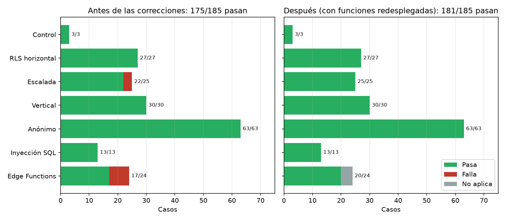

# Pruebas de seguridad de la base de datos

> **Documento histórico.** Registra el estado del proyecto a la fecha de su última revisión (16-11-2026) y no se actualiza. Las cifras, URL y pantallas que nombra pueden haber cambiado. El estado vigente (20-11-2026, `main` `d9d2c7c`) está en [`ESTADO_DEL_PROYECTO.md`](../../ESTADO_DEL_PROYECTO.md).

**Proyecto:** My Works App · **Base:** Supabase `wxqrfcqifkfgawrnqmnj` (PostgreSQL 17.6, PostgREST, Edge Functions)
**Fecha:** 16 de noviembre de 2026. Primera corrida 01:13, corrida final 01:32 y reprueba de Edge Functions tras redesplegarlas 02:06 (hora de Chile, UTC−3).
**Parte 4 de 4** de la auditoría de base de datos (ver `auditoria_base_datos.md`).

## 1. Objetivo

Comprobar que ningún usuario puede leer o cambiar datos que no le corresponden, ni darse permisos o beneficios que no pagó, ni ejecutar SQL propio, usando solo lo que cualquier persona tiene a mano: la clave pública `anon` de la app y una cuenta normal.

## 2. Método

### 2.1 Modelo de atacante

| Atacante | Qué tiene |
|----------|-----------|
| Anónimo | La URL del proyecto y la clave `anon` (está en el código de la web, es pública). |
| Cliente malicioso | Una cuenta de cliente normal y su token JWT. |
| Profesional malicioso | Una cuenta de profesional normal. |

Se crearon seis usuarios temporales (`qa.audit.*@test.myworksapp.cl`: cuatro clientes y dos profesionales) con un trabajo, un pago retenido (con un `token_tbk` falso) y dos mensajes entre cliente1 y pro1. El resto de usuarios actúa como "otra persona" que intenta acceder a esos datos. No se usaron cuentas reales ni la clave `service_role`, y al final se borró todo (sección 6).

### 2.2 Batería de pruebas

El script `docs/pruebas/seguridad/pruebas_seguridad.py` ejecuta 185 casos contra la API real (PostgREST, RPC y Edge Functions). Cada caso declara el resultado seguro esperado (por ejemplo "401/403 o lista vacía") y se marca **PASA** si la respuesta real coincide.

| Categoría | Casos | Qué prueba |
|-----------|-------|-----------|
| Control | 3 | Que cada usuario sí ve sus propios datos (para no confundir "bloqueado" con "roto"). |
| RLS horizontal | 27 | Un cliente intenta leer, editar o borrar el trabajo, pago, mensajes, PIN o notificaciones de otro; un profesional, los de otro profesional. Incluye RPC con el id de un trabajo ajeno. |
| Escalada de privilegios | 25 | Un usuario intenta cambiarse el rol a administrador, reactivar su cuenta, inflar su reputación, verificarse solo, subir su posición en el ranking, darse un impulso o una suscripción gratis, o liberar su propio pago. |
| Vertical (admin) | 30 | Un usuario normal llama a las 30 funciones de administración (métricas, disputas, liberar escrow, consola de soporte). |
| Anónimo | 63 | Sin sesión: lectura de cada una de las 52 tablas, escritura, y RPC privadas. |
| Inyección SQL | 13 | Comillas, `; DROP`, `OR 1=1` y comentarios en filtros de PostgREST, parámetros de RPC y búsquedas. |
| Edge Functions | 24 | Llamadas sin token, con token ajeno, retorno de Webpay/OneClick falsificado, cron sin secreto, CORS ante un origen ajeno. No se hizo ningún pago real. |

### 2.3 Revisión estática

- **Asesor de seguridad de Supabase** (`get_advisors`), antes y después.
- **Catálogo de funciones:** 140 funciones revisadas (116 `SECURITY DEFINER`); se comprobó que todas fijan `search_path` y quién puede ejecutarlas.
- **Semgrep 1.x** (CLI local, mismo motor que el servidor MCP de Semgrep): reglas `p/typescript`, `p/javascript`, `p/secrets`, `p/security-audit` y `p/owasp-top-ten` sobre las Edge Functions y migraciones (129 reglas, 150 archivos); y cuatro reglas propias para SQL (`docs/pruebas/seguridad/semgrep/reglas_sql_myworksapp.yml`): EXECUTE con SQL concatenado, GRANT de escritura a `anon`, políticas de escritura con `true`, y `SECURITY DEFINER` sin `search_path`. Las reglas propias se validaron primero con un archivo que contenía las cuatro malas prácticas (4 de 4 detectadas).

## 3. Resultados de la primera corrida

**175 de 185 casos pasaron.** Todo el aislamiento entre usuarios (RLS horizontal), las 30 funciones de administración, el acceso anónimo, las 13 pruebas de inyección y la autenticación de las Edge Functions resistieron.

Hallazgos reales:

| Id | Severidad | Hallazgo | Evidencia |
|----|-----------|----------|-----------|
| S1 | Alta | Un cliente podía escribir su propia reputación (`reputacion_cliente`, `calificaciones_cliente`) con un PATCH a su perfil. Los profesionales usan esa reputación para decidir si aceptan un trabajo. | PATCH `perfiles` → 200 con `calificaciones_cliente = 999`. |
| S2 | Alta | Un profesional podía crearse un "impulso" (destacado pagado en el catálogo) sin pagar; un trigger recalcula su ranking al instante. | POST `impulsos` → 201. |
| S3 | Media | Un usuario podía activarse una suscripción premium. | POST `suscripciones` → 201. Hoy la app no la usa para nada (los servicios de suscripción e impulso son simulados y nadie los llama), pero el permiso existía. |
| S4 | Baja | Las Edge Functions respondían `Access-Control-Allow-Origin: null` ante un origen desconocido. Los navegadores aceptan el literal `null` para páginas con origen `null` (iframes en sandbox, archivos locales). Como las funciones exigen un token Bearer, el impacto es bajo. | OPTIONS con `Origin: https://evil.example.com` → `ACAO: null`. |
| S5 | Baja | `anon` y `authenticated` tenían `TRUNCATE`, `TRIGGER` y `REFERENCES` sobre todas las tablas (permiso por defecto de Supabase). PostgREST no expone TRUNCATE, pero es un permiso que ignora RLS y no se necesita. Además `anon` tenía INSERT/UPDATE/DELETE aunque ninguna política le permite escribir. | `information_schema.role_table_grants`. |
| S6 | Baja | `listar_trabajos_marketplace` (SECURITY DEFINER) entregaba las solicitudes abiertas a cualquier usuario con sesión, no solo a profesionales. | RPC como cliente → 200 con datos. |
| S7 | Info | `bloqueos_pin_inicio` e `intentos_pin_inicio` tenían RLS sin ninguna política: seguro, pero un administrador no podía auditar los intentos de PIN. | Asesor de Supabase. |

Dos fallas del script resultaron ser falsos resultados y se corrigieron antes de la corrida final:
- La prueba de `reputacion_cliente` comparaba el texto `"5.00"` con `"5"` y la dio por segura cuando no lo era (el mismo problema S1). Ahora compara números.
- `send-push` y `soporte-automatico` respondieron 404 porque no están desplegadas en el proyecto. Una función que no existe no está expuesta; el caso se marca **N/A** (no aplica).

## 4. Correcciones

| Id | Corrección | Dónde |
|----|-----------|-------|
| S1 | El trigger `protect_profile_sensitive_fields` también rechaza cambios de `reputacion_cliente` y `calificaciones_cliente` cuando quien escribe es `authenticated`/`anon` y no es administrador. La función `calificar_cliente()` (SECURITY DEFINER) sigue pudiendo actualizarlos. El trigger pasó a `SECURITY INVOKER` para que `current_user` refleje quién escribe. Un trigger nuevo deja la reputación en cero si alguien intenta crear su perfil con un valor inventado. | Migración `20261116042629_auditoria_bd_seguridad.sql` |
| S2 | La política `impulsos_write` (dueño o admin) se reemplaza por INSERT/UPDATE/DELETE solo para administración. La lectura no cambia. | Misma migración |
| S3 | `suscripciones_all` se reemplaza por lectura del propio plan y escritura solo de administración. | Misma migración |
| S4 | `resolveCorsAllowOrigin` responde con la web pública (primer origen de la lista) en vez de `null` cuando el origen es desconocido. Se actualizaron las pruebas y se agregó una para `Origin: null`. 18 suites de Deno pasan. Las 16 Edge Functions que usan ese código se redesplegaron en producción el 16-nov a las 02:03 (hora de Chile). | `supabase/functions/_shared/cors_origin.ts`, `security_round6.test.ts`; despliegue en wxqrfcqifkfgawrnqmnj |
| S5 | `REVOKE TRUNCATE, TRIGGER, REFERENCES` a `anon` y `authenticated` en las 52 tablas, `REVOKE INSERT, UPDATE, DELETE` a `anon`, y lo mismo en los privilegios por defecto de tablas futuras. | Migración de seguridad |
| S6 | La función exige `es_rol_trabajador(auth.uid())` o `is_admin()`. | Migración de seguridad |
| S7 | Políticas de lectura solo para administración en ambas tablas. | Migración de seguridad |

Antes de restringir impulsos y suscripciones se revisó el código de las tres aplicaciones: `BoostService` y `SubscriptionService` no tienen llamadas, por lo que el cambio no rompe ninguna pantalla.

## 5. Resultados de la corrida final

| Categoría | Antes (PASA/total) | Después (PASA/total) |
|-----------|--------------------|-----------------------|
| Control | 3/3 | 3/3 |
| RLS horizontal | 27/27 | 27/27 |
| Escalada de privilegios | 22/25 | **25/25** |
| Vertical (admin) | 30/30 | 30/30 |
| Anónimo | 63/63 | 63/63 |
| Inyección SQL | 13/13 | 13/13 |
| Edge Functions | 17/24 | **20/24** (0 fallas, 4 N/A) |
| **Total** | **175/185** | **181/185 (0 fallas, 4 N/A)** |

En la primera corrida después de las migraciones quedaban tres fallas: S4 (CORS) en `webpay-status`, `webpay-create` y `guest-checkout`, porque el código corregido aún no estaba desplegado. Se redesplegaron las 16 Edge Functions que incluyen `_shared/cors_origin.ts`. Para no arrastrar otros cambios, cada función se publicó con el mismo código que ya estaba en producción y solo esa línea cambiada (la diferencia de cada una fue de una línea). Luego se volvió a correr la parte de Edge Functions con `seguridad/pruebas_cors_edge.py`, que no necesita usuarios de prueba:

| Prueba (16-nov 02:06) | Casos | Pasan |
|------------------------|-------|-------|
| CORS con origen ajeno (`https://evil.example.com`) | 16 | 16 |
| CORS con `Origin: null` (iframe en sandbox, archivo local) | 16 | 16 |
| CORS con la web oficial | 16 | 16 |
| Funciones con sesión obligatoria llamadas sin token | 9 | 9 |
| `webpay-reconcile` sin secreto, retorno Webpay y OneClick falsificados, ticket de invitado falso | 4 | 4 |
| **Total** | **61** | **61** |

Ahora un origen ajeno o `null` recibe `Access-Control-Allow-Origin: https://myworksapp-cl.vercel.app`, que no coincide con el suyo, y el navegador bloquea la lectura. La web oficial sigue funcionando igual. El archivo `resultados_seguridad_final.json` es la corrida "después" con esos tres casos reprobados; las cuatro N/A son las dos funciones que no están desplegadas (`send-push` y `soporte-automatico`).

**Análisis:** con esto no queda ningún caso de seguridad fallando. Las 181 pruebas aplicables pasan: ningún usuario lee ni modifica datos de otro, nadie se sube de rol, el visitante anónimo no escribe, las inyecciones se tratan como texto y las Edge Functions exigen sesión o secreto y ya no devuelven `null` en CORS.

**Asesor de Supabase después** (revisado de nuevo el 16-nov a las 02:05; mismo resultado, en `seguridad/advisors_seg_final.json`):
- Advertencias de RLS, de políticas permisivas múltiples y de `auth.uid()` evaluado por fila: 0.
- `anon_security_definer_function_executable` (4): `base_publica_profesional`, `categorias_con_disponibles`, `horarios_libres_profesional`, `listar_profesionales_catalogo`. Son el catálogo público a propósito; devuelven coordenadas redondeadas y nada personal.
- `authenticated_security_definer_function_executable` (61): son las RPC de la app. Cada una valida dentro quién llama, y las 30 de administración fallaron para un usuario normal en las pruebas verticales.
- `auth_leaked_password_protection`: la verificación de contraseñas filtradas (HaveIBeenPwned) es una opción de Supabase Auth que en el plan gratuito no está disponible; queda como recomendación para producción.

**Semgrep:** 0 hallazgos en 129 reglas de registro y 0 en las 4 reglas propias de SQL sobre 99 migraciones. El catálogo confirma lo mismo: las 140 funciones tienen `search_path` fijo y la única con SQL dinámico (`rls_auto_enable`, un event trigger) usa `format()` con identificadores del sistema, no datos del usuario.

## 6. Limpieza

Se borraron solo los datos de prueba, filtrando por los ids de los usuarios `qa.audit.*` y los ids `qa-audit-*`: 6 usuarios de Auth con sus identidades y perfiles, 2 fichas de profesional con sus horarios, oficios y eventos, 1 trabajo, 1 pago, 1 PIN y los mensajes y eventos de la prueba de estrés. No quedan usuarios ni filas de prueba. Las filas de la prueba E2E que corría en paralelo (marcadas `E2E-16NOV`) no se tocaron. El detalle de conteos está en `docs/pruebas/estres_base_datos.md`, sección 7.

## 7. Riesgos que quedan

1. **Despliegues desde ramas antiguas.** Durante la auditoría otro trabajo publicó `webpay-release` desde una rama que no tenía la corrección de CORS; se volvió a publicar con ambos cambios. Toda Edge Function debe desplegarse desde `main` actualizado, y después conviene correr `seguridad/pruebas_cors_edge.py`.
2. **`send-push` y `soporte-automatico` no están desplegadas.** Se revisó la base: ningún trigger ni tarea de `pg_cron` las llama (el soporte automático corre como `resolver_soporte_automatico()` en `pg_cron` cada 10 minutos). `send-push` necesita el secreto `FCM_SERVICE_ACCOUNT` de Firebase y un Database Webhook sobre `notificaciones`; hasta configurarlos, los avisos se ven dentro de la app, pero no llegan como notificación push al teléfono.
3. **Protección de contraseñas filtradas** de Supabase Auth: activarla al pasar a un plan pagado.
4. Las funciones SECURITY DEFINER concentran la seguridad. Toda función nueva debe validar `auth.uid()` dentro, y conviene agregar su caso a la batería de pruebas.

## 8. Archivos

- `docs/pruebas/seguridad/pruebas_seguridad.py`: batería de 185 casos (variables `SB_URL`, `SB_ANON`, `QA_PW`; la contraseña no se guarda).
- `docs/pruebas/seguridad/resultados_seguridad_antes.json`, `resultados_seguridad_despues.json` y `resultados_seguridad_final.json` (después del redespliegue): cada caso con su respuesta HTTP.
- `docs/pruebas/seguridad/pruebas_cors_edge.py` y `resultados_cors_edge.json`: reprueba de las 16 Edge Functions (61 casos).
- `docs/pruebas/seguridad/advisors_seg_final.json`: asesor de seguridad al cierre.
- `docs/pruebas/seguridad/tablas.json`: lista de tablas que recorre la batería anónima.
- `docs/pruebas/seguridad/advisors_seg_despues.txt`: asesor de seguridad después de las correcciones.
- `docs/pruebas/seguridad/semgrep/`: resultados JSON y reglas propias.
- `docs/pruebas/graficos_auditoria_bd.py` y `docs/pruebas/graficos/seg_01_resultados_categoria.png`: gráfico de resultados.
- `myworksapp_app/supabase/migrations/20261116042629_auditoria_bd_seguridad.sql`.
